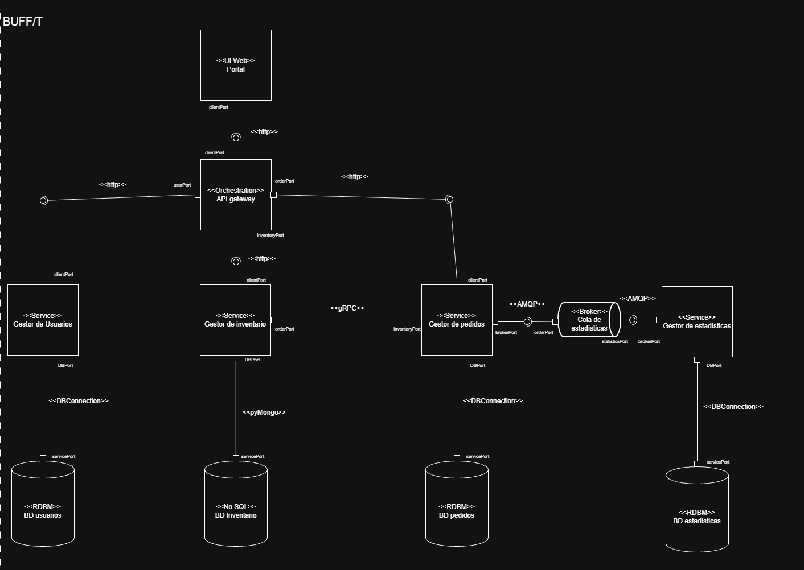
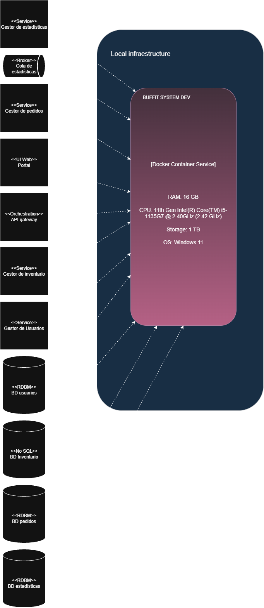
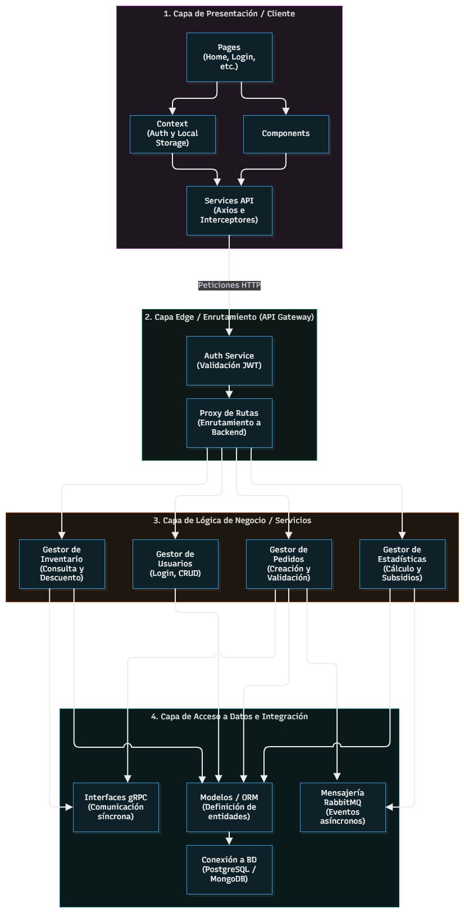
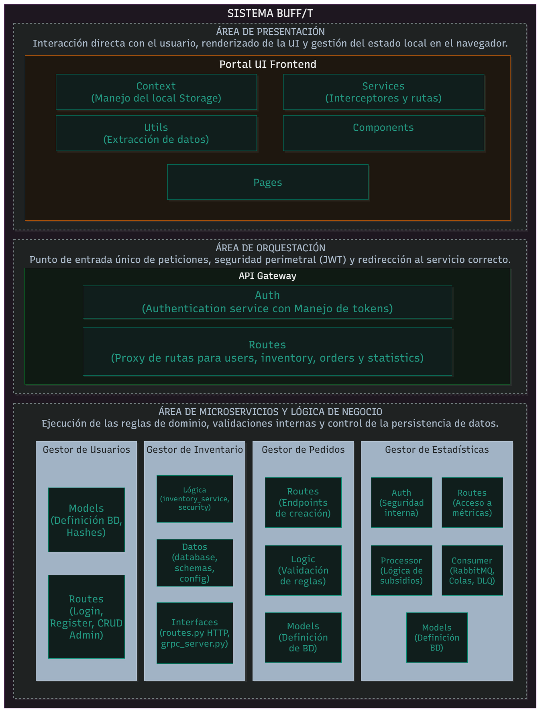

# Team 3-A

## Members

- Joan Camilo Betancourt González.
- Raúl Felipe Rodríguez Hernández.
- Daniel Mauricio Márquez Cruz.
- Nicolás Alejandro Diosa Benavides.

## Project

### Nombre: BUFF/T

### Logo:

### Description:

BUFF/T es una aplicación orientada a mejorar la experiencia del estudiante que almuerza en los comedores de la UNAL sede Bogotá, consiste en un intermediario entre las opciones de menú ofertadas diariamente por el contratista y el plato que el estudiante desea armar haciendo uso de ellas.

El flujo general de uso que se espera es el siguiente:

El estudiante entra a la aplicación web, inicia sesión y entra a la página de inicio en dónde el restaurante habrá publicado las opciones de menú del día en curso, a partir de ellas el estudiante arma su plato según sean las especificaciones (1 porción de proteína, 2 de carbohidratos...etc), establece un rango de horas para recoger el almuerzo y el punto de recogida del almuerzo (si es necesario), después de creada la orden y el plato, aparecerá el registro de creación de orden junto con el precio y el número de orden correspondientes. Por último el estudiante llega a la hora y el lugar convenidos, recoge su orden, hace el pago (si es necesario) y se cierra la orden dentro del sistema.

## Architecture

### C&C

### Deployment Structure 

Debido a la ausencia de datos reales sobre la futura carga transacciónal de la aplicación, hay información critica faltante para un entorno de producción, entre las cuales estan:

* __Tasa de peticiones:__ 

No se conoce el volumen de usuarios concurrentes en horas pico como la hora de almuerzo en la UNAL, lo que impide definir exactamente si se requieren réplicas múltiples para el API Gateway o el Gestor de Pedidos.

* __Volumen de almacenamiento:__ 

Falta definir la cuota en GB requerida para los volúmenes de las bases de datos.

* __Limites de CPU y Cache:__ 

Falta realizar pruebas de estrés para ajustar los recursos de Docker.

### Layered Structure 

### Decomposition Structure 

### Description of architectural styles used

Este estilo arquitectónico es de tipo orientado a servicios, cada uno de los servicios engloba una funcionalidad específica y mantiene una responsabilidad aislada pero lo suficientemente grande.

### Description of architectural elements and relations

* __PORTAL:__

Este elemento es un componente de cómputo pues aloja el frontend en forma de página Web de la aplicación, es lo que se le muestra a todos los roles al empezar el flujo de una actividad. Tecnología: React.

* __API GATEWAY:__

El orquestdor o API gateway de este proyecto es un elemento de orquestación y componente de cómputo, su principal función es redireccionar las peticiones del usuario una vez este se haya autenticado, gestionar los tokens de autenticación también y en general todos los roles tienen que pasar en su flujo de uso de la aplicación por este componente. Tecnología: FastAPI.

* __Gestor de usuarios:__

El gestor de usuarios es un elemento de tipo componente de cómputo, aloja la lógica de negocio para eliminar, consultar, modificar o añadir una nueva cuenta, este es el elemento que primeramente hace peticiones a la base de datos de usuarios. Tecnología: Flask.

* __Gestor de pedidos:__

El gestor de pedidos es un elemento de tipo componente de cómputo, aloja la lógica de negocio para eliminar, consultar, modificar o añadir un nuevo pedido, este es el elemento que primeramente hace peticiones a la base de datos de pedidos. Tecnología: Flask.

* __Gestor de inventario:__

El gestor de inventario es un elemento de tipo componente de cómputo, aloja la lógica de negocio para eliminar, consultar, modificar o añadir nuevo inventario, este es el elemento que primeramente hace peticiones a la base de datos de inventario. Tecnología: FastAPI.

* __Gestor de estadísticas:__

El gestor de estadísticas es un elemento de tipo componente de cómputo, aloja la lógica de negocio para consultar la información alojada en la BD de estadísticas y procesar aquella que llega a través de la cola de estadísticas. Tecnología: Flask.

* __Cola de estadísticas:__

La cola de estadísticas es un elemento de tipo componente de cómputo, se ocupa de almacenar temporalmente y suministrar los datos necesarios al gestor de estadísticas, con el objetivo de que no se interrumpa el flujo de pedidos por el proceso de negocio de generación de estadísticas. Tecnología: RabbitMQ.

* __BD usuarios:__

La base de datos de usuarios es un componente de almacenamiento, es relacional y se ocupa de guardar todos los registros de usuarios para poder completar los flujos a través del inicio de sesión. Tecnología: PostgreSQL.

* __BD pedidos:__

La base de datos de pedidos es un componente de almacenamiento, es relacional y se ocupa de guardar todos los registros de pedidos que hagan los usuarios, esta base de datos es accedida siempre que se pone un pedido o se procesa, es decir, los usuarios solo pueden añadir nuevos pedidos o en dado caso eliminarlos con 30 minutos de antelación con respecto al inicio del rango de horas de recogida mientras que los comedores solo pueden eliminarlos al haber entregado el pedido. Tecnología: PostgreSQL.

* __BD inventario:__

La base de datos de inventario es un componente de almacenamiento, es no relacional y se ocupa de guardar los registros del inventario disponible, se modifican los registros de cantidad cada vez que se hace un pedido de manera que se sabe la cantidad de inventario en tiempo real en cada comedor, esta base de datos es accedida siempre que se pone un pedido y en dado caso de que se cancele el pedido se vuelve a modificar. Tecnología: MongoDB.

* __BD estadísticas:__

La base de datos de estadísticas es un componente de almacenamiento, es relacional y se ocupa de guardar todos los registros de subsidios y características de los pedidos para poder cgenerar estadísticas de utilidad asociadas especialmente al rol de administración y trabajadores. Tecnología: PostgreSQL.

* __Conector Portal - API gateway:__

Este conector define una comunicación síncrona en donde el componente emisor de peticiones es el portal y el receptor es el orquestador o API gateway, con la logica de autenticación interna, esta comunicación es necesaria puesto que todo usuario que quiera acceder a los servicios de gestión tiene que encontrarse autenticado para evitar vulnerabilidades, la comunicación es de tipo http.

* __Conector API gateway - Gestor de Usuarios:__

Este conector define una comunicación síncrona en donde el componente emisor de peticiones es el orquestador o API gateway y el receptor es el servicio de gestión de usuarios, la comunicación es de tipo http.

* __Conector API gateway - Gestor de Pedidos:__

Este conector define una comunicación síncrona en donde el componente emisor de peticiones es el servicio de orquestación y el receptor es el servicio de gestión de pedidos, la comunicación es de tipo http.

* __Conector API gateway - Gestor de Inventario:__

Este conector define una comunicación síncrona en donde el componente emisor de peticiones es el servicio de orquestación y el receptor es el servicio de gestión de inventario, la comunicación es de tipo http.

* __Conector Gestor de Usuarios - BD usuarios:__

Este conector define una comunicación síncrona en donde el componente emisor de peticiones es el servicio de gestión de usuarios y el receptor es la base de datos de usuarios, la comunicación es de tipo Database Connection.

* __Conector Gestor de Pedidos - BD pedidos:__

Este conector define una comunicación síncrona en donde el componente emisor de peticiones es el servicio de gestión de pedidos y el receptor es la base de datos de pedidos, la comunicación es de tipo Database Connection.

* __Conector Gestor de Pedidos - Cola de estadísticas:__

Este conector define una comunicación síncrona en donde el componente emisor de peticiones es el servicio de gestión de estadísticas y el receptor es la base de datos de estadísticas, la comunicación es de tipo AMQP.

* __Conector Cola de estadísticas - Gestor de estadísticas:__

Este conector define una comunicación asíncrona en donde el componente emisor de peticiones es el servicio de gestión de estadísticas y el receptor es la base de datos de estadísticas, la comunicación es de tipo AMQP.

* __Conector Gestor de estadísticas - BD estadísticas:__

Este conector define una comunicación síncrona en donde el componente emisor de peticiones es el servicio de gestión de estadísticas y el receptor es la base de datos de estadísticas, la comunicación es de tipo Database Connection.

* __Conector Gestor inventario - BD inventario:__

Este conector define una comunicación síncrona en donde el componente emisor de peticiones es el servicio de gestión de inventario y el receptor es la base de datos de inventario, la comunicación es de tipo pyMongo.

* __Conector Gestor de pedidos - Gestor de Inventario:__

Este conector define una comunicación síncrona en donde el componente emisor de peticiones es el servicio de gestión de pedidos y el receptor es el servicio de gestión de inventario, la comunicación es de tipo gRPC.

NOTA: Cada uno de los componentes estará en su propio contenedor.

## How to run

Ejecutar el archivo iniciar.
