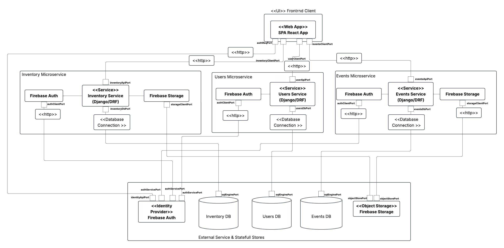

# UNDesparche: Prototype 1

**Software Architecture Course Project**  
**Universidad Nacional de Colombia · Facultad de Ingeniería**  
**Departamento de Ingeniería de Sistemas e Industrial (2026)**

---

## Authors & Academic Information

* **Authors:**
  * Deibyd Santiago Barragán Gaitán – `dbarragang@unal.edu.co`
  * Jacobo Alzate Corredor – `jalzateco@unal.edu.co`
  * Víctor Camilo Cañón Castellanos – `vcanonc@unal.edu.co`
  * David Santiago Velásquez Gómez – `dvelasquezg@unal.edu.co`
* **Professor:**
  * Santiago Suárez Suárez – `ssuarezs@unal.edu.co`

---

## Table of Contents

1. [Context](#context)
2. [Project Scope](#project-scope)
3. [Main System Features](#main-system-features)
4. [Actor Characterization](#actor-characterization)
5. [Entity Characterization](#entity-characterization)
6. [Business Rules](#business-rules)
7. [Functional Requirements](#functional-requirements)
8. [Non-Functional Requirements](#non-functional-requirements)
9. [System Architecture](#system-architecture)
10. [Installation and Running the Project](#installation-and-running-the-project)

---

## Context

At the Universidad Nacional de Colombia (UNAL), students lack a centralized platform to stay informed about campus activities and available recreational implements. As a consequence, many students are unaware of these resources and miss opportunities to engage in athletic, cultural, and recreational spaces.

Currently, inquiring about implement availability requires physically commuting across different faculties, as there is no system to check this information remotely. Similarly, event dissemination is largely conducted through institutional email, limiting its reach due to student email inbox saturation.

From this need arises the proposal for a solution that centralizes information regarding recreational equipment and events, enabling efficient queries, tracking, and management. The proposal outlines a system that facilitates visibility into implement availability by faculty, as well as the publication and browsing of events, incorporating notification mechanisms and geographical visualization across the campus.

The **UNDesparche** project focuses on the higher education sector and university institutional welfare management. Its core purpose is the development of a web platform designed to centralize, promote, and optimize access to recreational, cultural, and sports activities within the Universidad Nacional de Colombia (Bogotá Campus).

The system serves as a direct bridge between university administrative departments (faculties, sports, culture, and welfare offices) and students, resolving logistical inefficiencies in in-person equipment lending and institutional mass communication barriers (unread emails, outdated physical bulletin boards).

---

## Project Scope

Design and develop a web application for the management of events and recreational implements at the Universidad Nacional de Colombia, enabling inventory administration, implement availability visualization, and event management and exploration.

The system will include functionality for registration, updating, querying, tracking, and reserving implements and events, with role-based access control (System Administrator, Event Administrator, Implement Administrator, and Students). Equipment lending is restricted to the university community through institutional authentication, while external guests may subscribe to event notifications without authenticating.

---

## Main System Features

### System Administrator
1. **User Management:** Create, view, and delete registered user records, assign roles (*System Administrator*, *Event Administrator*, *Implement Administrator*, *Community Member*), and configure associated permissions.
2. **Event Management:** Supervise and manage all events registered in the system, including creation, modification, and deletion when required.
3. **Implement Management:** Supervise and manage the general inventory of recreational implements registered across faculties.
4. **Account Management:** Suspend or block accounts due to improper activities.

### Event Administrator
1. **Event Management:** Create, view, modify, and delete events created by themselves, setting attributes such as name, status (*Scheduled*, *In Progress*, *Cancelled*, *Completed*), description, venue, date/time, category, and others.
2. **Event Publication:** Publish events to make them visible to the rest of the system users.

### Implement Administrator
1. **Implement Management:** Register, update, delete, and browse recreational implements associated with their respective faculty.
2. **Availability Management:** Update the availability status of implements.
3. **Reservation Management:** Validate and process reservation requests made by students.

### Community Member
*(Registered user with an `@unal.edu.co` institutional email)*
1. **Implement Browsing:** Browse the catalog of implements by faculty and verify availability.
2. **Subscriptions & Notifications:** Subscribe to events or implements and receive notifications regarding relevant changes.
3. **Implement Reservation:** Place temporary reservations on available implements for a designated time window.

---

## Actor Characterization

| Actor | Description | Age Range | Gender | Interests / Hobbies | Accessibility Needs |
| :--- | :--- | :--- | :--- | :--- | :--- |
| **Community Member** | Students, faculty, or staff with `@unal.edu.co` email who use the system to check and reserve events and implements. | 15 – 100 years | All genders | Sports, video games, music, social integration, culture, welfare. | May present motor or visual impairments (system does NOT implement custom accessibility). |
| **Event Administrator** | Student, teacher, or administrative officer responsible for organizing, publishing, and managing the logistics of cultural or athletic events. | 18 – 65 years | All genders | Student leadership, cultural outreach, logistics, public space activation. | May present motor or visual impairments (system does NOT implement custom accessibility). |
| **Implement Administrator** | University Welfare officer or student assistant responsible for physical inventory and control of sports implements in faculties. | 18 – 65 years | All genders | Inventory management, customer service, sports, administrative tasks. | May present motor or visual impairments (system does NOT implement custom accessibility). |
| **System Administrator** | Support engineer in charge of audit logs, global access permissions, and overall technical operations. | 22 – 60 years | All genders | Cybersecurity, database administration, software optimization. | May present motor or visual impairments (system does NOT implement custom accessibility). |

---

## Entity Characterization

### 1. Community Members (Users)
* **Description:** Represents all registered individuals with institutional credentials (`@unal.edu.co` email = Community Member, Event Administrator, Implement Administrator, System Administrator).
* **Properties:** `id_usuario`, `nombre completo`, `correo institucional (@unal.edu.co)`, `facultad`, `rol` (*Permitted values: Miembro de la Comunidad, Administrador de Eventos, Administrador de Implementos, Administrador del Sistema*), `estado del usuario` (*Permitted values: Activo, Sancionado*), `fecha_registro`.

### 2. Event
* **Description:** Concrete activity scheduled within the geographical boundaries of the university campus. Can be attended by both university community members and external visitors (users without an `@unal.edu.co` email), created by an Event Administrator.
* **Properties:** `id_evento`, `nombre del evento`, `descripción`, `publicado`, `lugar`, `fecha y hora de inicio`, `fecha y hora de fin`, `organizador`, `estado del evento` (*Permitted values: Programado, En Curso, Finalizado, Cancelado*), `categoría temática`, `imagen`.

### 3. Implement
* **Description:** Recreational, sports, or leisure equipment owned by the university and available across faculties for loan to Community Members.
* **Properties:** `id_implemento`, `nombre del artículo`, `categoría`, `facultad propietaria`, `estado del implemento` (*Permitted values: Disponible, No Disponible, Reservado, Prestado*), `descripción`, `imagen`, `tiempo de uso`.

---

## Business Rules

* **RN-01 (Exclusive Authentication):** The system strictly rejects any registration attempt that does not originate from an `@unal.edu.co` email address.
* **RN-02 (Reservation Time Window):** When an available implement is set aside in the application, changing its status to *Reserved*, the Community Member has an unextendable period of ten (10) minutes to claim it in the faculty where it was reserved. After this time, the system automatically releases the implement, reverting its status to *Available*.
* **RN-03 (Penalty for Damaged Implement):** If an implement is returned in damaged condition, the Implement Administrator must immediately change the Community Member's status to *Sanctioned*, restricting their ability to create new reservations until paying the fine and resolving the repair or replacement. The implement status is concurrently set to *Unavailable*.
* **RN-04 (Logistics Management Exclusivity):** A user can only manipulate an implement's data if they hold the *Implement Administrator* role and the implement belongs to the faculty registered in their user profile.
* **RN-05 (Simultaneous Implements Limit):** A Community Member may hold at most one (1) implement under *Reserved* or *Borrowed/Occupied* status simultaneously across the entire system.

---

## Functional Requirements

* **RF-1:** The system must allow user registration through institutional Google accounts (`@unal.edu.co`).
* **RF-2:** The system must manage user roles: System Administrator, Event Administrator, Implement Administrator, and Community Member.
* **RF-3:** The system must enforce role-based access privileges for each user role.
* **RF-4:** The system must allow visualization of published events on an interactive map of the university campus.
* **RF-5:** The system must allow filtering events by category and status.
* **RF-6:** The system must allow sorting events by date.
* **RF-7:** The system must allow filtering implements by category.
* **RF-8:** The system must allow registered users to consult available implements by faculty.
* **RF-9:** The system must allow community members to make a temporary reservation on an implement in "available" status, changing its status to "reserved" for a 10-minute window to ensure in-person pickup.
* **RF-10:** The system must allow registered and authenticated users to formally request the loan of available implements.
* **RF-11:** The system must allow registered users to subscribe to an event.
* **RF-12:** The system must allow unregistered external users to subscribe to events via email to receive related notifications.
* **RF-13:** The system must send email notifications to subscribed users when changes occur in events.
* **RF-14:** The system must allow event administrators to create events specifying name, description, venue, date, time, category, and status.
* **RF-15:** The system must allow saving events in draft status, preventing public visibility until the creating administrator decides to publish it.
* **RF-16:** The system must allow event administrators to publish events created by them.
* **RF-17:** The system must allow event administrators to modify events created by them.
* **RF-18:** The system must allow event administrators to cancel events created by them.
* **RF-19:** The system must prevent deletion of events that have already been published in order to maintain historical activity records; these may only transition to "Cancelled".
* **RF-20:** The system must display a liability disclaimer before confirming an implement request.
* **RF-21:** The system must permit implement requests only if the user accepts the liability disclaimer.
* **RF-22:** The system must allow the system administrator to view all registered users, including name, institutional email, status, and role.
* **RF-23:** The system must allow the system administrator to filter users by role and status (Active, Sanctioned).
* **RF-24:** The system must allow the system administrator to search for users by name or institutional email.
* **RF-25:** The system must allow the system administrator to delete registered users, except other system administrators.
* **RF-26:** The system must allow the system administrator to assign and revoke user roles, except for other system administrators.
* **RF-27:** The system must allow the system administrator to view, modify, and delete any registered event.
* **RF-28:** The system must allow implement administrators to register, view, modify, and delete implements associated with their faculty.
* **RF-29:** The system must allow implement administrators to update implement statuses for their faculty among: available, unavailable, reserved, borrowed/occupied.
* **RF-30:** The system must allow implement administrators to manage implement reservation requests.
* **RF-31:** The system must allow implement administrators to enable or restrict a user's borrowing access.
* **RF-32:** The system must log actions performed in the implements module, storing the responsible user, date, time, and action type.

---

## Non-Functional Requirements

### Security
* **RNF-1:** The system must implement Firebase Authentication to handle registration and login via Google accounts.
* **RNF-2:** The system must terminate user sessions if 10 minutes have elapsed since the user's last activity.

### Performance
* **RNF-3:** Inventory availability queries and geographic map loading must not exceed 2 seconds under normal network conditions.
* **RNF-4:** The backend must implement a caching strategy for high-frequency queries to avoid repetitive database hits.

### Scalability
* **RNF-5:** The system must be deployed using separate Docker containers for frontend, backend, and database.
* **RNF-6:** The architecture must allow adding new modules without affecting existing ones (events and implements).

### Availability
* **RNF-7:** Under controlled errors, the system must log the exception and maintain application uptime without losing user information.
* **RNF-8:** The system must feature an automated weekly database backup mechanism.

### Maintainability
* **RNF-9:** The source code must adhere to the PEP8 standard and apply Clean Code principles and design patterns.
* **RNF-10:** Source code must include technical documentation for relevant classes, methods, and modules using comments and docstrings.

### Portability
* **RNF-11:** The web application must function correctly on the latest two versions of Google Chrome.

### Usability
* **RNF-12:** The system must provide a responsive Graphical User Interface (GUI).
* **RNF-13:** Users must be able to reach any core system feature in 5 clicks or fewer.

### Interoperability
* **RNF-14:** The system must integrate Google Maps Platform to display event locations across the university campus.
* **RNF-15:** The system must implement an external service for sending email notifications.

### Quality
* **RNF-16:** The system must include unit tests for core modules.
* **RNF-17:** Static code analyzers (linters) must be utilized during development to minimize defects during implementation.

### Concurrency
* **RNF-18:** The system must prevent race conditions that could compromise state integrity (e.g., if two users attempt to reserve the same implement simultaneously, only the first request succeeds).
* **RNF-19:** The application must concurrently support approximately 400 users at any hour, operating 24/7 Monday through Sunday during the academic term established by the University Council.

---

## System Architecture

Below is the Components and Connectors (C&C) diagram of the planned architecture:
The Component and Connector (C&C) Diagram:



The model organizes the system into three main layers:

- Frontend Client (<<UI>> Frontend Client): Contains the <<Web App>> SPA React App component, which is the single point of user interaction.

- Backend Microservices Layer (Backend Containers): Composed of three encapsulated and independent subsystems.

- External Services & Persistence: Includes relational data stores and SaaS cloud services.

Components:

- "Web App" SPA React App ("UI"): The user interface component executed in the client's browser. It consumes local resources (CPU/RAM in the browser) and initiates the system's initial requests.

- "Service" Inventory Service, Users Service, and Events Service: The primary backend compute units. They process the business rules for each domain autonomously and independently.

- Internal Adapters (Firebase Auth and Firebase Storage): Act as auxiliary components (utilities / adapters) within the microservices' internal structure to adapt external SDK APIs to the interfaces expected by the services.

- "DB" Inventory DB, Users DB, and Events DB: The relational database management system (RDBMS) engines. Each provides ACID guarantees to its respective microservice under the polyglot persistence / Database per Service pattern.

- "Identity Provider" Firebase Auth: An external managed service acting as the single source of truth for identity state, credentials, and custom user claims.

- "Object Storage" Firebase Storage: Unstructured cloud object storage used to store binary files such as event and equipment images.

Connectors:

- "http": Operates between backend adapters and external APIs in the cloud.

- "Database Connection": Links the persistence port of each microservice to the input port of its respective relational database engine.

Why it is a microservices-based architecture:

It is a microservices architecture because no direct connection (via HTTP or RPC) exists between the Users, Events, and Inventory microservices, and each exclusively owns and manages its own relational persistent storage. Furthermore, authentication and authorization do not require cascading calls to the Users Service; all microservices autonomously validate the token and custom role claims.

---
## Installation and Running the Project

### Prerequisites
* [Docker](https://docs.docker.com/get-docker/) (v24.0+ recommended)
* [Docker Compose](https://docs.docker.com/compose/) (v2.20+)
* [Git](https://git-scm.com/)

---

### Step 1: Clone the Repository
```bash
git clone <repository-url>
cd undesparche
```

---

### Step 2: Configure Firebase Credentials

To enable Google Authentication and Firebase token verification, place your Firebase Service Account JSON key in the root directory:
```bash
# Copy your credentials into the root folder:
cp /path/to/your/firebase-adminsdk.json ./firebase_credentials.json
```
> **Note:** A template is provided at [`firebase_credentials.example.json`](./firebase_credentials.example.json). All three backend microservices (`events_service`, `users_service`, `inventory_service`) automatically mount this root file in read-only mode (`:ro`).

---

### Step 3: Environment Variables Configuration

Environment files with default values are provided as templates:
* **Frontend:** [`frontend_web/.env.example`](./frontend_web/.env.example)
* **Events Service:** [`events_service/events_service/.env.example`](./events_service/events_service/.env.example)
* **Users Service:** [`users_service/users_service/.env.example`](./users_service/users_service/.env.example)
* **Inventory Service:** [`inventory_service/inventory_service/.env.example`](./inventory_service/inventory_service/.env.example)

Docker automatically falls back to `.env.example` if a custom `.env` is omitted. However, you can create your custom environment files:
```bash
# Frontend
cp frontend_web/.env.example frontend_web/.env

# Backend Microservices
cp events_service/events_service/.env.example events_service/events_service/.env
cp users_service/users_service/.env.example users_service/users_service/.env
cp inventory_service/inventory_service/.env.example inventory_service/inventory_service/.env
```

---

### Step 4: Build and Run with Docker Compose

Run the following command in the root directory:
```bash
docker compose up --build
```
Or run in detached mode (background):
```bash
docker compose up -d --build
```

---

### Automatic Database Migrations and Seeding

Upon container startup, each Django microservice executes automatic migrations and database seeding (`update_or_create`):

| Service | Startup Command | Seeded Data |
| :--- | :--- | :--- |
| **`events_service`** | `migrate && seed_events && runserver` | 9 Campus Events + Institutional users |
| **`users_service`** | `migrate && seed_users && runserver` | 4 Pre-configured institutional users & roles |
| **`inventory_service`** | `migrate && seed_inventory && runserver` | Sports & recreational implements across faculties |

#### Pre-seeded Accounts for Development / Testing
Seeded accounts are created in the database with their respective roles. A default password (`Admin123*`) is set for Django Admin panel access (`/admin/`), while user access in the main web application is handled via institutional Google Authentication (`@unal.edu.co`):

| Email | System Role | Faculty |
| :--- | :--- | :--- |
| `dbarragang@unal.edu.co` | `SYS_ADMIN` (System Administrator) | Engineering |
| `vcanonc@unal.edu.co` | `EVENT_ADMIN` (Event Administrator) | Engineering |
| `jalzateco@unal.edu.co` | `IMPLEMENT_ADMIN` (Implement Administrator) | Engineering |
| `dvelasquezg@unal.edu.co` | `COMMUNITY` (Active Community Member) | Engineering |

---

### Application Access Endpoints

Once the containers are up, the application is accessible at:

* **Frontend Web Application:** [http://localhost:5172](http://localhost:5172)
* **Events Service API:** [http://localhost:8000/events/](http://localhost:8000/events/)
* **Users Service API:** [http://localhost:5000/users/](http://localhost:5000/users/)
* **Inventory Service API:** [http://localhost:8080/inventory/implements/](http://localhost:8080/inventory/implements/)

---

### Useful Commands

* **View container logs:**
  ```bash
  docker compose logs -f
  ```
* **Stop all containers:**
  ```bash
  docker compose down
  ```
* **Stop and remove data volumes (Fresh reset):**
  ```bash
  docker compose down -v
  ```
