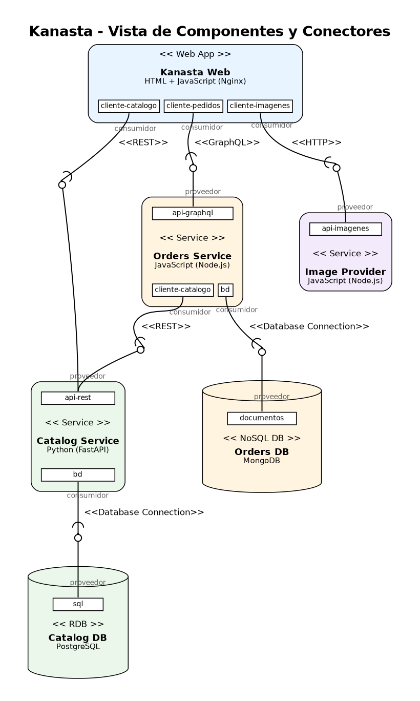

# Estructura de Componentes y Conectores (C&C)

## Vista C&C



El diagrama se genera con Graphviz a partir de [`vista-cc.dot`](vista-cc.dot):

```bash
dot -Tpng vista-cc.dot -o vista-cc.png
```

### Cómo leer el diagrama

| Símbolo | Significado |
|---|---|
| Caja redondeada | Componente de presentación o de lógica. Arriba dice su tipo `<< >>`, luego su nombre y su tecnología. |
| Cilindro | Componente de datos (base de datos). |
| Cuadro pequeño con nombre | **Puerto**: punto por donde el componente ofrece o pide un servicio. |
| Bola ( `o` ) | Rol **proveedor**: el componente que ofrece la interfaz. |
| Pierna con media luna ( `(` ) | Rol **consumidor**: el componente que usa la interfaz. |
| Texto `<< >>` sobre la línea | Tipo de **conector** (protocolo de comunicación). |

## Estilos arquitectónicos usados

### 1. Cliente-servidor (estilo principal)

Toda la comunicación de Kanasta sigue el modelo **petición-respuesta**: un cliente pide algo y un servidor responde.

- El navegador con **Kanasta Web** es el cliente de los tres servicios.
- **Orders Service** también es cliente: cuando necesita precios o inventario se los pide al **Catalog Service**.
- Cada servicio es cliente de su propia base de datos.

Los servidores no conocen a sus clientes y nunca les envían mensajes por su cuenta; solo responden.

### 2. Por niveles (tiers)

Los componentes están organizados en tres niveles. Cada nivel solo habla con el nivel de abajo:

| Nivel | Componentes |
|---|---|
| Presentación | Kanasta Web |
| Lógica | Catalog Service, Orders Service, Image Provider |
| Datos | Catalog DB (PostgreSQL), Orders DB (MongoDB) |

Kanasta Web nunca se conecta directamente a una base de datos, y cada base de datos pertenece a un solo servicio.

## Elementos

### Componentes

| Componente | Tipo | Tecnología | Responsabilidad | Puertos |
|---|---|---|---|---|
| **Kanasta Web** | Web App (presentación) | HTML, CSS, JavaScript, Nginx | Mostrar la tienda: catálogo, detalle, carrito, pedidos y panel de administración. Nginx entrega las páginas y redirige cada petición al servicio correcto. | `cliente-catalogo`, `cliente-pedidos`, `cliente-imagenes` |
| **Catalog Service** | Service (lógica) | Python 3.12, FastAPI | Productos, categorías, búsqueda e inventario. Es el único que puede cambiar las unidades disponibles. | `api-rest` (ofrece), `bd` (usa) |
| **Orders Service** | Service (lógica) | JavaScript, Node.js 20, Express, GraphQL | Carritos de compra, creación de pedidos y cambio de estado de los pedidos. | `api-graphql` (ofrece), `cliente-catalogo` (usa), `bd` (usa) |
| **Image Provider** | Service (lógica) | JavaScript, Node.js 20, Express | Entregar las imágenes de los productos. Si una imagen no existe entrega una imagen de reemplazo. | `api-imagenes` (ofrece) |
| **Catalog DB** | RDB (datos) | PostgreSQL 16 | Guardar categorías y productos en tablas relacionadas. | `sql` (ofrece) |
| **Orders DB** | NoSQL DB (datos) | MongoDB 7 | Guardar carritos y pedidos como documentos. | `documentos` (ofrece) |

### Conectores

| Conector | Tipo | Consumidor → Proveedor | Para qué se usa |
|---|---|---|---|
| C1 | **REST** (HTTP + JSON) | Kanasta Web → Catalog Service | Listar categorías, listar y buscar productos, ver el detalle de un producto. |
| C2 | **GraphQL** (HTTP + JSON) | Kanasta Web → Orders Service | Consultar y modificar el carrito, confirmar pedidos, consultar pedidos, cambiar estados. |
| C3 | **HTTP** (archivos) | Kanasta Web → Image Provider | Descargar las imágenes de los productos. |
| C4 | **REST** (HTTP + JSON) | Orders Service → Catalog Service | Consultar precio y unidades de un producto y reservar unidades al confirmar un pedido. |
| C5 | **Database Connection** (protocolo de PostgreSQL) | Catalog Service → Catalog DB | Leer productos y descontar inventario con SQL. |
| C6 | **Database Connection** (protocolo de MongoDB) | Orders Service → Orders DB | Leer y guardar carritos y pedidos. |

## Relaciones

1. **Kanasta Web usa a los tres servicios**, pero cada uno por un tipo de conector distinto, según lo que mejor le sirve:
   - REST para el catálogo, porque son consultas simples de "dame este recurso".
   - GraphQL para los pedidos, porque la web pide exactamente los campos que necesita en cada pantalla (el carrito, la lista de pedidos o solo el estado) con un único punto de entrada.
   - HTTP simple para las imágenes, porque solo se descargan archivos.
2. **Orders Service depende de Catalog Service**. El servicio de pedidos nunca lee la base del catálogo: le pregunta al Catalog Service por su API REST. Así el catálogo sigue siendo el único dueño del inventario.
3. **Cada base de datos tiene un solo dueño.** Catalog DB solo la usa Catalog Service y Orders DB solo la usa Orders Service.
4. **Image Provider no depende de nadie.** Puede cambiarse por otro proveedor de imágenes sin tocar los demás componentes; la web solo necesita la dirección `/images/<archivo>`.

## Ejemplo: confirmar un pedido

1. El cliente pulsa **Confirmar pedido** en Kanasta Web.
2. Kanasta Web envía la mutación GraphQL `placeOrder` al Orders Service (C2).
3. Orders Service lee el carrito desde Orders DB (C6).
4. Por cada producto, Orders Service consulta precio y unidades al Catalog Service por REST (C4).
5. Orders Service pide reservar las unidades: `POST /api/products/{id}/reserve` (C4).
6. Catalog Service descuenta el inventario en Catalog DB con SQL (C5).
7. Orders Service guarda el pedido y vacía el carrito en Orders DB (C6).
8. Kanasta Web muestra el número del pedido al cliente.

## Despliegue

Cada componente corre en su propio contenedor Docker y todos se describen en `proyecto/codigo/docker-compose.yml`:

| Contenedor | Imagen base | Puerto expuesto |
|---|---|---|
| web | nginx:1.27-alpine | 8080 |
| catalog-service | python:3.12-slim | 8001 |
| orders-service | node:20-alpine | 8002 |
| image-provider | node:20-alpine | 8003 |
| catalog-db | postgres:16-alpine | — (solo red interna) |
| orders-db | mongo:7 | — (solo red interna) |
