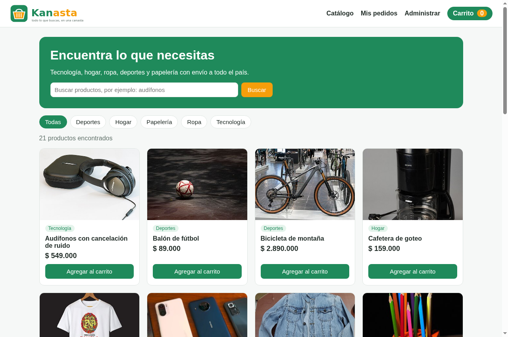
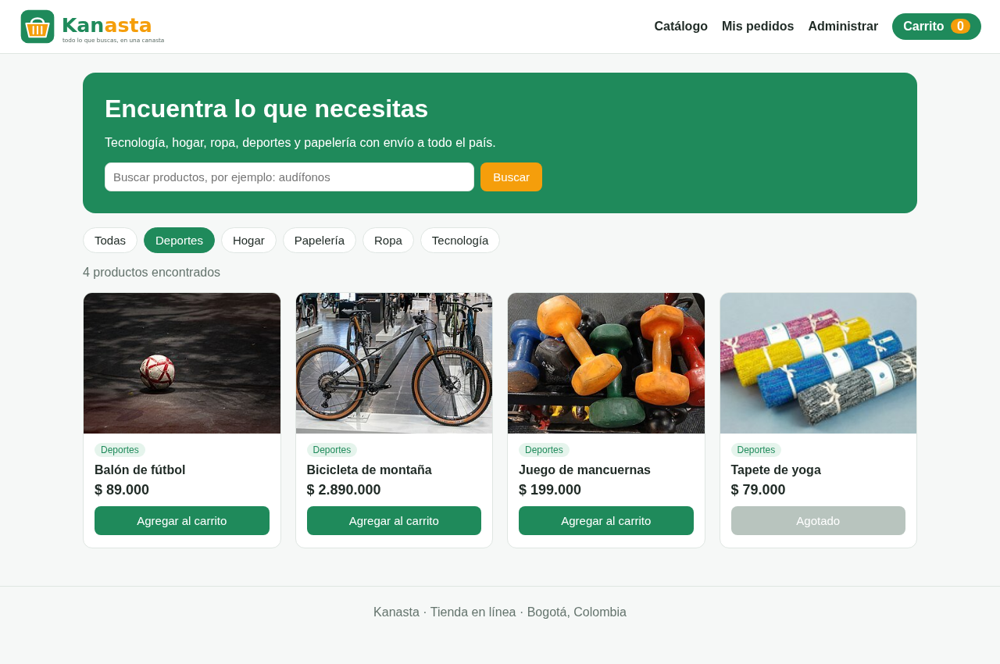
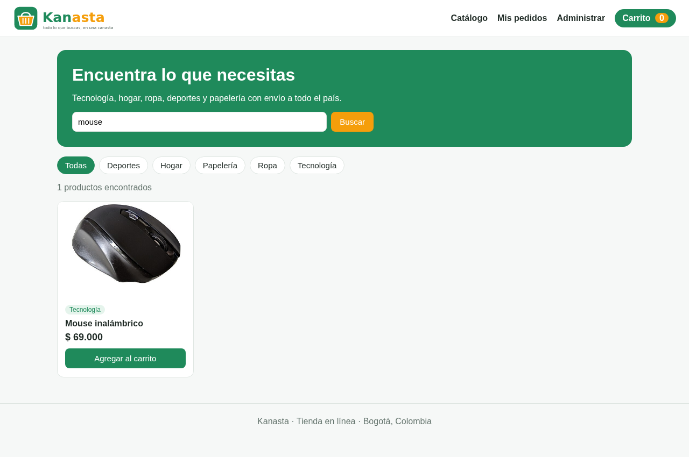
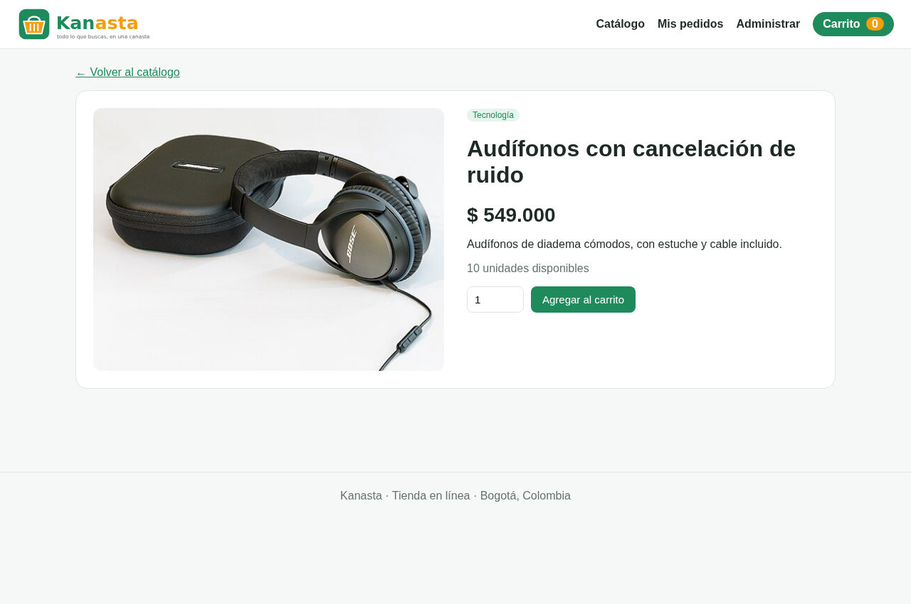
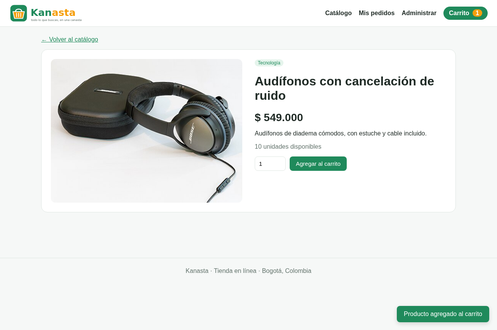
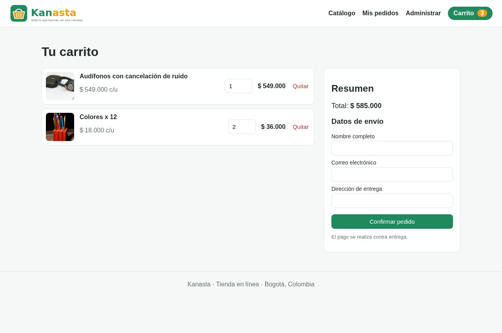
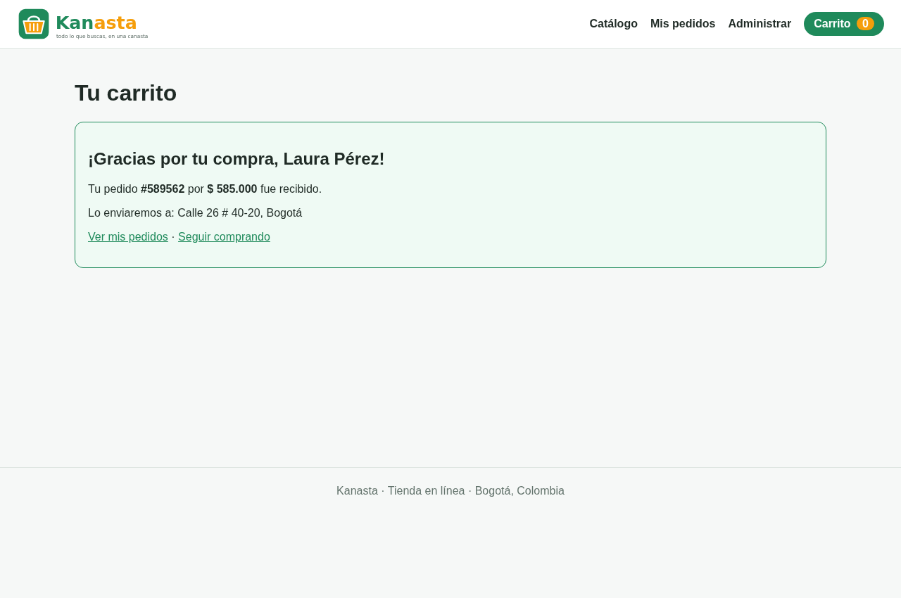
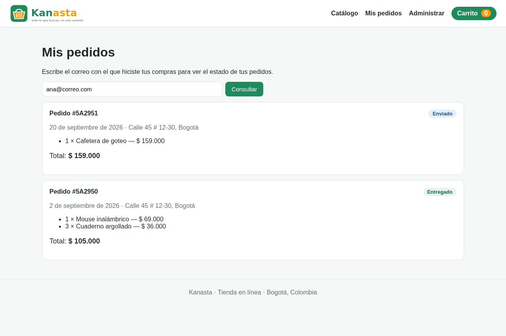
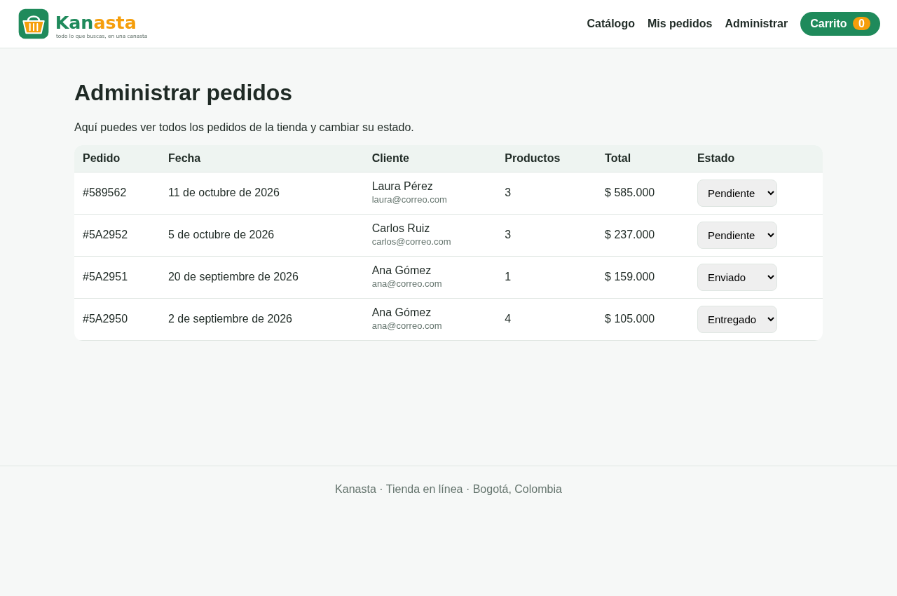
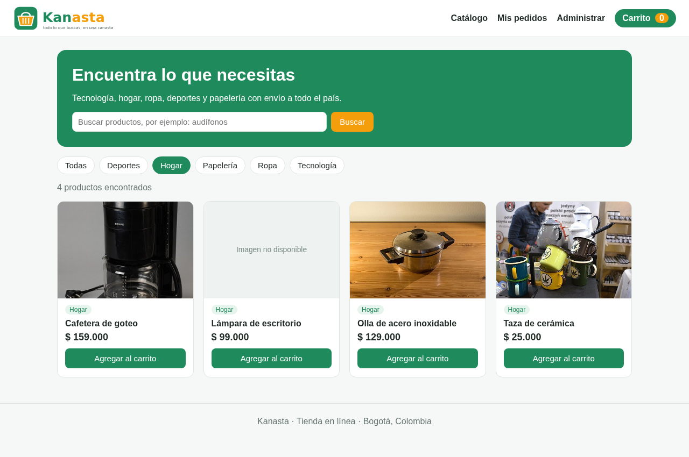

# Manual de usuario

Este manual explica cómo usar la tienda Kanasta paso a paso.

Para abrir la tienda, primero hay que encenderla (ver [README](../../README.md#cómo-ejecutar)) y luego entrar a **http://localhost:8080** desde el navegador.

## 1. El menú

En la parte de arriba de todas las páginas está el menú:

| Opción | Para qué sirve |
|---|---|
| **Catálogo** | Ver y buscar productos. |
| **Mis pedidos** | Consultar los pedidos que hiciste. |
| **Administrar** | Ver todos los pedidos de la tienda y cambiar su estado (para el personal de la tienda). |
| **Carrito** | Ver lo que vas a comprar. El número naranja indica cuántas unidades llevas. |

## 2. Ver el catálogo

La página principal muestra todos los productos con su foto, categoría y precio.

Si un producto no tiene unidades, el botón dice **Agotado** y no se puede agregar.

## 3. Filtrar por categoría

Pulsa una de las categorías (Deportes, Hogar, Papelería, Ropa o Tecnología) para ver solo esos productos. Pulsa **Todas** para volver a ver todo.

## 4. Buscar un producto

Escribe una palabra en el buscador, por ejemplo *mouse*, y pulsa **Buscar**.

## 5. Ver el detalle de un producto

Pulsa la foto o el nombre de un producto para ver su descripción y cuántas unidades quedan. Desde aquí puedes elegir la cantidad y pulsar **Agregar al carrito**.

Cuando agregas un producto aparece un aviso verde en la esquina y el contador del carrito aumenta.

## 6. Revisar el carrito

Pulsa **Carrito** en el menú. Allí puedes:

- Cambiar la cantidad de un producto escribiendo un nuevo número.
- Pulsar **Quitar** para sacar un producto.
- Ver el total a pagar.

El carrito se guarda: si cierras la página y vuelves desde el mismo navegador, tus productos siguen ahí.

## 7. Confirmar el pedido

En el mismo carrito, llena tus datos de envío (nombre, correo y dirección) y pulsa **Confirmar pedido**. El pago se hace contra entrega.

Si todo está bien, verás el número de tu pedido:

> Si mientras tanto otra persona compró las últimas unidades de un producto, verás un aviso rojo y podrás ajustar tu carrito.

## 8. Consultar mis pedidos

Entra a **Mis pedidos**, escribe el correo que usaste al comprar y pulsa **Consultar**. Verás cada pedido con su fecha, productos, total y estado.

Los estados posibles son:

| Estado | Significado |
|---|---|
| Pendiente | El pedido fue recibido y se está preparando. |
| Enviado | El pedido va en camino. |
| Entregado | El pedido llegó a su destino. |
| Cancelado | El pedido fue cancelado. |

> Para probar, puedes consultar el correo **ana@correo.com**, que ya tiene pedidos de ejemplo.

## 9. Administrar pedidos (personal de la tienda)

Entra a **Administrar**. Verás una tabla con todos los pedidos, del más reciente al más antiguo. Para cambiar el estado de un pedido, elige el nuevo estado en la lista de la última columna. El cambio se guarda de inmediato y el cliente lo verá en **Mis pedidos**.

## 10. Imágenes no disponibles

Si la foto de un producto no está disponible, la tienda muestra un recuadro gris con el texto "Imagen no disponible" y todo lo demás sigue funcionando con normalidad.

## Preguntas frecuentes

**¿Necesito crear una cuenta?**
No. Solo necesitas tu correo para confirmar y consultar pedidos. Las cuentas de usuario llegarán en la próxima versión.

**¿Puedo pagar con tarjeta?**
Por ahora el pago es contra entrega. El pago en línea está planeado para la próxima versión.

**¿Por qué no puedo agregar más unidades de un producto?**
Porque la tienda no permite comprar más unidades de las que hay en inventario.
