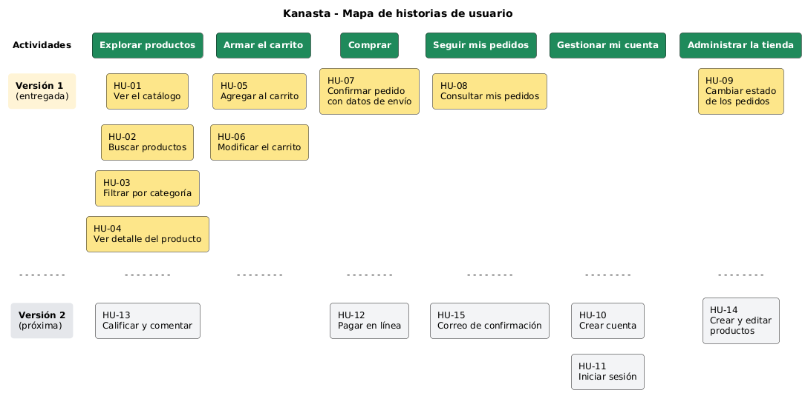

# Requisitos funcionales

Los requisitos funcionales de Kanasta están escritos como **historias de usuario**. Cada historia dice quién la necesita, qué quiere hacer y para qué.

## Tipos de usuario

| Usuario | Descripción |
|---|---|
| Cliente | Persona que entra a la tienda para ver productos y comprar. No necesita cuenta. |
| Administrador | Persona de la tienda que atiende los pedidos. |

## Historias de usuario

**Estado:** ✅ Implementada en la versión 1 · ⏳ Planeada para la versión 2

| ID | Historia de usuario | Criterios de aceptación | Prioridad | Estado |
|---|---|---|---|---|
| HU-01 | Como **cliente** quiero **ver el catálogo de productos** para **conocer lo que vende la tienda**. | Se muestran todos los productos con foto, nombre, categoría y precio. Los productos agotados aparecen marcados como "Agotado". | Alta | ✅ |
| HU-02 | Como **cliente** quiero **buscar productos por nombre o descripción** para **encontrar rápido lo que necesito**. | Al escribir un texto y pulsar "Buscar" solo se muestran los productos que lo contienen. Si no hay resultados se muestra un mensaje. | Alta | ✅ |
| HU-03 | Como **cliente** quiero **filtrar los productos por categoría** para **ver solo lo que me interesa**. | Hay un botón por categoría y uno de "Todas". Al elegir una categoría solo se ven sus productos. | Media | ✅ |
| HU-04 | Como **cliente** quiero **ver el detalle de un producto** para **decidir si lo compro**. | Se muestra foto grande, descripción, precio y unidades disponibles. | Alta | ✅ |
| HU-05 | Como **cliente** quiero **agregar productos al carrito** para **comprarlos juntos**. | El producto se suma al carrito y el contador del menú aumenta. No se puede agregar más unidades de las disponibles. | Alta | ✅ |
| HU-06 | Como **cliente** quiero **cambiar cantidades y quitar productos del carrito** para **ajustar mi compra**. | Al cambiar la cantidad el total se recalcula. El botón "Quitar" elimina el producto. El carrito se conserva si recargo la página. | Alta | ✅ |
| HU-07 | Como **cliente** quiero **confirmar mi pedido con mis datos de envío** para **recibir los productos en mi casa**. | Se piden nombre, correo y dirección. Al confirmar se descuentan las unidades del inventario, se vacía el carrito y se muestra el número del pedido. | Alta | ✅ |
| HU-08 | Como **cliente** quiero **consultar mis pedidos con mi correo** para **saber en qué estado están**. | Al escribir el correo se listan sus pedidos con fecha, productos, total y estado (Pendiente, Enviado, Entregado o Cancelado). | Media | ✅ |
| HU-09 | Como **administrador** quiero **ver todos los pedidos y cambiar su estado** para **llevar el control de los envíos**. | Se ve una tabla con todos los pedidos. Al cambiar el estado en la lista, el cambio se guarda y el cliente lo ve en "Mis pedidos". | Alta | ✅ |
| HU-10 | Como **cliente** quiero **crear una cuenta** para **no escribir mis datos en cada compra**. | Registro con nombre, correo y contraseña. El correo no se puede repetir. | Media | ⏳ |
| HU-11 | Como **cliente** quiero **iniciar sesión** para **ver mis pedidos sin escribir mi correo**. | Ingreso con correo y contraseña. Opción de cerrar sesión. | Media | ⏳ |
| HU-12 | Como **cliente** quiero **pagar en línea con tarjeta o PSE** para **no pagar contra entrega**. | Se conecta con una pasarela de pagos. El pedido queda "Pagado" solo si el pago es aprobado. | Media | ⏳ |
| HU-13 | Como **cliente** quiero **calificar y comentar los productos** para **ayudar a otros compradores**. | Calificación de 1 a 5 estrellas y comentario. Se muestra el promedio en el detalle del producto. | Baja | ⏳ |
| HU-14 | Como **administrador** quiero **crear y editar productos** para **mantener el catálogo al día**. | Formulario para nombre, descripción, precio, unidades, categoría e imagen. | Media | ⏳ |
| HU-15 | Como **cliente** quiero **recibir un correo cuando hago un pedido** para **tener el comprobante**. | Se envía un correo con el número del pedido, los productos y el total. | Baja | ⏳ |

## Resumen

| Total de historias | Implementadas | Planeadas | Avance |
|---|---|---|---|
| 15 | 9 | 6 | 60 % |

## Mapa de historias de usuario

El mapa organiza las historias según las actividades del usuario (columnas) y la versión en que se entregan (filas).

El código fuente del mapa está en [`mapa-historias-usuario.puml`](mapa-historias-usuario.puml) (PlantUML).
