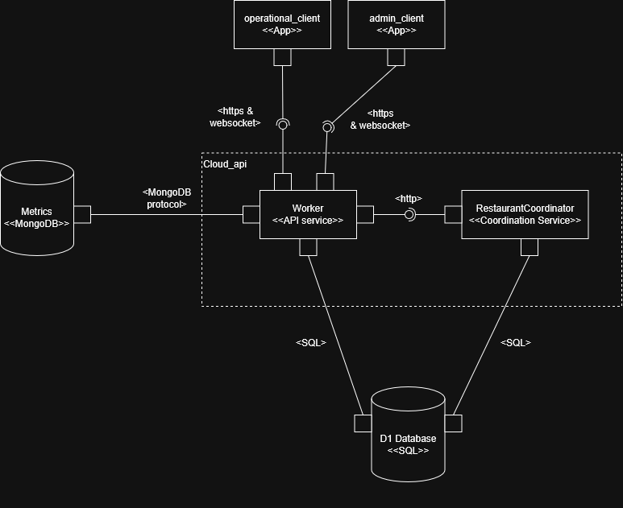
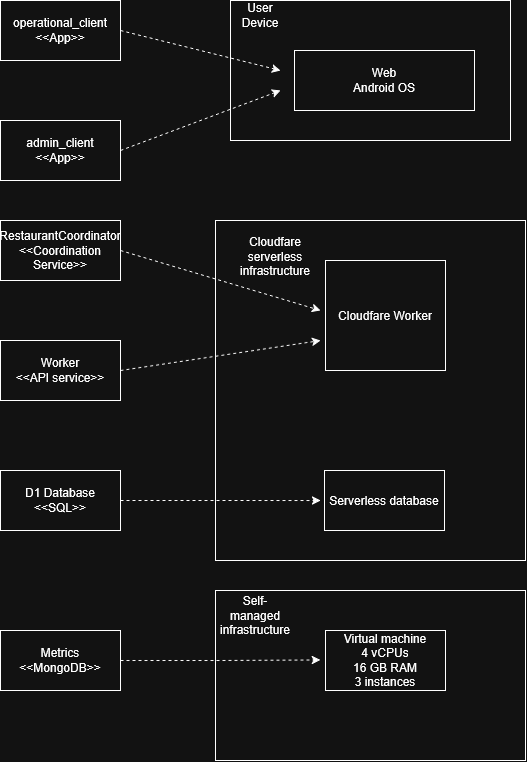
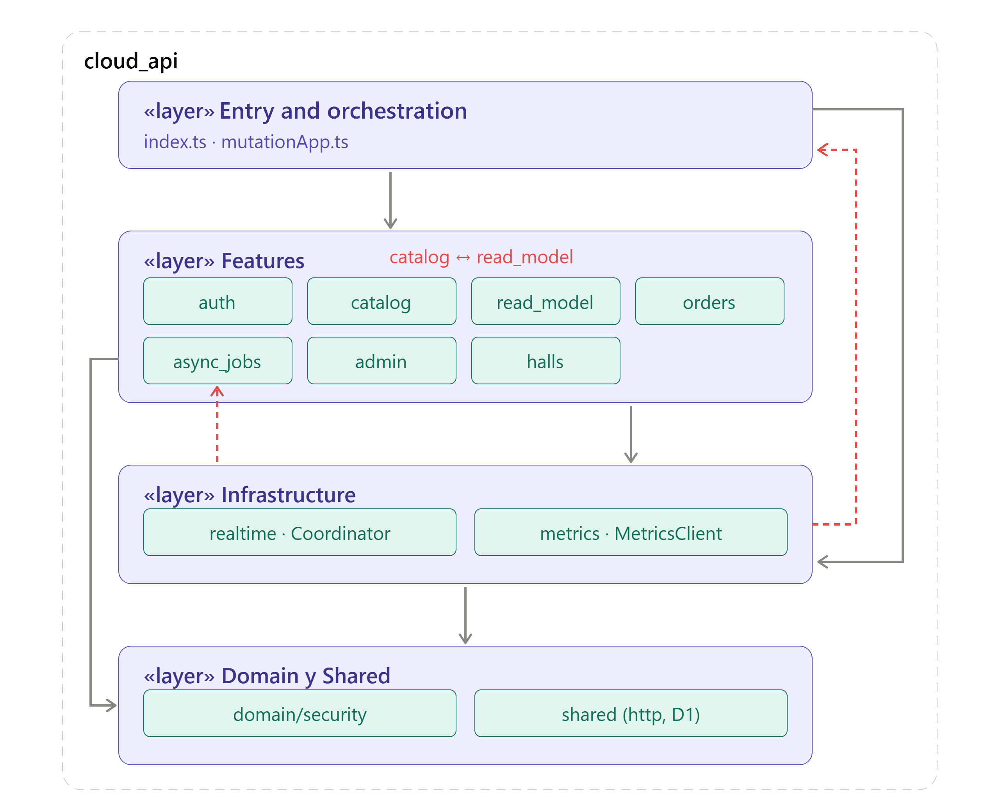
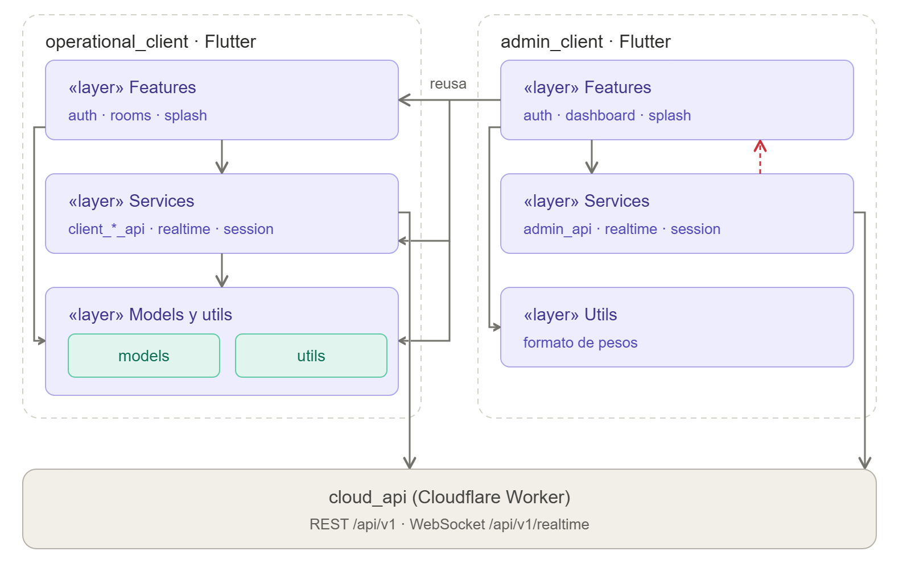
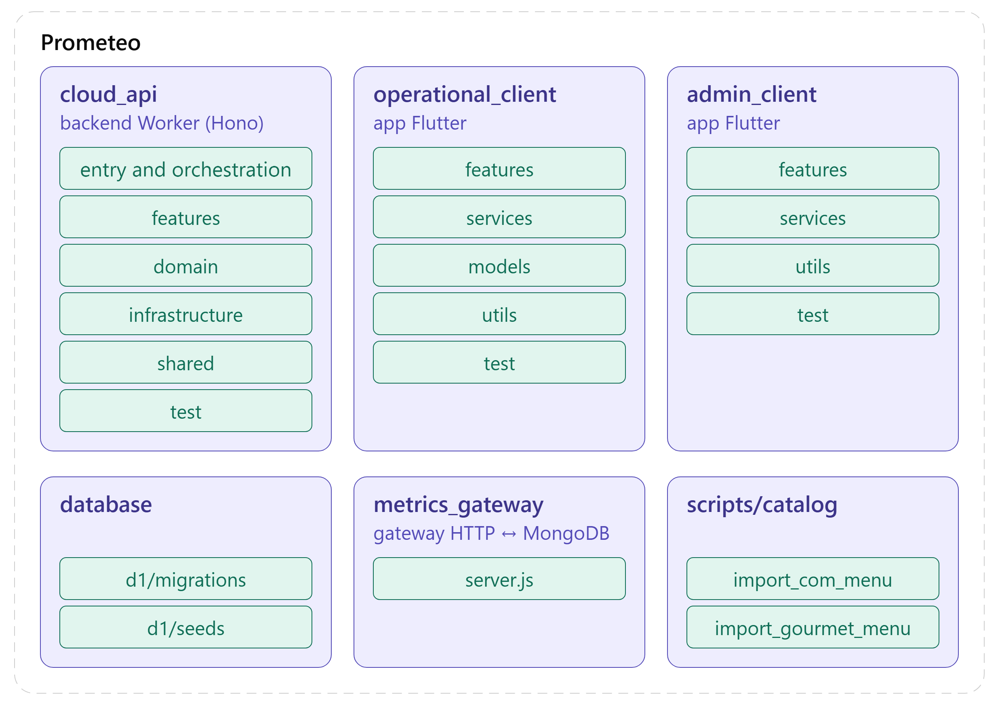
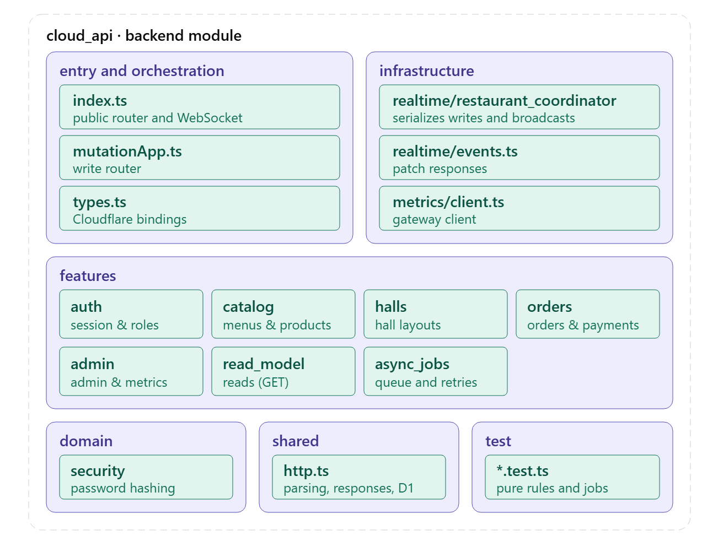
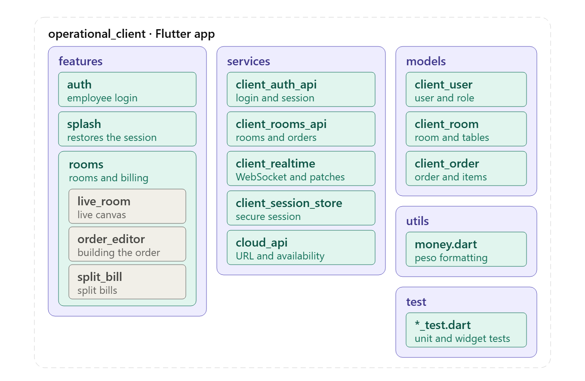
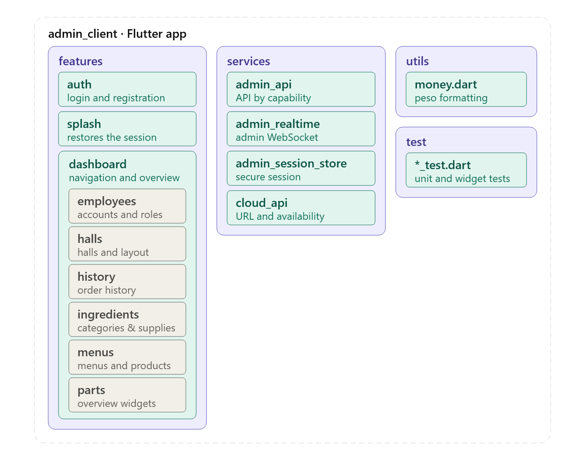

# Team 3-D-Prometeo


## Members

- Daniel Aguilar Castro
- Omar Chaparro Flechas
- Baruj Vladimir Ramirez Escalante
- David Alejandro Herrera Novoa
- Cristian Camilo Castillo Meneses

## Project
Sistema de operación y administración de restaurante. La aplicación usa una API desplegada en Cloudflare Workers, D1 como base de datos y un Durable Object para distribuir cambios en tiempo real.

# Architectural Structures

## Component-and-Connector (C&C) Structure

### C&C View



### Description of architectural elements and relations

#### Elementos principales

- **operational_client:** Aplicación Flutter para la operación diaria del restaurante: selección de salones, gestión de mesas, toma y entrega de pedidos, cobros, división de cuentas y ventas por turno.
- **admin_client:** Aplicación Flutter para la administración del negocio: catálogo, ingredientes, salones, empleados, historial y métricas. Disponible solo para usuarios con rol de administrador.
- **cloud_api:** Backend principal, implementado como Cloudflare Worker con Hono. Es el único punto de entrada público del sistema y concentra la lógica de negocio y la coordinación en tiempo real. Internamente se compone de:
    - `index.ts`: router público que valida sesiones, aplica middleware y expone `/api/v1/*` y `/api/v1/realtime`.
    - `features/*`: módulos de dominio (`auth`, `catalog`, `halls`, `orders`, `admin`, `read_model`).
    - `mutationApp.ts`: router interno que registra solo las rutas de escritura.
    - `RestaurantCoordinator`: Durable Object que serializa las mutaciones, valida sesión, rol y acceso por salón, garantiza idempotencia y difunde parches de tiempo real a los clientes suscritos.
- **D1 Database:** Base de datos SQL y única fuente de verdad del sistema. Almacena usuarios, sesiones, catálogo, salones, órdenes, metadatos de idempotencia y versiones de recursos. Ningún cliente accede a ella directamente.
- **metrics-gateway / MongoDB:** Las métricas de ventas acumuladas viven en MongoDB, al que el Worker accede por HTTP a través del `metrics-gateway` (un gateway de datos puro, sin lógica de negocio), ya que los Workers no abren TCP crudo. Solo aplica en desarrollo local.

#### Relaciones

- **operational_client ↔ cloud_api:** HTTPS REST en `/api/v1/*` para consultas y operaciones, y WebSocket en `/api/v1/realtime` para recibir actualizaciones de mesas, pedidos y layout.
- **admin_client ↔ cloud_api:** mismos canales que el cliente operativo, con acceso adicional a operaciones administrativas, métricas y al feed administrativo en tiempo real.
- **cloud_api → D1:** SQL mediante prepared statements. Las lecturas se resuelven directamente en el Worker; las escrituras se ejecutan a través del `RestaurantCoordinator` y `mutationApp`. El Coordinator también consulta permisos y persiste los receipts de idempotencia.
- **cloud_api → clientes:** tras cada mutación exitosa, el `RestaurantCoordinator` difunde parches (`RealtimePatch`) por la conexión WebSocket abierta. D1 no emite cambios.

### Description of architectural styles and patterns used

- **Cliente-servidor:** dos clientes Flutter (operativo y administrativo) consumen un único backend, `apps/cloud_api`. Los clientes no se comunican entre sí ni guardan datos compartidos; toda regla de negocio se valida en el servidor.
- **API REST sobre HTTPS:** el backend expone recursos versionados bajo `/api/v1` (`auth`, `admin`, pedidos, salones, catálogo) con verbos HTTP estándar. Las lecturas son `GET` y las escrituras son `POST`, `PUT`, `PATCH` y `DELETE` autenticadas con token de sesión.
- **Serverless / edge computing:** la API corre como Cloudflare Worker, sin servidores que administrar, y usa D1 (SQLite gestionado) como base de datos y un Durable Object para el estado con coordinación.
- **Publicación-suscripción orientada a eventos:** los clientes abren un WebSocket con el Durable Object `RestaurantCoordinator`. Cada mutación exitosa genera parches pequeños por recurso (salones, pedidos, actividad, métricas, catálogo) que se difunden (multicast) solo a los clientes suscritos al recurso afectado.
- **Separación de lecturas y escrituras (estilo CQRS):** las lecturas van directo del Worker a D1, y el catálogo se sirve desde la Cache API de Workers con llaves versionadas. Las escrituras se canalizan por el coordinador, que las serializa, las ejecuta y publica sus efectos.

## Deployment Structure

### Deployment View



### Description of architectural elements and relations

- **Dispositivos cliente:** navegadores o dispositivos que ejecutan los clientes Flutter (operativo y administrativo). Alcanzan el backend a través de una URL estable (`RESTAURANT_API_URL`), sin descubrimiento local, certificados propios, mDNS ni emparejamiento por QR.
- **Cloudflare Worker (`cloud_api`):** unidad de despliegue del backend en el edge de Cloudflare. Aloja el router Hono y el Durable Object `RestaurantCoordinator`.
- **D1:** base de datos SQLite gestionada por Cloudflare, desplegada junto al Worker y accedida mediante el binding `DB`.
- **Durable Object `RestaurantCoordinator`:** instancia con estado coordinada por Cloudflare que serializa escrituras y mantiene las conexiones WebSocket.
- **metrics-gateway + MongoDB:** servicios desplegados por separado (solo en desarrollo local vía `docker-compose`). El Worker se comunica con el gateway por HTTP (`METRICS_GATEWAY_URL`) y el gateway abre TCP contra MongoDB.

Relaciones de despliegue:

- Los dispositivos cliente se conectan al Worker por **HTTPS** (REST) y **WebSocket** (tiempo real).
- El Worker se enlaza a **D1** y al **Durable Object** mediante bindings de Cloudflare.
- El Worker llama al **metrics-gateway** por HTTP; el gateway es el único que abre conexión TCP a **MongoDB**.

### Description of architectural patterns used

- **Serverless / edge deployment:** el backend se despliega como Cloudflare Worker (`npm run cloud:deploy`), sin servidores que administrar.
- **Gateway de datos:** el `metrics-gateway` actúa como adaptador HTTP ↔ MongoDB para sortear la imposibilidad del Worker de abrir TCP crudo, sin introducir lógica de negocio.
- **Contenedorización para desarrollo local:** `docker-compose` levanta el backend emulado, los builds web de los clientes, MongoDB y el gateway de métricas.

## Layered Structure

### Layered View

**Backend (`cloud_api`)**



**Clientes (Flutter)**



### Description of architectural elements and relations

- **Backend (`apps/cloud_api`):**
    - `features`: rutas y reglas de negocio por capacidad (`auth`, `catalog`, `halls`, `orders`, `admin`, `read_model`).
    - `domain`: reglas propias del servidor (por ejemplo seguridad y hashing de contraseñas).
    - `infrastructure`: código de plataforma y tiempo real (Durable Object, coordinación).
    - `shared`: utilidades transversales (helpers HTTP/D1).
- **Clientes (`operational_client`, `admin_client`):**
    - `features`: pantallas y flujos de interfaz.
    - `services`: acceso a la API, tiempo real y gestión de sesión.
    - `utils`: utilidades transversales.

Las capas superiores dependen de las inferiores: las `features` usan `services`/`shared`, y estos a su vez usan `domain`/`infrastructure`. No existen dependencias inversas.

### Description of architectural patterns used

- **Arquitectura por capas (layered):** separación en niveles con dependencias dirigidas hacia abajo.
- **Organización por features:** dentro de cada capa, el código se agrupa por capacidad del negocio en lugar de por tipo técnico.

## Decomposition Structure

### Decomposition View

**Sistema completo**



**Backend**



**Cliente operativo**



**Cliente administrativo**



### Description of architectural elements and relations

```text
apps/
  cloud_api/            Worker, reglas del servidor y tiempo real
  operational_client/   Flutter para meseros, caja y operación del salón
  admin_client/         Flutter para configuración, métricas e historial
database/
  d1/migrations/        Esquema versionado de D1
  d1/seeds/             Datos de desarrollo
scripts/
  catalog/              Importadores de catálogos hacia D1
services/
  metrics_gateway/      Gateway HTTP ↔ MongoDB (métricas; solo local)
docs/
  architecture/         Diseño vigente del sistema
  development/          Reglas y flujos para contribuir
```

- **apps/cloud_api:** único backend del sistema; se descompone en `features`, `domain`, `infrastructure` y `shared`.
- **apps/operational_client** y **apps/admin_client:** clientes Flutter; su código de producto vive en `lib` (`features`, `services`, `utils`). Los directorios nativos (`android`, `ios`, `linux`, `macos`, `web`, `windows`) contienen integración de plataforma y, en gran parte, archivos generados.
- **database/d1:** migraciones acumulativas y datos de desarrollo de D1.
- **scripts/catalog:** importadores de catálogos hacia D1.
- **services/metrics_gateway:** gateway HTTP ↔ MongoDB para métricas (solo desarrollo local).
- **docs:** documentación de arquitectura y de contribución.

El cliente administrativo depende por path del cliente operativo para reutilizar la vista en vivo; ningún otro cruce de dependencias entre clientes está permitido.

# Prototype

## Instructions for deploying the software system locally

### Clonar el repositorio

```bash
git clone https://github.com/unal-sw-arch/swarch-2026ii.git
cd swarch-2026ii/g3-D-Prometeo
```

Todos los comandos siguientes se ejecutan desde la carpeta `g3-D-Prometeo/`.

### Con Docker (de manera local)

Requisitos: Docker y Docker Compose.

```bash
docker compose up --build
```

| Servicio          | Descripción                                               | URL                    |
| ----------------- | --------------------------------------------------------- | ---------------------- |
| `backend`         | Worker en `wrangler dev` (D1 y Durable Object emulados)   | http://localhost:8787  |
| `web-operational` | Build web del cliente operativo servido por nginx         | http://localhost:8080  |
| `web-admin`       | Build web del cliente administrativo servido por nginx    | http://localhost:8081  |
| `mongo`           | MongoDB, dueño de las métricas de ventas                  | mongodb://localhost:27017 |
| `metrics-gateway` | Gateway HTTP ↔ Mongo para el Worker (ver `services/`)     | http://localhost:8788  |

> Las métricas de ventas acumuladas viven en MongoDB (no en D1). El Worker no
> abre TCP crudo, así que las lee/escribe por HTTP a través del
> `metrics-gateway`, un gateway de datos puro (sin lógica de negocio). Ver
> `services/metrics_gateway/README.md`. Solo aplica en desarrollo local.

Con el stack levantado, aplica las migraciones y los datos de desarrollo en otra terminal:

```bash
docker compose exec backend npm run cloud:d1:migrate:local
docker compose exec backend npm run cloud:d1:seed:local
```

Notas:

- El backend monta el código fuente para hot-reload y guarda el estado emulado de D1 en el volumen `wrangler-state`, que persiste entre reinicios. Para empezar desde cero: `docker compose down -v`.
- La URL del backend se compila dentro de los builds web (`--dart-define=RESTAURANT_API_URL`, por defecto `http://localhost:8787`). Si cambias el puerto o el host del backend, reconstruye las imágenes web con el build arg actualizado.
- La imagen de `web-admin` se construye con contexto `apps/` porque `admin_client` depende de `operational_client` por path.
- Docker solo se usa para desarrollo local; en producción el Worker se despliega a Cloudflare con `npm run cloud:deploy`.

### Usuarios de prueba

`development.sql` crea usuarios con contraseñas conocidas para probar la aplicación en local. Los hashes se generan con el mismo scrypt del backend (`apps/cloud_api/domain/security/password.ts`).

| Rol      | Usuario        | Contraseña        |
| -------- | -------------- | ----------------- |
| admin    | `admin.test`   | `AdminTest1234`   |
| waiter   | `mesero.test`  | `MeseroTest1234`  |
| kitchen  | `cocina.test`  | `CocinaTest1234`  |
| cashier  | `caja.test`    | `CajaTest123456`  |
| manager  | `gerente.test` | `GerenteTest1234` |

### Sin Docker

#### Comandos principales

```bash
npm install
npm run cloud:typecheck
npm test
npm run cloud:dev
```

#### Clientes Flutter

Para cada cliente Flutter:

```bash
flutter pub get
flutter analyze
flutter test
```

Consulta [la arquitectura](docs/architecture/system.md) y [las reglas de contribución](CONTRIBUTING.md) antes de añadir una funcionalidad.
