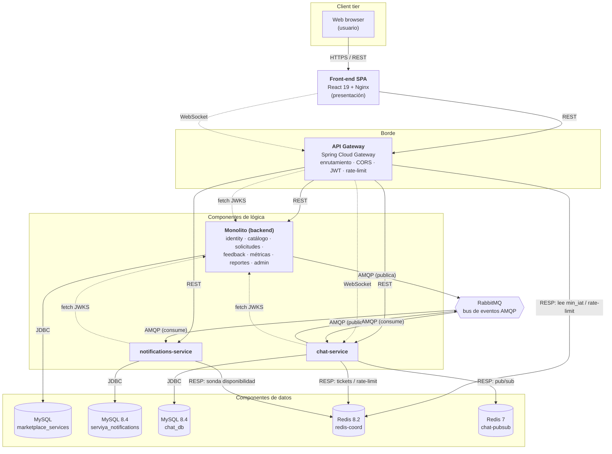
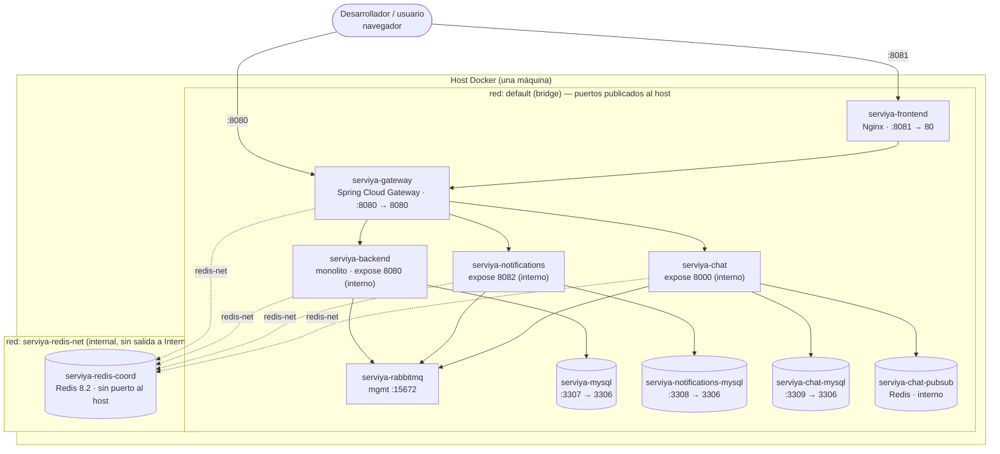
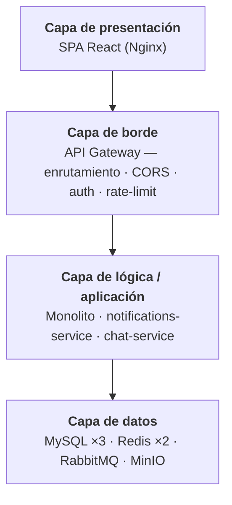
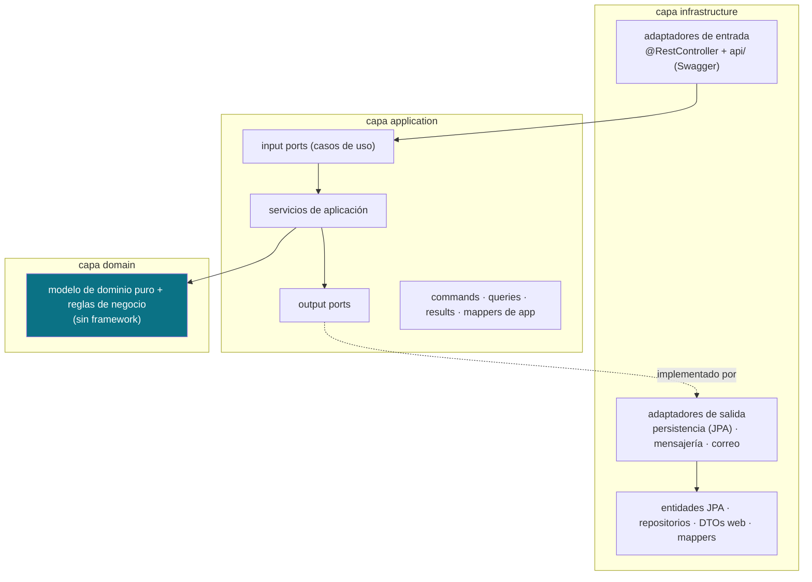
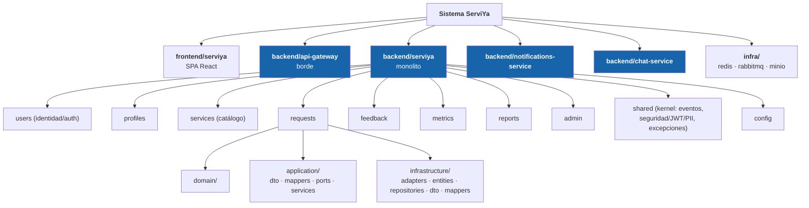

# Prototype 2 — Concrete Architectural Structures

> **Software Architecture 2026-II — Universidad Nacional de Colombia**
> Entrega 2 (Prototype 2). Documentación de las estructuras arquitectónicas concretas del sistema y
> prototipo desplegable localmente.

---

## 1. Team

- **Name:** Grupo E
- **Members:**
  - Juan José Sánchez Mora — [@Juanjo3465](https://github.com/Juanjo3465)
  - Cristian David Arcia Quintero — [@carciaq](https://github.com/carciaq)
  - Fabián Andrés Rozo Rodríguez — [@RzRz-dev](https://github.com/RzRz-dev)
  - Ana Sofía Rodríguez Neira — [@sofi1003](https://github.com/sofi1003)

---

## 2. Software System

- **Name:** ServiYa

- **Logo:**

  

- **Description:**

  **ServiYa** es un **marketplace de servicios a domicilio**: conecta a **clientes** que necesitan un
  servicio con **oferentes** que lo prestan en una dirección dada. Cubre el ciclo completo de una
  contratación — perfiles de oferentes y catálogo de servicios, búsqueda, el flujo de solicitudes
  (aceptación, reprogramación, finalización), feedback bidireccional (calificaciones + reseñas),
  métricas de reputación, reportes y moderación de contenido, un back office de administración,
  notificaciones asíncronas (en-app + correo) y **chat en tiempo real** entre las dos partes de una
  solicitud.

  El sistema es una **aplicación distribuida** orquestada con Docker Compose. Nació como un monolito
  modular y se está **descomponiendo incrementalmente en microservicios detrás de un API gateway**
  (patrón *Strangler Fig*). A la fecha de este prototipo, dos capacidades ya se extrajeron a servicios
  independientes con su propia base de datos — **notificaciones** y **chat** —, mientras el resto de las
  capacidades de negocio siguen en un único backend endurecido ("el monolito"). **Toda** petición HTTP
  entra por un único borde (el **API gateway**), que concentra enrutamiento, CORS, autenticación (JWT
  ES256 verificado contra un JWKS) y rate limiting.

  Los datos personales sensibles (documento, teléfono, dirección) se almacenan **cifrados
  (AES-256-GCM)**; los access tokens se firman con **ES256** (clave asimétrica, verificable por JWKS).

  **Tecnología (resumen)**

  | Preocupación | Tecnología |
  |--------------|-----------|
  | Front-end (presentación) | React 19 + Vite (JavaScript), servido por Nginx |
  | API gateway (borde) | Spring Cloud Gateway (Spring WebFlux, reactivo), Java 21 |
  | Servicios de lógica | Spring Boot 3.5.5, Java 21 (arquitectura hexagonal) |
  | Datos relacionales | MySQL 8.4 (una base de datos **por** servicio) |
  | Coordinación / caché (NoSQL) | Redis 8.2 (coordinación), Redis 7 (pub/sub del chat) |
  | Mensajería | RabbitMQ 4.1 (bus de eventos AMQP) |
  | Almacenamiento de objetos (opcional) | MinIO (compatible S3, adjuntos del chat) |
  | Seguridad | JWT ES256 + JWKS, AES-256-GCM para PII, rotación de refresh token |
  | Despliegue | Docker / Docker Compose (orientado a contenedores) |

  **Lenguajes de programación:** Java (todos los servicios backend) y JavaScript (front-end) — dos
  lenguajes de propósito general distintos.

---

## 3. Architectural Structures

Se documentan cuatro estructuras, cada una con su vista, sus elementos y relaciones, y los estilos y
patrones arquitectónicos que la sustentan.

### 3.1. Component-and-Connector (C&C) Structure

La vista C&C muestra el sistema **en ejecución**: los componentes que corren y los conectores por los
que interactúan.

#### C&C View



#### Descripción de elementos y relaciones

**Componentes**

| Componente | Tipo | Responsabilidad |
|------------|------|-----------------|
| **Front-end SPA** | Presentación | SPA React 19 (construida con Vite, servida por Nginx). Renderiza toda la UI; guarda el access token en memoria y el refresh token en una cookie HttpOnly. |
| **API Gateway** | Lógica (borde) | **Único punto de entrada HTTP público**. Enrutamiento por path a los servicios, CORS centralizado, verificación de JWT ES256 (vía JWKS) con chequeo de revocación `min_iat`, rate limiting global + de auth por IP, inyección de correlation-id y normalización de errores. |
| **Monolito (`backend`)** | Lógica | El núcleo aún monolítico: `users` (identidad/auth — **emite** los tokens ES256 y **sirve el JWKS**), `profiles`, `services` (catálogo), `requests`, `feedback`, `metrics`, `reports`, `admin`. Publica eventos al bus mediante un **outbox** transaccional. |
| **notifications-service** | Lógica | Microservicio independiente: consume eventos de RabbitMQ, persiste una bandeja en-app, envía correo (Brevo) y reintenta los fallidos de forma programada. Expone su REST **solo a través del gateway**. |
| **chat-service** | Lógica | Microservicio independiente: chat 1-a-1 en tiempo real para una solicitud, sobre WebSocket; persiste mensajes, los difunde entre instancias vía Redis Pub/Sub y publica eventos de chat al bus. |
| **MySQL × 3** | Datos (relacional) | **Base de datos por servicio**: `marketplace_services` (monolito), `serviya_notifications`, `chat_db`. Ningún servicio lee la base de otro. |
| **redis-coord** | Datos (NoSQL, clave-valor) | Sustrato de **coordinación** compartido: marca de revocación de tokens (`min_iat`), contadores de rate limiting distribuido y locks de los `@Scheduled`. Usuarios ACL por servicio. Solo alcanzable en la red interna. |
| **chat-pubsub** | Datos (NoSQL, clave-valor) | Redis **Pub/Sub** efímero, solo para difundir mensajes de chat entre instancias del chat-service. Sin persistencia. |
| **RabbitMQ** | Infra de conector | El **bus de eventos** asíncrono entre servicios. |
| **MinIO** *(opcional)* | Datos (object store) | Almacenamiento compatible S3 para adjuntos del chat (perfil `minio` de Compose). |

**Conectores** (el prototipo usa varios *tipos* de conector, entre ellos dos distintos basados en HTTP):

| Conector | Tipo | Dónde se usa |
|----------|------|--------------|
| **REST sobre HTTP** | Petición/respuesta síncrona (HTTP) | navegador → gateway → cada servicio |
| **WebSocket** | Full-duplex en streaming (upgrade HTTP) | navegador → gateway → chat-service (chat en vivo) |
| **AMQP** | Mensajería asíncrona publish/subscribe | monolito/chat → RabbitMQ → notificaciones/chat |
| **JDBC** | Protocolo de base de datos | cada servicio → su propio MySQL |
| **RESP (protocolo Redis)** | Clave-valor / pub-sub | servicios → redis-coord y chat-pubsub |

**Relaciones clave**

- Todo lo que mira al cliente cruza el **gateway**; el monolito y los servicios extraídos **no se
  publican al host** — solo son alcanzables en la red interna de Docker.
- La autenticación está **desacoplada de la identidad**: el monolito es el único **emisor de tokens** y
  el único que tiene la clave privada de firma; el gateway y los demás servicios son **resource
  servers** que verifican tokens obteniendo las claves públicas del emisor (**JWKS**) por la red
  interna. No hay secreto simétrico compartido.
- Los flujos cross-servicio (p. ej. "notificar al usuario") son **asíncronos y desacoplados** vía el
  bus, de modo que un notifications-service lento o caído nunca bloquea una transacción de negocio (el
  outbox lo amortigua).

#### Estilos y patrones arquitectónicos

- **Cliente–Servidor** — navegador/SPA contra servicios de servidor.
- **API Gateway** (borde / punto de entrada único) — enrutamiento, seguridad transversal y CORS en un
  solo lugar.
- **Microservicios + Strangler Fig** — servicios desplegables de forma independiente (`notifications`,
  `chat`) extraídos de un monolito modular que se estrangula progresivamente.
- **Database per Service** (datos *shared-nothing*) — cada servicio es dueño de su esquema; sin acceso
  cruzado a bases de datos.
- **Publish–Subscribe / Event-Driven** — RabbitMQ desacopla productores de consumidores.
- **Transactional Outbox** — el monolito publica eventos de forma atómica con su transacción local.
- **Seguridad basada en tokens con identidad externa (JWT + JWKS)** — patrón resource-server; firmas
  asimétricas (ES256), rotación de claves y revocación por `min_iat`.
- **Sustrato de coordinación tipo sidecar** — Redis como primitiva compartida para rate limiting y
  locks.

---

### 3.2. Deployment Structure

La vista de despliegue mapea los componentes de ejecución sobre **nodos** — aquí, contenedores Docker
en una sola máquina, conectados por dos redes Docker — y muestra los puertos publicados.

#### Deployment View



#### Descripción de elementos y relaciones

- **Nodos = contenedores.** Cada componente lógico corre en su propio contenedor Docker con un
  `container_name` fijo; las imágenes se construyen del repo (`gateway`, `backend`,
  `notifications-service`, `chat-service`, `frontend`) o se descargan (`mysql`, `redis`, `rabbitmq`,
  `minio`).
- **Dos redes.**
  - `default` (bridge) lleva el tráfico este-oeste normal y los pocos puertos **publicados al host**.
  - `serviya-redis-net` se declara **`internal: true`** (sin ruta a Internet); solo circula aquí el
    tráfico de coordinación a `redis-coord`, por eso `redis-coord` **no tiene puerto al host**.
- **Puertos publicados (host → contenedor).** `frontend` `8081→80`, `gateway` `8080→8080`, consola
  `rabbitmq` `15672`, y las tres instancias MySQL en `3307/3308/3309` (solo para depuración). El
  monolito (`8080`), notificaciones (`8082`) y chat (`8000`) son **`expose`-only** — inaccesibles desde
  el host, solo vía el gateway. Los endpoints de gestión/métricas corren en un **puerto separado y no
  publicado** (`9090`).
- **Orden de arranque y resiliencia.** `depends_on` + health checks ordenan el boot (los servicios
  esperan a que su MySQL/RabbitMQ esté sano); `restart: on-failure` cubre la carrera en que MySQL pasa
  su health check de socket antes de aceptar TCP. Los servicios toleran un `redis-coord` ausente al
  arrancar (conexión perezosa, fail-open).
- **El estado vive en volúmenes nombrados** (`mysql_data`, `notifications_mysql_data`,
  `chat_mysql_data`, `rabbitmq_data`, `redis-coord-data`, `minio_data`), de modo que reiniciar un
  contenedor conserva sus datos; borrar un volumen re-siembra desde cero.
- **El aprovisionamiento del esquema** difiere por nodo: el MySQL del monolito se siembra desde SQL
  montado en volumen limpio; `notifications` y `chat` corren **Flyway** al arrancar el servicio.

#### Patrones arquitectónicos usados

- **Despliegue orientado a contenedores / multi-contenedor** orquestado por **Docker Compose**.
- **Database per Service** materializado como tres contenedores de base de datos separados.
- **Segmentación de red** — una red **interna** dedicada aísla el sustrato de coordinación.
- **Arranque condicionado por health checks** y **reinicio supervisado** para orden y auto-recuperación.
- **Configuración y secretos externalizados** vía variables de entorno / `.env` (estilo 12-factor).
- **Exposición por un solo borde** — solo el gateway (y el front-end estático) son alcanzables desde
  fuera.

---

### 3.3. Layered Structure

Coexisten dos estratificaciones complementarias: una **a nivel de sistema** a lo largo del sistema
distribuido, y la **hexagonal por servicio** dentro de cada servicio Java.

#### Layered View

**(a) Capas a nivel de sistema**



**(b) Capas hexagonales por servicio (ports & adapters), p. ej. dentro del monolito**



#### Descripción de elementos y relaciones

- **Las capas del sistema** están estrictamente ordenadas: presentación habla solo con el borde; el
  borde es la única capa que se abre hacia la de lógica; cada servicio de lógica habla solo con **su**
  porción de la capa de datos. **No hay salto de capas** del navegador a un servicio o a una base.
- **Dentro de cada servicio**, la regla de dependencia apunta hacia adentro:
  `infrastructure → application → domain`.
  - **domain** — modelo y reglas de negocio puros, sin dependencias de framework.
  - **application** — interfaces de caso de uso (**input ports**), servicios de aplicación y **output
    ports** (interfaces que el dominio necesita que el exterior cumpla, p. ej. persistencia). Los DTOs
    aquí son `Command`/`Query`/`Result`.
  - **infrastructure** — controllers REST (adaptadores de entrada), adaptadores de salida de
    persistencia/mensajería/correo, entidades JPA, repositorios y DTOs web (`Form`/`Response`). Los
    controllers y adaptadores dependen de **ports**, nunca entre sí.
- El dominio nunca importa Spring; los adaptadores son reemplazables sin tocar la lógica de negocio —
  las interfaces de puerto son las costuras por las que el monolito se va partiendo en servicios.

#### Patrones arquitectónicos usados

- **Arquitectura por capas (N-tier)** a escala de sistema (presentación / borde / lógica / datos).
- **Arquitectura hexagonal (Ports & Adapters)** dentro de cada servicio, reforzando la regla de
  dependencia hacia adentro y aislando el dominio.
- **DTO / mapping por capa** (MapStruct) para desacoplar los modelos web, de aplicación y de dominio.
- **Lecturas estilo CQRS** — read-models/queries dedicados para vistas de lista y detalle.

---

### 3.4. Decomposition Structure

La vista de descomposición muestra cómo el sistema se divide en **unidades de implementación**
(módulos), de forma recursiva e independiente del tiempo de ejecución.

#### Decomposition View



#### Descripción de elementos y relaciones

- **Nivel superior** — el monorepo se descompone en cinco unidades desplegables (front-end, gateway,
  monolito, notifications-service, chat-service) más una unidad **`infra/`** que contiene las
  definiciones de infraestructura compartida (fragmentos Compose de Redis, RabbitMQ, MinIO, ACLs).
- **El monolito** se descompone en **9 módulos de negocio** (`users`, `profiles`, `services`,
  `requests`, `feedback`, `metrics`, `reports`, `admin`) más un kernel **`shared`** (eventos de
  aplicación, seguridad/JWT/PII, excepciones + handlers, filtrado de texto, stats) y `config`. `admin`
  es un orquestador sin persistencia propia. El front-end espeja esta estructura de módulos bajo
  `src/modules/`.
- **Cada módulo** se descompone de nuevo en los tres paquetes hexagonales — `domain/`, `application/`
  (`dto`, `mappers`, `ports/input`, `ports/output`, `services`) e `infrastructure/` (`adapters/input`,
  `adapters/output`, `entities`, `repositories`, `dto`, `mappers`). El diagrama expande `requests` como
  ejemplo representativo.
- **Las relaciones de uso** entre módulos son deliberadas e informan el orden de migración: un clúster
  fuertemente acoplado (`profiles ↔ services ↔ {metrics, feedback}`) se piensa mover como una unidad de
  grano grueso, mientras los módulos hoja (notificaciones, luego métricas, …) se extraen primero —
  `notifications` y `chat` ya lo están.

> **Estilos/patrones** a este nivel: **descomposición modular por capacidad de negocio (vertical
> slices)**, un módulo **shared-kernel** para preocupaciones transversales, y alineación de las unidades
> de descomposición con las futuras unidades de despliegue (cada módulo es candidato a microservicio).

---

## 4. Prototype — Instrucciones de despliegue local

Todo el sistema corre con **Docker** y **Docker Compose**; no se necesita JDK/Node local para
ejecutarlo. Esta carpeta es **autocontenida**: incluye el código fuente de todos los servicios, por lo
que `docker compose … up --build` construye y levanta el sistema completo.

### Requisitos previos

- **Docker** y **Docker Compose v2** (`docker compose …`).
- Una shell POSIX para el paso único de ACL de Redis (Git Bash en Windows, o WSL).

### Paso 1 — Configurar variables de entorno

Desde la raíz de esta carpeta, crea un `.env` a partir de la plantilla y completa los secretos:

```bash
cp .env.example .env
```

La aplicación **falla rápido** si faltan secretos críticos o son débiles. Como mínimo configura, en
`.env`:

- **Contraseñas de base de datos:** `DB_PASSWORD`, `MYSQL_ROOT_PASSWORD`, `NOTIFICATIONS_DB_PASSWORD`,
  `NOTIFICATIONS_MYSQL_ROOT_PASSWORD`, `CHAT_DB_PASSWORD`, `CHAT_DB_ROOT_PASSWORD`.
- **Par de claves JWT ES256** (`JWT_PRIVATE_KEY`, `JWT_PUBLIC_KEY`) — base64 del DER, generado con
  OpenSSL (los comandos están documentados en `.env.example`):

  ```bash
  openssl ecparam -name prime256v1 -genkey -noout -out ec-priv.pem
  openssl pkcs8 -topk8 -nocrypt -in ec-priv.pem -out ec-priv-pkcs8.pem
  # JWT_PRIVATE_KEY = base64 del DER:
  grep -v -- ----- ec-priv-pkcs8.pem | tr -d '\n'
  openssl ec -in ec-priv.pem -pubout -out ec-pub.pem
  # JWT_PUBLIC_KEY = base64 del DER:
  grep -v -- ----- ec-pub.pem | tr -d '\n'
  ```

- **Claves de cifrado / compartidas** (≥ 32 chars aleatorios cada una): `ENCRYPTION_KEY`,
  `NOTIFICATIONS_PAYLOAD_KEY` (debe ser idéntica en el monolito y notificaciones),
  `NOTIFICATIONS_ENCRYPTION_KEY`.
- **RabbitMQ:** `RABBITMQ_PASSWORD`, `CHAT_RABBITMQ_PASSWORD`.
- El correo está **apagado por defecto** (`EMAIL_ENABLED=false`); déjalo así para correr sin cuenta
  Brevo.
- Las contraseñas `REDIS_*` ya traen valores de desarrollo que funcionan en `.env.example`.

### Paso 2 — Renderizar el ACL de coordinación de Redis (una vez)

```bash
cd infra/redis/acl
./render-acl.sh users.coord.acl.tpl users.coord.acl
cd ../../..
```

### Paso 3 — Construir y levantar todo el stack

El Redis de coordinación vive en un Compose separado que debe **fusionarse** con el raíz:

```bash
docker compose \
  -f docker-compose.yml \
  -f infra/redis/docker-compose.redis.yml \
  up --build
```

> Para correr el stack base **sin** el sustrato de coordinación (funcional, con rate-limiting/locks
> degradados a fail-open) puedes usar solo `docker compose up --build`. El comando fusionado de arriba
> es el montaje recomendado y completo.

El primer arranque tarda unos minutos (builds de Maven + inicialización de MySQL). Los servicios con
`restart: on-failure` pueden reiniciarse una o dos veces mientras sus bases quedan listas — es
esperado.

### Paso 4 — Acceder al sistema

| Superficie | URL |
|------------|-----|
| **Aplicación web** (front-end) | <http://localhost:8081> |
| **API gateway** (todo `/api/**`) | <http://localhost:8080> |
| Consola de gestión de RabbitMQ | <http://localhost:15672> |

Crea una cuenta nueva desde la UI web (los usuarios semilla tienen contraseñas de relleno). Todo el
tráfico de API — incluido el chat por WebSocket — pasa por el gateway en `:8080`.

### Opcional — adjuntos del chat (MinIO)

```bash
docker compose --profile minio up -d minio minio-init
```

### Reiniciar a un estado limpio

Detén y elimina contenedores **y volúmenes** para re-sembrar todas las bases desde cero:

```bash
docker compose -f docker-compose.yml -f infra/redis/docker-compose.redis.yml down -v
```

---

### Estructura de esta carpeta

```
g3-E-serviya/
├── README.md                     # este artefacto (Prototipo 2)
├── assets/logo.svg               # logo del sistema
├── docker-compose.yml            # stack completo (gateway, monolito, notif, chat, datos, bus)
├── docker-compose.dev.yml        # overrides de desarrollo (hot-reload)
├── .env.example                  # plantilla de configuración/secretos
├── backend/
│   ├── api-gateway/              # borde (Spring Cloud Gateway)
│   ├── serviya/                  # monolito (hexagonal por módulo)
│   ├── notifications-service/    # microservicio de notificaciones
│   └── chat-service/             # microservicio de chat (WebSocket)
├── frontend/serviya/             # SPA React 19 + Vite
├── mysql/                        # SQL de bootstrap del monolito
├── infra/                        # redis (coord + ACL) · rabbitmq · minio
└── redis-scripts/                # scripts Lua de coordinación (referencia)
```
