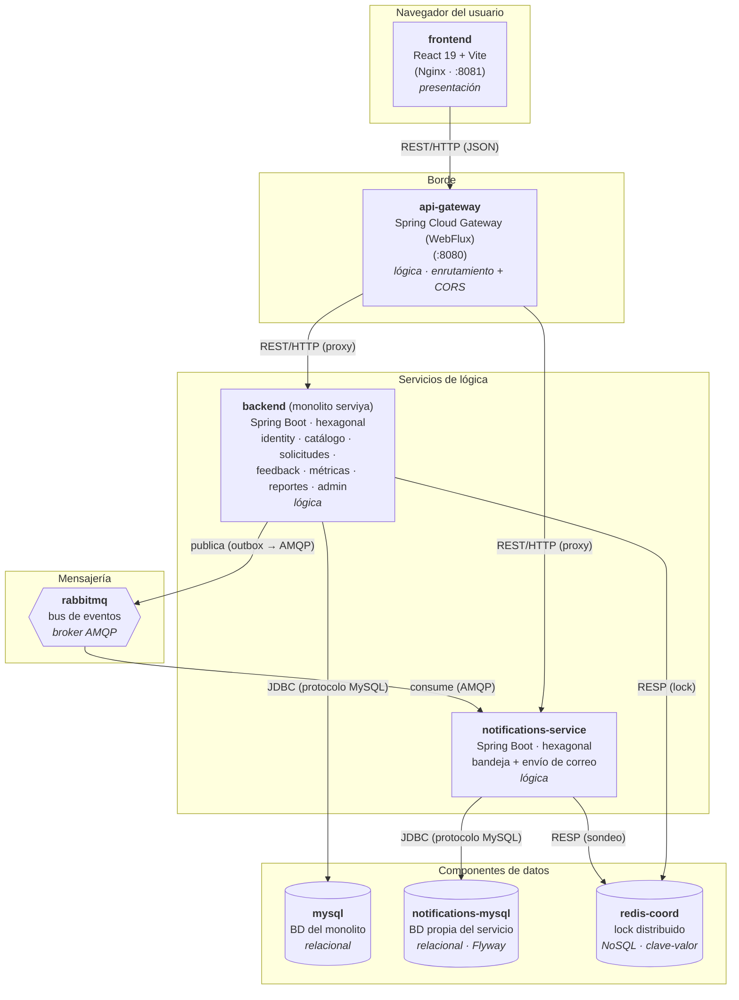

# Prototype 1 — Simple Architectural Structure

> **Software Architecture 2025-II — Universidad Nacional de Colombia**
> Entrega 1 (Prototype 1). Prototipo vertical de un sistema de software distribuido basado en un
> diseño arquitectónico inicial.

---

## 1. Team

- **Name:** Grupo E
- **Members:**
  - Juan José Sánchez Mora — [@Juanjo3465](https://github.com/Juanjo3465)
  - Cristian David Arcia Quintero — [@carciaq](https://github.com/carciaq)
  - Fabián Andrés Rozo Rodríguez — [@RzRz-dev](https://github.com/RzRz-dev)
  - Ana Sofía Rodríguez Neira — [@sofi1003](https://github.com/sofi1003)

---

## 2. Software System

- **Name:** ServiYa
- **Logo:**

  

- **Description:**

  ServiYa es un **marketplace de servicios a domicilio**: conecta a **clientes** que necesitan un
  servicio con **oferentes** que lo prestan. Cubre el ciclo completo de una contratación — registro y
  autenticación de usuarios, gestión de perfiles, publicación y búsqueda de servicios por categoría y
  ubicación, solicitudes de servicio con negociación de fecha (re-agendamiento), calificaciones y
  reseñas (feedback), métricas de desempeño, reportes/moderación y notificaciones (en-app y correo).

  Los datos personales sensibles (documento, teléfono, dirección) se almacenan **cifrados
  (AES-256-GCM)** y la autenticación es por **JWT (HS256)**.

---

## 3. Architectural Structures

### 3.1. Component-and-Connector (C&C) Structure

#### C&C View



**Puertos expuestos al host:** gateway `:8080` (único punto de entrada HTTP), frontend `:8081`,
mysql `:3307`, notifications-mysql `:3308`, consola de RabbitMQ `:15672`. El monolito y el
notifications-service **no** se publican al host: se accede a ellos a través del gateway.

#### Architectural styles used

- **Arquitectura distribuida orientada a servicios (microservicios en formación).** El sistema está
  compuesto por servicios desplegables de forma independiente (gateway, monolito, notifications-service),
  cada uno en su propio contenedor. El `notifications-service` es el primer servicio **extraído** del
  monolito.
- **API Gateway.** Un único punto de entrada en el borde (`api-gateway`) enruta las peticiones hacia el
  servicio correspondiente y **centraliza la política de CORS**, de modo que los servicios internos no
  quedan expuestos directamente ni duplican esa lógica.
- **Database-per-service.** Cada servicio es dueño de sus datos: el monolito usa `mysql` y el
  `notifications-service` su propia `notifications-mysql` (gestionada con Flyway). No comparten esquema.
- **Event-driven / publish-subscribe con Transactional Outbox.** La comunicación entre el monolito y el
  `notifications-service` es **asíncrona** vía RabbitMQ. El monolito persiste el evento en una tabla
  _outbox_ dentro de la misma transacción de negocio y un _relay_ programado lo publica al bus; el
  servicio lo consume (`@RabbitListener`). Esto desacopla los servicios y tolera caídas del bus sin
  perder notificaciones.
- **Arquitectura hexagonal (ports & adapters)** dentro de cada servicio Java: el dominio es
  independiente del framework y las dependencias apuntan hacia adentro (`infrastructure → application →
  domain`).
- **Coordinación mediante lock distribuido.** Las tareas programadas (`@Scheduled`) se serializan con un
  lock en `redis-coord` para que, con varias réplicas, solo una ejecute cada tarea.

#### Architectural elements and relations

**Componentes de presentación**

| Componente | Tecnología | Responsabilidad |
|---|---|---|
| `frontend` | React 19 + Vite, servido por Nginx | SPA: todas las pantallas del marketplace. Consume la API a través del gateway. |

**Componentes de lógica**

| Componente | Tecnología | Responsabilidad |
|---|---|---|
| `api-gateway` | Spring Cloud Gateway (reactivo, Netty/WebFlux) | Punto de entrada HTTP único (:8080). Enruta `/api/v1/notifications/**` y `/api/v1/notification-channels` al `notifications-service` y el resto al monolito. CORS centralizado. |
| `backend` (monolito `serviya`) | Spring Boot (Java), hexagonal por módulo | Núcleo del negocio: identity/auth, perfiles, catálogo de servicios, solicitudes y re-agendamiento, feedback, métricas, reportes/moderación y administración. |
| `notifications-service` | Spring Boot (Java), hexagonal | Microservicio de notificaciones: bandeja (REST), consumo de eventos (AMQP) y envío de correo. BD propia. |

**Componentes de datos**

| Componente | Tecnología | Tipo | Responsabilidad |
|---|---|---|---|
| `mysql` | MySQL | Relacional | Persistencia del monolito. |
| `notifications-mysql` | MySQL 8.4 | Relacional | Persistencia propia del `notifications-service` (migraciones con Flyway). |
| `redis-coord` | Redis 8.2 | NoSQL (clave-valor) | Sustrato de coordinación: lock distribuido para las tareas `@Scheduled`. |
| `rabbitmq` | RabbitMQ | Broker de mensajería | Bus de eventos entre el monolito y el `notifications-service`. |

**Conectores (relaciones entre componentes)**

| # | Conector | Entre | Tipo |
|---|---|---|---|
| 1 | **REST/HTTP (JSON)** | `frontend` → `api-gateway` → (`backend`, `notifications-service`) | HTTP síncrono petición/respuesta |
| 2 | **AMQP** | `backend` → `rabbitmq` → `notifications-service` | Mensajería asíncrona (pub/sub, outbox) |
| 3 | **JDBC (protocolo MySQL)** | `backend` → `mysql`; `notifications-service` → `notifications-mysql` | Acceso a datos relacional |
| 4 | **RESP (protocolo Redis)** | `backend`, `notifications-service` → `redis-coord` | Coordinación clave-valor |

**Cumplimiento de los requisitos no funcionales de la entrega**

| Requisito | Cómo se cumple |
|---|---|
| Arquitectura distribuida | Varios servicios en contenedores separados, comunicados por red. |
| ≥1 componente de presentación | `frontend` (React). |
| ≥2 componentes de lógica | `api-gateway`, `backend`, `notifications-service` (3). |
| ≥2 componentes de datos (relacional + NoSQL) | `mysql` / `notifications-mysql` (relacional) + `redis-coord` (NoSQL). |
| ≥2 tipos de conectores HTTP | REST/HTTP + (ampliado) AMQP, JDBC, RESP. |
| ≥2 lenguajes de propósito general | Java (backend/gateway/notificaciones) + JavaScript (frontend). |
| Despliegue orientado a contenedores | `docker compose` orquesta todos los componentes. |

---

## 4. Prototype — Instrucciones de despliegue local

### 4.1. Requisitos previos

- **Docker** y **Docker Compose** (v2) instalados y en ejecución.
- Puertos libres en el host: `8080`, `8081`, `3307`, `3308`, `15672`.

### 4.2. Configuración (`.env`)

Desde esta carpeta del prototipo (`project/prototype_1/e/`), copiar el `.env.example` a `.env` y
rellenar los secretos (no usar los valores de ejemplo; varios servicios **fallan al arrancar** con
claves vacías, de ejemplo o de menos de 32 caracteres):

```bash
cp .env.example .env
```

Variables obligatorias: `DB_NAME`, `DB_USER`, `DB_PASSWORD`, `DB_URL`, `MYSQL_ROOT_PASSWORD`,
`JWT_SECRET`, `JWT_EXPIRATION_MS`, `ENCRYPTION_KEY`, `RABBITMQ_USER`, `RABBITMQ_PASSWORD`,
`NOTIFICATIONS_PAYLOAD_KEY` (debe ser **idéntica** en monolito y servicio),
`NOTIFICATIONS_ENCRYPTION_KEY`, `NOTIFICATIONS_DB_PASSWORD`, `NOTIFICATIONS_MYSQL_ROOT_PASSWORD`.

### 4.3. Levantar el sistema (stack base)

Desde esta carpeta del prototipo (`project/prototype_1/e/`):

```bash
docker compose up --build
```

Esto construye y arranca: `api-gateway`, `backend`, `notifications-service`, `mysql`,
`notifications-mysql`, `rabbitmq` y `frontend`. El esquema del monolito se crea en el primer arranque
(volumen limpio) desde `mysql/create_database.sql`; el del servicio de notificaciones lo aplica Flyway.

### 4.4. (Opcional) Incluir Redis — componente NoSQL de coordinación

`redis-coord` vive en un compose propio que se **fusiona** con el raíz. Antes del primer arranque hay
que generar su ACL:

```bash
(cd infra/redis/acl && ./render-acl.sh users.coord.acl.tpl users.coord.acl)
docker compose -f docker-compose.yml -f infra/redis/docker-compose.redis.yml up --build
```

> El sistema **tolera** que Redis no esté presente (las tareas programadas se ejecutan sin lock
> distribuido), pero para demostrar el componente NoSQL se levanta con este overlay.

### 4.5. Verificación / puntos de acceso

| Servicio | URL |
|---|---|
| Frontend (SPA) | http://localhost:8081 |
| API (vía gateway) | http://localhost:8080/api/v1/... |
| Health del gateway | http://localhost:8080/gateway-actuator/health |
| Swagger del monolito | http://localhost:8080/swagger-ui.html |
| Consola de RabbitMQ | http://localhost:15672 |

### 4.6. Apagar

```bash
docker compose -f docker-compose.yml -f infra/redis/docker-compose.redis.yml down        # detener
docker compose -f docker-compose.yml -f infra/redis/docker-compose.redis.yml down -v      # + borrar datos
```
