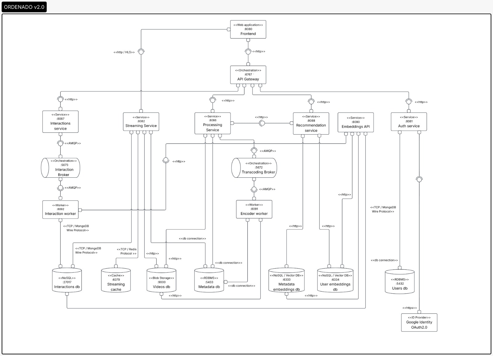
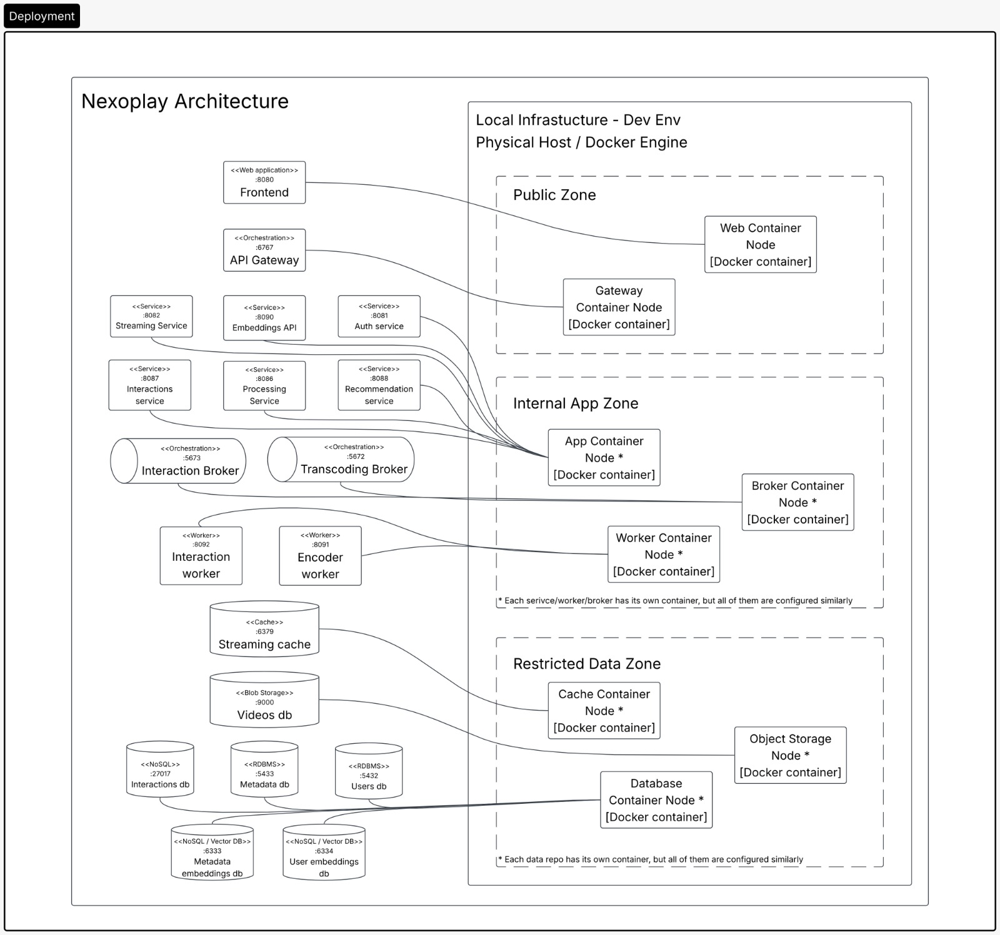
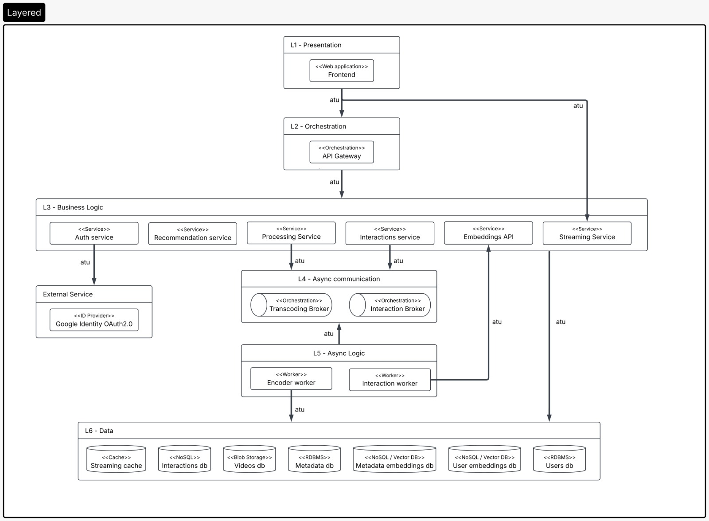
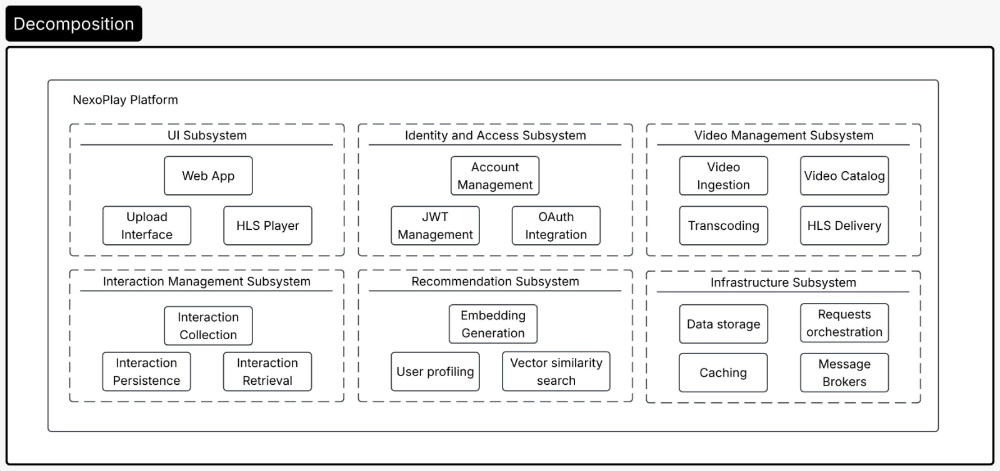

# 3. Delivery

## 3.1. Artifact


### Team

**Grupo F - Nexo play**

#### Full names of the team members

| Integrante | Frente de referencia |
| --- | --- |
| Cristian Steven Motta Ojeda | Interactions Service e Interaction Worker |
| Juan Jose Martin | Integración y despliegue, en coordinación con el equipo |
| Camilo Andrés Medina Sánchez | Embeddings API y perfiles vectoriales |
| Nicolas Andrés Bolaños Fernandez | Recommendation Service y personalización |

### Software System

#### Name

**NexoPlay**

#### Logo


#### Description

NexoPlay es una plataforma académica de video bajo demanda desarrollada para Arquitectura de Software, Universidad Nacional de Colombia, Bogotá, 2026-II. Integra registro e inicio de sesión, carga y administración de videos, procesamiento asíncrono, reproducción HLS, interacciones y recomendaciones basadas en perfiles vectoriales.

El alcance de MVP1 cubre publicación y reproducción. La ampliación de MVP2 incorpora likes, comentarios, eventos de reproducción, embeddings de metadatos y personalización.

El producto permite publicar contenido y recuperarlo para reproducción, y añade una ruta de descubrimiento basada en intereses del usuario. La personalización se apoya en metadatos e interacciones; no analiza imágenes o audio ni existe una medición de satisfacción de usuarios reales.

**Alcance de la entrega**

- Acceso de usuarios y administración de videos propios.
- Procesamiento asíncrono, catálogo, miniaturas y reproducción HLS.
- Reproducciones registradas al comenzar, likes, retiros y comentarios.
- Vectores de videos y perfiles normalizados, con pesos iniciales 1/3/2.
- Actualización tras diez eventos nuevos desde la última confirmación, sobre el historial agregado completo.
- Recomendaciones y respaldo al catálogo general, con interfaz «For you».

### Architectural Structures

#### Component-and Connector (C&C) Structure

##### C&C View



##### Description of architectural elements and relations

| Componente | Responsabilidad y relación |
| --- | --- |
| Frontend (`frontend`) | Presenta acceso, carga, catálogo, reproductor e interacciones. Consulta el API Gateway y recibe HLS directamente de Streaming. |
| API Gateway (`api-gateway`) | Verifica la identidad y dirige solicitudes HTTP a Auth, Processing, Interactions y Recommendation. |
| Auth Service (`auth-service`) | Gestiona registro e inicio de sesión, conserva cuentas en Users DB y se integra con Google cuando se habilita OAuth. |
| Processing Service (`processing-service`) | Guarda metadatos en Metadata DB y originales en Videos DB. Registra trabajos de transcodificación y envía una copia de los metadatos a Embeddings. |
| Job Dispatcher (`job-dispatcher`) | Recupera trabajos pendientes de Metadata DB, los publica en el canal de transcodificación y recupera trabajos cuyo plazo de ejecución venció. |
| Encoder Worker (`encoder-worker`) | Consume trabajos de transcodificación, genera HLS y miniaturas con FFmpeg, guarda archivos en Videos DB y actualiza el estado en Metadata DB. |
| Embeddings Dispatcher (`embeddings-dispatcher`) | Recupera de Metadata DB las notificaciones pendientes y reintenta su entrega HTTP a Embeddings. |
| Streaming Service (`streaming-service`) | Consulta Metadata DB para servir el catálogo, recupera HLS y miniaturas de Videos DB y utiliza Streaming Cache para las listas de reproducción. |
| Interactions Service (`interactions-service`) | Recibe reproducciones, likes y comentarios, valida el video en Metadata DB y publica eventos en Interaction Broker. Consulta Interactions DB para mostrar likes y comentarios. |
| Interaction Worker (`interaction-worker`) | Consume eventos, los conserva en Interactions DB y envía a Embeddings el resumen acumulado del usuario al completar diez eventos nuevos desde la última actualización confirmada. |
| Embeddings API (`embeddings-service`) | Genera vectores de videos y perfiles de usuarios, los guarda en Qdrant y conserva estado de recuperación en diarios SQLite locales. Recibe metadatos de Processing y resúmenes del Interaction Worker. |
| Recommendation Service (`recommendation-service`) | Consulta los vectores de usuario y video en Qdrant, verifica disponibilidad en Metadata DB y devuelve recomendaciones ordenadas al Gateway. |
| Transcoding Broker | Canal de RabbitMQ que entrega trabajos al Encoder Worker. Comparte el servidor `transcoding-broker` con el canal de interacciones. |
| Interaction Broker | Canal de RabbitMQ que entrega eventos de Interactions Service al Interaction Worker, mediante exchanges y colas separados del flujo de transcodificación. |
| Metadata DB (`metadataba-db`) | PostgreSQL para metadatos, estados de procesamiento, trabajos y notificaciones pendientes de embeddings. Lo utilizan Processing, dispatchers, Encoder, Streaming, Interactions y Recommendation. |
| Users DB (`users-db`) | PostgreSQL para cuentas y credenciales, utilizado por Auth Service. |
| Videos DB (`videos-db`) | MinIO para originales, segmentos HLS y miniaturas. Processing y Encoder escriben objetos; Streaming los recupera para entregarlos al navegador. |
| Streaming Cache (`redis`) | Conserva listas de reproducción en caché para reducir lecturas repetidas desde Streaming. |
| Interactions DB (`interactions-db`) | MongoDB para eventos, likes, comentarios y estado de actualización de perfiles. El Worker persiste la actividad y el servicio de interacciones consulta sus resultados. |
| Metadata Embeddings DB (`video_embeddings`) | Colección de Qdrant que asocia cada UUID de video con su vector y datos adicionales. Embeddings la actualiza y Recommendation la consulta. |
| User Embeddings DB (`user_embeddings`) | Colección de Qdrant con los perfiles vectoriales de usuarios. Embeddings la actualiza y Recommendation la consulta; comparte la instancia `qdrant` y el endpoint REST con `video_embeddings`. |
| Google Identity | Proveedor externo de identidad que se comunica con Auth Service mediante OAuth 2.0 cuando se habilita el acceso con Google. |


##### Description of architectural styles and patterns used

- **Microservicios:** responsabilidades diferenciadas y contenedores por servicio.
- **Cliente-servidor y Gateway:** la interfaz solicita operaciones a los servicios mediante entradas definidas.
- **Procesamiento por eventos:** el trabajo de videos e interacciones se desacopla mediante colas.

Estas decisiones soportan la operación prevista; su aceptación conjunta sigue requiriendo una demostración.

#### Deployment Structure

##### Deployment View



##### Description of architectural elements and relations

La propuesta sitúa el sistema en una máquina local con Docker y organiza presentación, aplicaciones/Workers y datos. La implementación define 19 servicios y ocho volúmenes persistentes. El navegador accede a la interfaz, Gateway y Streaming; los demás componentes colaboran por la red local de contenedores.

##### Description of architectural patterns used

- Contenedores para reproducir el entorno de desarrollo.
- Volúmenes para conservar datos y tareas después de reinicios.
- Un host local como alcance de demostración.
- Réplicas estáticas de Workers como mecanismo de ampliación, sin prometer autoscaling ni alta disponibilidad.


#### Layered Structure

##### Layered View



##### Description of architectural elements and relations

| Capa | Responsabilidad |
| --- | --- |
| L1 — Presentation | Experiencia del usuario |
| L2 — Orchestration | Entrada y enrutamiento de solicitudes |
| L3 — Business Logic | Funciones de acceso, videos, interacciones y personalización |
| L4 — Async communication | Transporte de tareas y eventos |
| L5 — Async Logic | Ejecución de trabajo en segundo plano |
| L6 — Data | Datos originales, eventos, caché, objetos y vectores |

Google aparece como proveedor externo. El acceso directo del navegador a Streaming y la llamada del Worker a Embeddings están permitidos.

##### Description of architectural patterns used

El sistema organiza las responsabilidades en capas que colaboran mediante servicios y eventos. Los componentes pueden comunicarse directamente con otras capas cuando el diseño lo permite, sin recorrer todas las intermedias. Esta organización delimita la función de cada parte; la aceptación de sus funcionalidades requiere comprobar su comportamiento mediante pruebas.

#### Decomposition Structure

##### Decomposition View



##### Description of architectural elements and relations

| Subsistema | Aporte a la entrega |
| --- | --- |
| UI | Carga, catálogo, reproductor e interacción visible |
| Identity and Access | Cuentas, JWT y acceso Google opcional |
| Video Management | Ingesta, transformación, catálogo y entrega |
| Interaction Management | Recibir, persistir y consultar actividad |
| Recommendation | Generar representaciones, perfilar y recuperar similitud |
| Infrastructure | Datos, caché, mensajería y entrada de solicitudes |

Los seis subsistemas tienen correspondencia identificable en el repositorio. Un subsistema funcional puede repartirse entre servicios; el dibujo no exige una carpeta o contenedor por cada caja.

### Prototype

#### Instructions for deploying the software system locally

**Preparación del operador**

1. Usar la versión integrada acordada con el equipo.
2. Disponer de Docker Desktop con contenedores Linux y puertos libres.
3. Completar el entorno privado desde `.env.example`, conservando las credenciales fuera del repositorio.
4. Preparar el modelo seleccionado según la guía técnica.
5. Construir y levantar los servicios; confirmar sus dependencias.

```powershell
if (-not (Test-Path -LiteralPath .env)) {
    Copy-Item -LiteralPath .env.example -Destination .env
}

docker compose config --quiet
docker compose build
docker compose up -d --no-build
```
