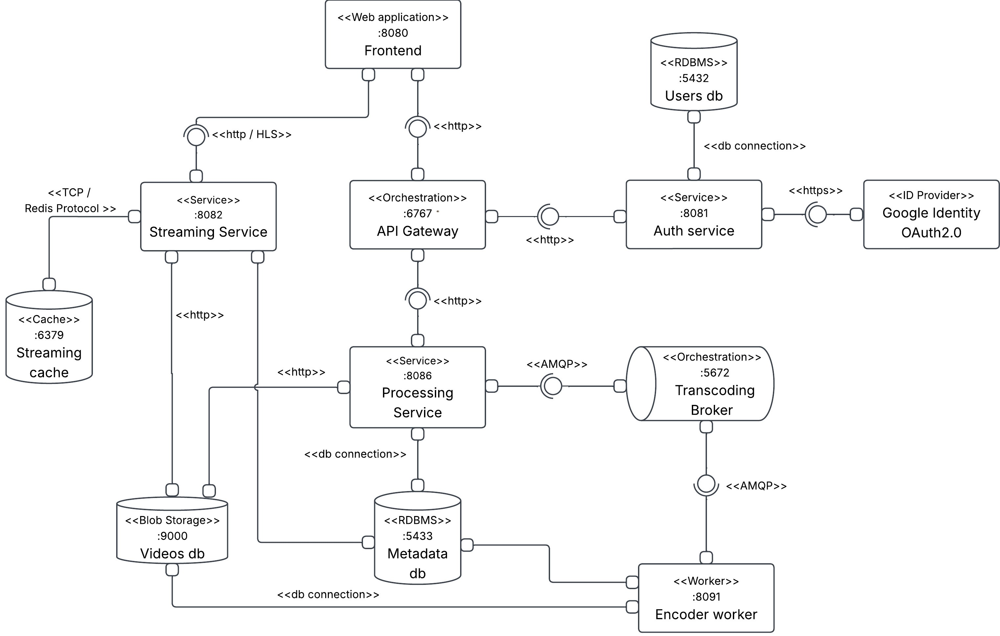

<div align="center">


# NexoPlay

### Simple Streaming Service · MVP1

Upload a video. Process it asynchronously. Play it through HLS.


[Overview](#overview) · [Prototype requirements](#prototype-1-requirements) · [Architecture](#architecture) · [Local deployment](#local-deployment) · [API reference](#api-reference) · [Team](#team)

**Universidad Nacional de Colombia, Bogotá**<br>
Software Architecture · 2026-II · Group F

</div>

---

## Overview

NexoPlay is a distributed video streaming platform built as an academic software architecture project. Users can register, upload videos with descriptive metadata, follow their processing status, browse the catalog, and watch content through HTTP Live Streaming (HLS).

The project explores how services coordinate authentication, media ingestion, asynchronous processing, persistence, and content delivery. HTTP APIs handle interactive requests, RabbitMQ distributes encoding jobs, PostgreSQL stores relational data, and MinIO stores video files.

This repository contains the first delivery stage, **MVP1**. The project specification also defines an **MVP2** focused on user interactions and personalized recommendations, described in the [roadmap](#roadmap).

The first delivery is a **vertical prototype**: a working path from the web interface through backend services and persistent storage, ending in video playback. Its objective is to demonstrate the initial architectural design through a locally deployable system.

## Features

| Capability | Current behavior |
| --- | --- |
| Authentication | Email and password registration/login, JWT sessions, and optional Google OAuth 2.0 login. |
| Video uploads | Authenticated uploads of `.mp4`, `.avi`, and `.mov` files with a title, description, and category. |
| Asynchronous processing | RabbitMQ jobs consumed by FFmpeg workers, with durable job records, retries, and worker leases. |
| Adaptive streaming | H.264/AAC HLS renditions in 1080p, 720p, and 480p when the source resolution allows them. |
| Processing status | Upload progress followed by `PENDING`, `PROCESSING`, `COMPLETED`, or `FAILED` status. |
| Public catalog | Cursor pagination, thumbnails, video details, and title filtering within the current catalog page. |
| Playback | Browser playback with hls.js, relative HLS playlists, and streamed media segments. |
| Video deletion | Only the video's owner can delete it, after confirmation; files and related database records are removed. |

Only successfully processed videos appear as playable catalog entries. Lower-resolution uploads use a source-sized rendition rather than being upscaled. Videos without an audio track remain playable without audio.

## Architecture

The platform combines **microservices**, **client-server communication**, and **an asynchronous processing pipeline**. Authentication and video management go through the API Gateway. The browser requests catalog and HLS resources directly from the Streaming Service.

### Architectural styles

| Style | Application in NexoPlay |
| --- | --- |
| Microservices | Authentication, video processing, and streaming have distinct responsibilities and separate deployable containers. Processing and streaming share the video metadata store. |
| Client-server | The browser initiates HTTP requests; backend APIs return authentication results, metadata, catalog entries, or media resources. |
| Event-driven processing | The RabbitMQ broker queues encoding jobs for asynchronous consumption by encoder workers. Encoding runs independently of the upload request. |

### Component-and-Connector view



### Components

| Component | Technology | Responsibility | Default host access |
| --- | --- | --- | --- |
| Frontend | React, Vite, Tailwind CSS, hls.js; served by Nginx | Authentication UI, catalog, uploads, playback, and deletion. | `8080` |
| API Gateway | Node.js, Express | Validate JWTs and route authentication and video management requests. | `6767` |
| Auth Service | Node.js, Express, bcrypt, JWT | Account registration, password login, and Google login. | Through the gateway; internal `8081` |
| Processing Service | Python, FastAPI, SQLAlchemy, Boto3, Pika | Validate uploads, persist metadata/jobs, publish pending jobs to the broker through its outbox process, recover expired worker leases, expose processing status, and enforce owner-only deletion. | `8086` |
| Transcoding broker | RabbitMQ | Queue encoding work and failed-job notifications. | AMQP `5672`; management UI `15672` |
| Encoder workers | Python, FFmpeg, ffprobe | Inspect media, generate HLS renditions and thumbnails, and persist results. | Internal health endpoint `8091` |
| Streaming Service | Node.js, Express | Serve the catalog, metadata, thumbnails, playlists, and segments. | `8082` |
| Metadata database | PostgreSQL 16 | Video metadata, jobs, renditions, and HLS package records. | `5433`; internal `5432` |
| Users database | PostgreSQL 16 | Accounts, password hashes, providers, and roles. | `5434`; internal `5432` |
| Video storage | MinIO, S3-compatible API | Original uploads, HLS packages, and thumbnails. | S3 `9000`; console `9001` |
| Streaming cache | Redis 7 | Cache HLS playlists. | `6379` |

Video existence and status are checked against PostgreSQL for streaming requests, so deleted videos cannot remain accessible through cached playlists. The current Compose setup runs one Streaming Service instance; encoder workers can be [scaled independently](#scaling-workers).

### Connectors and relations

| From | To | Connector | Responsibility |
| --- | --- | --- | --- |
| Frontend | API Gateway | HTTP/REST, JSON and multipart form data | Account access, uploads, owner status queries, and deletion. |
| API Gateway | Auth and Processing services | HTTP/REST | Forward requests and establish authenticated identity for protected video operations. |
| Frontend | Streaming Service | HTTP/HLS and HTTP metadata requests | Browse the catalog and retrieve playlists, segments, and thumbnails. |
| Auth Service | Google Identity | HTTPS, OAuth 2.0 | Exchange the authorization code and retrieve the verified user profile. |
| Auth, Processing, workers, and Streaming | Their PostgreSQL databases | PostgreSQL connections and SQL | Persist and query accounts, metadata, jobs, and processing results. |
| Processing, workers, and Streaming | MinIO | S3-compatible API over HTTP | Store originals and outputs, retrieve media, and delete video objects. |
| Processing Service and encoder workers | Transcoding broker / RabbitMQ | AMQP | Publish confirmed jobs, deliver work, and acknowledge consumed messages. |
| Streaming Service | Redis | TCP, Redis protocol | Read and write cached HLS playlists. |

The gateway handles authenticated control operations, while streaming requests go directly to the delivery service. The broker distributes expensive encoding work across workers, and persistent job records allow publication and processing to resume after temporary failures.

## Local deployment

### Prerequisites

- Docker with the Compose plugin.
- On Windows, Docker Desktop configured for Linux containers.
- Network access to image registries and package repositories for the initial build.

Docker supplies the Node.js/Python runtimes, FFmpeg, databases, broker, and cache.

### 1. Configure the environment

From the repository root, create `.env` using the supplied template. In PowerShell:

```powershell
Copy-Item .env.example .env
```

On Linux/macOS, use `cp .env.example .env`.

Edit `.env` to set the PostgreSQL, users database, MinIO, and RabbitMQ credentials and a long random `JWT_SECRET`. The relevant groups are `POSTGRES_*`, `USERS_DB_*`, `MINIO_*`, and `RABBITMQ_*`. Keep the file local; it is excluded from Git. Compose supplies the internal service hostnames.

Google sign-in is optional. To enable it, set `GOOGLE_CLIENT_ID` and `GOOGLE_CLIENT_SECRET` and configure the OAuth client's redirect URI as `http://localhost:6767/auth/google/callback`, using your configured gateway port if different. Email/password authentication works independently of this provider.

### 2. Deploy locally

```bash
docker compose up -d --build
docker compose ps
```

Wait for services with health checks to become healthy. The first build downloads images and dependencies.

| Local entry point | Default URL |
| --- | --- |
| Web application | [http://localhost:8080](http://localhost:8080) |
| Processing API documentation | [http://localhost:8086/docs](http://localhost:8086/docs) |
| MinIO console | [http://localhost:9001](http://localhost:9001) |
| RabbitMQ management UI | [http://localhost:15672](http://localhost:15672) |

Use the credentials from `.env` for the infrastructure consoles. Host ports can be configured through the variables in [`.env.example`](.env.example).

## API reference

### Authentication and video management

Base URL: `http://localhost:6767`

| Method | Endpoint | Access | Purpose |
| --- | --- | --- | --- |
| `POST` | `/auth/register` | Public | Register with `name`, `email`, and `password`; return a JWT. |
| `POST` | `/auth/login` | Public | Sign in with `email` and `password`; return a JWT. |
| `GET` | `/auth/google` | Public | Start the optional Google login flow. |
| `POST` | `/api/videos` | Authenticated | Upload a video using multipart form data. |
| `GET` | `/api/videos/{video_id}` | Owner | Retrieve metadata, processing state, attempts, errors, and output locations. |
| `DELETE` | `/api/videos/{video_id}` | Owner | Delete the video and associated files/records; return `204`. |

Send protected requests with `Authorization: Bearer <token>`. The gateway strips client-supplied identity headers before injecting the verified user identity. Deletion also verifies the JWT directly in the Processing Service and compares its subject with the stored `owner_id`.

For deletion, missing/invalid credentials return `401`, another owner returns `403`, and a nonexistent video returns `404`. A still-incomplete upload returns `409`; a storage/database failure returns `503` and can be retried.

### Catalog and playback

Base URL: `http://localhost:8082` - these endpoints are public.

| Method | Endpoint | Purpose |
| --- | --- | --- |
| `GET` | `/videos?limit=20&cursor=...` | List completed videos, newest first, using cursor pagination. |
| `GET` | `/videos/{video_id}` | Retrieve public video details and ownership information. |
| `GET` | `/videos/{video_id}/availability` | Check whether the registered HLS master exists. |
| `GET` | `/videos/{video_id}/thumbnail` | Retrieve the JPEG poster. |
| `GET` | `/videos/{video_id}/hls/master.m3u8` | Retrieve the master playlist. |
| `GET` | `/videos/{video_id}/hls/{resource_path}` | Retrieve a rendition playlist or `.ts` segment. |

## Storage and persistence

The default bucket is `streaming-videos`. Each video has an isolated UUID prefix:

```text
streaming-videos/
└── videos/{video_id}/
    ├── original/
    │   └── source.mp4              # source.avi or source.mov for other inputs
    ├── hls/
    │   ├── master.m3u8
    │   ├── 1080p/
    │   │   ├── index.m3u8
    │   │   └── segment_*.ts
    │   ├── 720p/
    │   │   ├── index.m3u8
    │   │   └── segment_*.ts
    │   └── 480p/
    │       ├── index.m3u8
    │       └── segment_*.ts
    └── thumbnails/
        └── poster.jpg
```

Rendition directories depend on the source resolution; smaller sources use `source/`. Intermediate MP4 renditions stay in worker temporary storage. HLS playlists use relative paths, with a default segment target of four seconds.

PostgreSQL stores video records in `video_metadata` and processing details in `video_processing_jobs`, `video_variants`, and `video_hls_packages`. See the [metadata model](shared/services/video_metadata_service.py) and [job models](shared/services/processing_jobs.py) for the field definitions.

Docker volumes persist PostgreSQL, MinIO, RabbitMQ, and Redis data across container restarts. Changing database or broker credentials in `.env` does not rewrite accounts already stored in an existing volume.

## Development and operations

### Repository layout

```text
.
├── frontend/                 # React application and Nginx configuration
├── api_gateway/              # JWT validation and HTTP routing
├── auth_service/             # Authentication and users database initialization
├── processing_service/       # Upload/status/delete API and broker integration
│   └── migrations/           # Metadata schema reset for disposable environments
├── encoder_worker/           # FFmpeg processing and worker health endpoint
├── transcoding_broker/       # RabbitMQ image, configuration, and Debian fallback
├── shared/                   # Python DTOs, models, database and storage clients
├── compose.yaml              # Local multi-service deployment
├── .env.example              # Environment template
└── requirements-dev.txt      # Python development dependencies
```

### Scaling workers

Set `TRANSCODING_WORKER_REPLICAS=3` in `.env`. Each worker handles one job at a time and exposes its health endpoint only inside Docker.

| Setting | Default | Purpose |
| --- | --- | --- |
| `HLS_SEGMENT_SECONDS` | `4` | Target HLS segment duration. |
| `TRANSCODE_MAX_ATTEMPTS` | `3` | Maximum attempts per processing job. |
| `TRANSCODE_RETRY_SECONDS` | `15` | Base retry delay, increasing exponentially. |
| `WORKER_LEASE_SECONDS` | `120` | Worker lease duration; renewed while active. |
| `TRANSCODE_TIMEOUT_SECONDS` | `3600` | Timeout for an FFmpeg processing command. |
| `FFMPEG_THREADS` | `2` | Threads per conversion. |
| `PLAYLIST_TTL` | `600` | Redis playlist cache lifetime in seconds. |

## Roadmap

The project specification, *Prototype 1: Simple Streaming Service*, defines the following MVP2 objectives:

- [ ] Record video views, likes, removed likes, and comments.
- [ ] Persist interaction events asynchronously through a broker and workers.
- [ ] Generate video embeddings from descriptive metadata and store them in a vector database.
- [ ] Build weighted user preference profiles from interaction history.
- [ ] Retrieve and display personalized recommendations, with refresh support.
- [ ] Provide fallback recommendations for users with insufficient interaction history.

These capabilities are planned for MVP2. The broader design also describes password recovery and load balancing for HTTP services; dedicated implementations of those components are future work.

## Team

Developed by **Group F** for **Software Architecture, 2026-II**, at **Universidad Nacional de Colombia, Bogotá**, Faculty of Engineering, Department of Systems and Industrial Engineering.

| Team member | Contact |
| --- | --- |
| Cristian Steven Motta Ojeda  | [cmottato@unal.edu.co](mailto:cmottato@unal.edu.co)
| Juan Jose Martin  | [jmartinv@unal.edu.co](mailto:jmartinv@unal.edu.co)
| Camilo Andrés Medina Sánchez | [cmedinasa@unal.edu.co](mailto:cmedinasa@unal.edu.co) |
| Nicolas Andrés Bolaños Fernandez | [nbolanosf@unal.edu.co](mailto:nbolanosf@unal.edu.co) |
