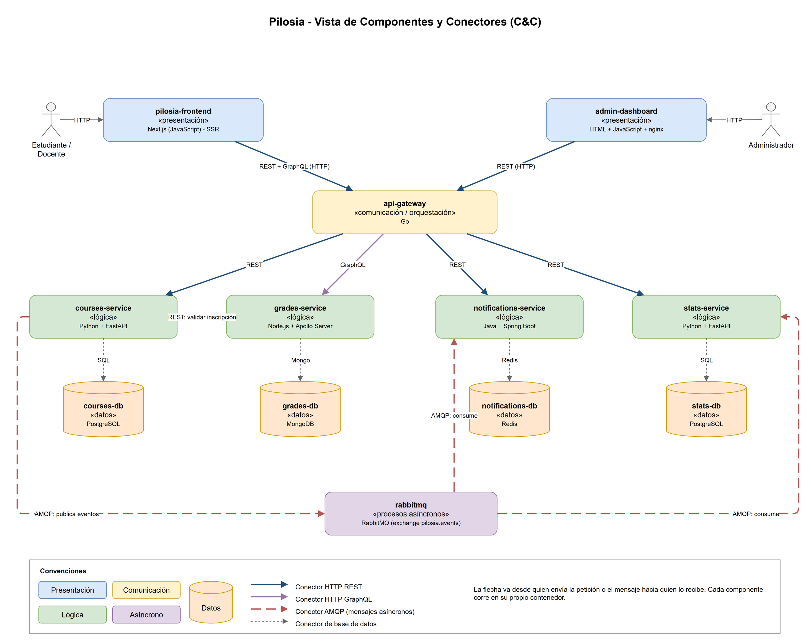
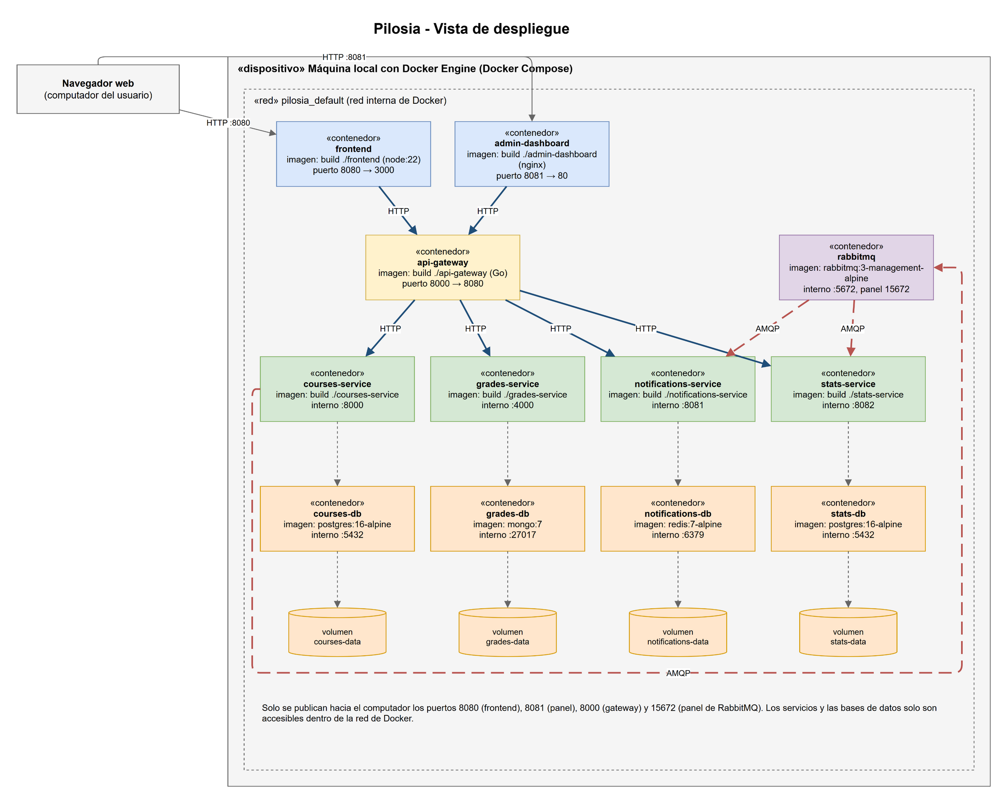
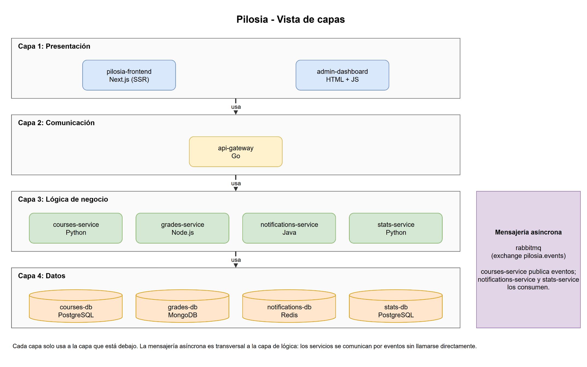
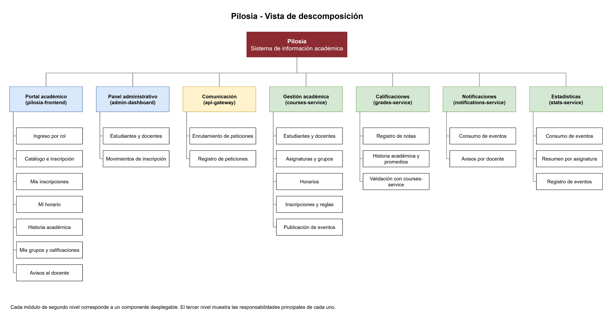

# Team 3-G

## Members

- Alirio Hernando Martínez Barreto
- Nicolas Pajaro Sanchez
- Álvaro Andrés Romero Castro

## Project

### Pilosia


Pilosia es un sistema de información académica. La idea es parecida a la de los sistemas
que usan los estudiantes para manejar su vida académica: ver qué materias se ofrecen, inscribirlas, ver el horario y
consultar las notas.

En el primer prototipo construimos lo básico (inscripciones y notas). En este segundo prototipo rediseñamos la
arquitectura: agregamos un API Gateway, un panel administrativo, mensajería asíncrona con RabbitMQ, un servicio de
notificaciones y un servicio de estadísticas, y el frontend pasó a usar SSR (Server-Side Rendering) con Next.js.

Hay tres tipos de usuario:

**Estudiante** (frontend web)

- **Catálogo de asignaturas:** ve las materias del periodo con sus grupos, docente, horario y cupos libres. Puede buscar por nombre o código.
- **Inscripción:** inscribe una materia escogiendo un grupo. El sistema revisa que:
  - el grupo tenga cupos,
  - no tenga ya inscrita esa materia,
  - no pase el límite de créditos (20),
  - no haya cruce de horario con otra materia inscrita.
- **Mis inscripciones:** lista de materias inscritas en el periodo, con el total de créditos. Desde aquí puede cancelar una inscripción.
- **Mi horario:** tabla semanal (lunes a sábado) con las materias inscritas.
- **Historia académica:** notas por periodo, promedio de cada periodo, promedio acumulado y créditos aprobados. Solo consulta.

**Docente** (frontend web)

- **Mis grupos:** ve los grupos que dicta en el periodo actual.
- **Calificaciones:** ve los estudiantes inscritos en un grupo y registra o modifica la nota final de cada uno (de 0.0 a 5.0; se aprueba con 3.0).
- **Avisos:** cuando un estudiante se inscribe en uno de sus grupos, le aparece un aviso de "Nueva actividad".

**Administrador** (panel administrativo)

- Consulta la lista de estudiantes y docentes.
- Ve los **movimientos de inscripción** por asignatura (cuántas inscripciones y cancelaciones ha habido), que se arman con los eventos asíncronos.

Como es un prototipo, **no hay autenticación real**: en la pantalla de ingreso se escoge el rol y un usuario de prueba.
El periodo actual es `2025-2`.

### Limitaciones del prototipo

- No hay inicio de sesión con contraseña; el usuario se escoge de una lista.
- Solo se maneja un periodo actual (`2025-2`), configurado en `docker-compose.yml`.
- Los horarios usan horas en punto (por ejemplo 07:00 - 09:00).
- Las estadísticas empiezan en cero: solo cuentan los movimientos que ocurren después de levantar el sistema.

## Architecture

Todos los diagramas se hicieron en draw.io. Los archivos editables están en la carpeta [`docs/`](docs/).

### 1. Estructura de Componentes y Conectores (C&C)

#### Vista C&C



#### Elementos arquitectónicos

| Componente | Tipo | Tecnología | Qué hace |
|---|---|---|---|
| `pilosia-frontend` | Presentación | Next.js (JavaScript) | Interfaz web para estudiantes y docentes. Usa **SSR**: el servidor de Next.js consulta los datos al gateway y envía la página ya armada al navegador. |
| `admin-dashboard` | Presentación | HTML + JavaScript, servido con nginx | Segunda interfaz, para el administrador. Muestra estudiantes, docentes y estadísticas de inscripción. |
| `api-gateway` | Comunicación / orquestación | Go | Punto de entrada único al backend. Recibe todas las peticiones de las interfaces y las reenvía al servicio que corresponde según la ruta (`/api`, `/graphql`, `/notifications`, `/stats`). |
| `courses-service` | Lógica | Python + FastAPI | Maneja estudiantes, docentes, asignaturas, grupos, horarios e inscripciones. Aplica las reglas de inscripción y **publica un evento** cada vez que alguien inscribe o cancela. |
| `grades-service` | Lógica | JavaScript (Node.js) + Apollo Server | Maneja las notas. Permite registrar/modificar notas y arma la historia académica con los promedios. Expone una API GraphQL. |
| `notifications-service` | Lógica | Java + Spring Boot | Escucha los eventos de inscripción y guarda un aviso para el docente del grupo. Expone los avisos por REST. |
| `stats-service` | Lógica | Python + FastAPI | Escucha los mismos eventos y lleva la cuenta de inscripciones y cancelaciones por asignatura. Expone el resumen por REST. |
| `rabbitmq` | Procesos asíncronos | RabbitMQ | Broker de mensajes. Recibe los eventos de courses-service en el exchange `pilosia.events` (tipo fanout) y entrega una copia a cada servicio interesado. |
| `courses-db` | Datos | PostgreSQL (relacional) | Tablas `students`, `professors`, `courses`, `course_groups`, `group_schedules` y `enrollments`. |
| `grades-db` | Datos | MongoDB (NoSQL, documentos) | Colección `grades` (un documento por estudiante y grupo). |
| `notifications-db` | Datos | Redis (NoSQL, clave-valor) | Una lista de avisos por docente (`notifications:professor:<id>`). |
| `stats-db` | Datos | PostgreSQL (relacional) | Tablas `enrollment_events` (cada evento recibido) y `course_stats` (resumen por asignatura). |

¿Por qué estas bases de datos?

- **courses-db (PostgreSQL):** las inscripciones tienen muchas relaciones (estudiante, grupo, materia, horario) y reglas como cupos o no repetir una inscripción.
- **grades-db (MongoDB):** cada nota es un documento independiente que ya trae los datos de la materia y casi siempre se consulta por estudiante o por grupo.
- **notifications-db (Redis):** los avisos son datos pequeños que se leen muy seguido (el frontend del docente pregunta cada 3 segundos). Una lista en memoria por docente es suficiente y muy rápida.
- **stats-db (PostgreSQL):** las estadísticas son conteos y sumas, que son fáciles de hacer con SQL.

Cada servicio de lógica tiene su **propia** base de datos y ningún otro servicio entra a ella.

#### Conectores

| Conector | Desde → Hacia | Tipo | Uso |
|---|---|---|---|
| HTTP | navegador → frontend / admin-dashboard | HTTP | El usuario abre las páginas. |
| REST + GraphQL | frontend → api-gateway | HTTP (JSON) | El servidor de Next.js (SSR) y el navegador piden datos al gateway. |
| REST | admin-dashboard → api-gateway | HTTP (JSON) | Listas de estudiantes, docentes y estadísticas. |
| REST | api-gateway → courses-service | HTTP (JSON) | Rutas `/api/...` |
| GraphQL | api-gateway → grades-service | HTTP (POST con consultas GraphQL) | Ruta `/graphql` |
| REST | api-gateway → notifications-service | HTTP (JSON) | Ruta `/notifications` |
| REST | api-gateway → stats-service | HTTP (JSON) | Rutas `/stats/...` |
| REST | grades-service → courses-service | HTTP (JSON) | Antes de guardar una nota, valida que el estudiante esté inscrito en ese grupo. |
| AMQP | courses-service → rabbitmq | Mensajes asíncronos | Publica los eventos `EnrollmentCreated` y `EnrollmentCancelled`. |
| AMQP | rabbitmq → notifications-service / stats-service | Mensajes asíncronos | Cada servicio consume los eventos desde su propia cola (`pilosia.notifications` y `pilosia.stats`). |
| SQL / Mongo / Redis | cada servicio → su base de datos | Protocolo propio de cada base | Leer y guardar datos. |

#### Relaciones

- El estudiante y el docente usan el **frontend**; el administrador usa el **admin-dashboard**.
- Las dos interfaces solo hablan con el **api-gateway**, nunca directamente con los servicios.
- El **api-gateway** reenvía cada petición al servicio que corresponde.
- **grades-service** depende de **courses-service** para validar inscripciones antes de guardar una nota.
- **courses-service** no sabe quién va a usar sus eventos: solo los publica en RabbitMQ. **notifications-service** y
  **stats-service** los reciben por su cuenta. Si uno de ellos está caído, la inscripción igual se hace.

Ejemplo del flujo asíncrono cuando un estudiante se inscribe:

1. El estudiante pulsa "Inscribir" en el frontend; la petición pasa por el gateway hasta courses-service.
2. courses-service valida las reglas, guarda la inscripción en PostgreSQL y responde al estudiante.
3. Además publica el evento `EnrollmentCreated` en el exchange `pilosia.events` de RabbitMQ.
4. RabbitMQ entrega una copia a la cola de notifications-service y otra a la de stats-service.
5. notifications-service guarda el aviso en Redis; el docente lo ve en su pantalla en pocos segundos.
6. stats-service suma la inscripción en su base de datos; el administrador la ve en el panel.

#### Estilos y patrones arquitectónicos usados

- **Cliente-servidor:** los navegadores (clientes) piden la información a los servidores por HTTP.
- **Arquitectura por capas (n-tier):** el sistema está dividido en presentación, comunicación, lógica y datos (ver la vista de capas).
- **Microservicios / basado en servicios:** la lógica está dividida en cuatro servicios pequeños e independientes, cada uno con
  su propia base de datos (patrón *database per service*), escritos en lenguajes distintos y desplegados en contenedores separados.
- **API Gateway:** un único punto de entrada para las interfaces, que oculta dónde está cada servicio.
- **Publicador-suscriptor (event-driven):** courses-service publica eventos y otros servicios se suscriben a ellos a través de RabbitMQ,
  sin conocerse entre sí.
- **SSR (Server-Side Rendering):** subarquitectura del frontend. La página se genera en el servidor de Next.js en cada petición.

### 2. Estructura de despliegue

#### Vista de despliegue



#### Elementos y relaciones

- **Máquina local con Docker Engine:** es el único nodo físico. Docker Compose crea todos los contenedores a partir de `docker-compose.yml`.
- **Red `pilosia_default`:** red interna de Docker. Los contenedores se encuentran entre sí por su nombre (por ejemplo `http://api-gateway:8080`).
- **Contenedores:** cada componente de la vista C&C corre en su propio contenedor (12 en total). Los nuestros se construyen desde
  su carpeta (`build`); RabbitMQ, PostgreSQL, MongoDB y Redis usan imágenes oficiales.
- **Puertos publicados:** solo `8080` (frontend), `8081` (panel administrativo), `8000` (gateway) y `15672` (panel de RabbitMQ)
  se publican hacia el computador. Los servicios y las bases de datos solo se ven dentro de la red de Docker.
- **Volúmenes:** cada base de datos guarda sus archivos en un volumen de Docker, así los datos no se pierden al reiniciar los contenedores.

#### Patrones de despliegue usados

- **Un servicio por contenedor:** cada componente se despliega, reinicia y escala por separado.
- **Orquestación con Docker Compose:** un solo archivo define todos los contenedores, la red, los volúmenes y el orden de arranque
  (con `healthcheck` y `depends_on`, por ejemplo los servicios esperan a que su base de datos y RabbitMQ estén listos).
- **Punto de entrada único:** hacia afuera solo se exponen las interfaces y el gateway; el resto queda en la red privada.

### 3. Estructura de capas

#### Vista de capas



#### Elementos y relaciones

| Capa | Elementos | Responsabilidad |
|---|---|---|
| 1. Presentación | `pilosia-frontend`, `admin-dashboard` | Mostrar la información y recibir las acciones del usuario. |
| 2. Comunicación | `api-gateway` | Recibir las peticiones de la capa de presentación y dirigirlas al servicio correcto. |
| 3. Lógica de negocio | `courses-service`, `grades-service`, `notifications-service`, `stats-service` | Aplicar las reglas del sistema (inscripciones, notas, avisos, estadísticas). |
| 4. Datos | `courses-db`, `grades-db`, `notifications-db`, `stats-db` | Guardar la información de forma permanente. |
| Transversal: mensajería asíncrona | `rabbitmq` | Llevar los eventos entre servicios de la capa de lógica. |

La relación entre capas es "usa": cada capa solo usa a la capa que está justo debajo. Por ejemplo, el frontend nunca entra a una base
de datos y un servicio nunca llama al frontend.

#### Patrones usados

- **Arquitectura en capas estricta (closed layers):** una capa no se salta a la siguiente. Por eso las interfaces pasan siempre por el gateway.
- **Mensajería como capa transversal:** RabbitMQ no pertenece a una capa en particular, sirve para que los servicios de lógica se
  comuniquen por eventos sin depender unos de otros.

### 4. Estructura de descomposición

#### Vista de descomposición



#### Elementos y relaciones

La relación de esta vista es "es parte de": el sistema se divide en módulos y cada módulo en sus responsabilidades principales.

| Módulo | Componente | Responsabilidades |
|---|---|---|
| Portal académico | `pilosia-frontend` | Ingreso por rol, catálogo e inscripción, mis inscripciones, mi horario, historia académica, mis grupos y calificaciones, avisos al docente. |
| Panel administrativo | `admin-dashboard` | Estudiantes y docentes, movimientos de inscripción. |
| Comunicación | `api-gateway` | Enrutamiento de peticiones y registro (log) de cada petición. |
| Gestión académica | `courses-service` | Estudiantes y docentes, asignaturas y grupos, horarios, inscripciones y sus reglas, publicación de eventos. |
| Calificaciones | `grades-service` | Registro de notas, historia académica y promedios, validación con courses-service. |
| Notificaciones | `notifications-service` | Consumo de eventos, avisos por docente. |
| Estadísticas | `stats-service` | Consumo de eventos, registro de eventos, resumen por asignatura. |

### Cómo cumplimos los requisitos no funcionales

| Requisito | Cómo se cumple |
|---|---|
| Arquitectura distribuida | 12 componentes, cada uno en su propio contenedor, que se comunican por la red. |
| Al menos dos componentes de presentación (uno web) | `pilosia-frontend` (web) y `admin-dashboard`. |
| Frontend web con subarquitectura SSR | `pilosia-frontend` con Next.js: la página se genera en el servidor en cada petición (`dynamic = "force-dynamic"`). |
| Al menos cuatro componentes de lógica | `courses-service`, `grades-service`, `notifications-service` y `stats-service`. |
| Componente de comunicación/orquestación | `api-gateway`. |
| Al menos cuatro componentes de datos (relacional y NoSQL) | `courses-db` (PostgreSQL), `grades-db` (MongoDB), `notifications-db` (Redis) y `stats-db` (PostgreSQL). |
| Componente para procesos asíncronos | `rabbitmq` (con los consumidores `notifications-service` y `stats-service`). |
| Conectores HTTP | REST y GraphQL entre interfaces, gateway y servicios. |
| Al menos cuatro lenguajes de propósito general | Python, JavaScript, Go y Java. |
| Despliegue orientado a contenedores | Docker + Docker Compose. |

## How to run

### Despliegue local

**Requisitos:** tener instalado [Docker Desktop](https://www.docker.com/products/docker-desktop/) (incluye Docker Compose).
No hace falta instalar Python, Node.js, Go, Java ni las bases de datos.

1. Abrir una terminal en esta carpeta (donde está `docker-compose.yml`).
2. Construir y levantar todos los contenedores:

   ```bash
   docker compose up --build
   ```

   La primera vez tarda varios minutos porque descarga las imágenes, compila los servicios (Go, Java, Next.js) y crea las bases de datos.

3. Abrir en el navegador: **http://localhost:8080** (frontend) y **http://localhost:8081** (panel administrativo).

Para detener el sistema se usa `Ctrl + C` o `docker compose down`.
Si se quiere volver a los datos de prueba iniciales (borrando lo que se haya inscrito, calificado o notificado):

```bash
docker compose down -v
```

**Puertos que quedan disponibles:**

| URL | Qué es |
|---|---|
| http://localhost:8080 | Frontend web (Next.js con SSR) |
| http://localhost:8081 | Panel administrativo |
| http://localhost:8000 | API Gateway (por ejemplo http://localhost:8000/api/courses) |
| http://localhost:15672 | Panel de RabbitMQ (usuario `pilosia`, contraseña `pilosia`) |

### Usuarios de prueba

| Rol | Usuario | Para probar |
|---|---|---|
| Estudiante | 20231001 - Laura Gómez Ruiz | Tiene historia académica en dos periodos y 2 materias inscritas. |
| Estudiante | 20231002 - Andrés Martínez López | Tiene historia académica y materias inscritas. |
| Estudiante | 20222003 - Camila Torres Díaz | Tiene historia académica y materias inscritas. |
| Estudiante | 20241004 - Santiago Rojas Pérez | Estudiante nuevo, sin notas. |
| Docente | María Fernanda Castro | Dicta Arquitectura de Software (grupo 1) y Bases de Datos (grupo 2). |
| Docente | Jorge Enrique Ramírez | Dicta varios grupos, entre ellos Bases de Datos (grupo 1). |
| Docente | Ricardo Molina Suárez | Dicta las materias de matemáticas. |
| Docente | Paula Andrea Herrera | Dicta Física Mecánica. |

Casos útiles para la demostración:

- Como **Laura**, inscribir **Bases de Datos grupo 2** → falla porque el grupo no tiene cupos.
- Como **Laura**, inscribir **Estructuras de Datos grupo 1** → falla por cruce de horario con Arquitectura de Software.
- Como **Laura**, inscribir **Bases de Datos grupo 1** → funciona y aparece en *Mis inscripciones* y *Mi horario*.
- Entrar como **Jorge Enrique Ramírez** (docente de ese grupo) → aparece el aviso "Laura Gómez Ruiz se inscribió en Bases de Datos" (flujo asíncrono).
- Abrir el **panel administrativo** → en *Movimientos de inscripción* aparece Bases de Datos con 1 inscripción.
- Como docente, poner una nota → al volver a entrar como el estudiante, la nota aparece en la *Historia académica*.
- Para ver el SSR: con la sesión iniciada, usar "Ver código fuente" en el navegador; el HTML ya trae el catálogo con los datos.

### Ejemplos de uso de las APIs (a través del gateway)

```bash
curl http://localhost:8000/api/courses
```

```bash
curl -X POST http://localhost:8000/api/students/20231001/enrollments -H "Content-Type: application/json" -d "{\"group_id\": 12}"
```

```bash
curl "http://localhost:8000/notifications?professorId=2"
```

```bash
curl http://localhost:8000/stats/courses
```

```bash
curl -X POST http://localhost:8000/graphql -H "Content-Type: application/json" -d "{\"query\": \"{ academicHistory(studentCode: \\\"20231001\\\") { average approvedCredits periods { period average } } }\"}"
```

Principales rutas:

| Método | Ruta | Servicio | Descripción |
|---|---|---|---|
| GET | `/api/students`, `/api/professors` | courses-service | Listas de estudiantes y docentes |
| GET | `/api/courses?search=` | courses-service | Catálogo del periodo con grupos, cupos y horario |
| GET | `/api/students/{code}/enrollments` | courses-service | Inscripciones del estudiante en el periodo |
| POST | `/api/students/{code}/enrollments` | courses-service | Inscribir un grupo (`{"group_id": 12}`); publica `EnrollmentCreated` |
| DELETE | `/api/students/{code}/enrollments/{id}` | courses-service | Cancelar una inscripción; publica `EnrollmentCancelled` |
| GET | `/api/students/{code}/schedule` | courses-service | Bloques del horario del estudiante |
| GET | `/api/professors/{id}/groups` | courses-service | Grupos del docente en el periodo |
| GET | `/api/groups/{id}/students` | courses-service | Datos del grupo y estudiantes inscritos |
| POST | `/graphql` | grades-service | `academicHistory`, `groupGrades`, `registerGrade` |
| GET | `/notifications?professorId=` | notifications-service | Avisos de un docente |
| GET | `/stats/courses` | stats-service | Inscripciones y cancelaciones por asignatura |
| GET | `/stats/events` | stats-service | Últimos eventos recibidos |

### Estructura del proyecto

```
.
├── README.md
├── docker-compose.yml
├── docs/                       # logo y diagramas (draw.io + PNG)
├── frontend/                   # Next.js (SSR)
│   ├── app/page.jsx            # página que se arma en el servidor
│   └── src/
│       ├── server-api.js       # consultas que hace el servidor al gateway
│       ├── api.js              # consultas que hace el navegador
│       ├── App.jsx             # menú según el rol
│       └── views/              # Login, Catalog, MyEnrollments, MySchedule,
│                               # AcademicHistory, MyGroups, GroupGrades
├── admin-dashboard/            # HTML + JavaScript + nginx
├── api-gateway/                # Go
├── courses-service/            # Python + FastAPI (REST) + publicador de eventos
├── grades-service/             # Node.js + Apollo Server (GraphQL)
├── notifications-service/      # Java + Spring Boot (consumidor de eventos + Redis)
├── stats-service/              # Python + FastAPI (consumidor de eventos + PostgreSQL)
└── databases/
    ├── postgres/init.sql       # tablas y datos de prueba de courses-db
    ├── mongo/init.js           # notas de prueba de grades-db
    └── stats/init.sql          # tablas de stats-db
```
