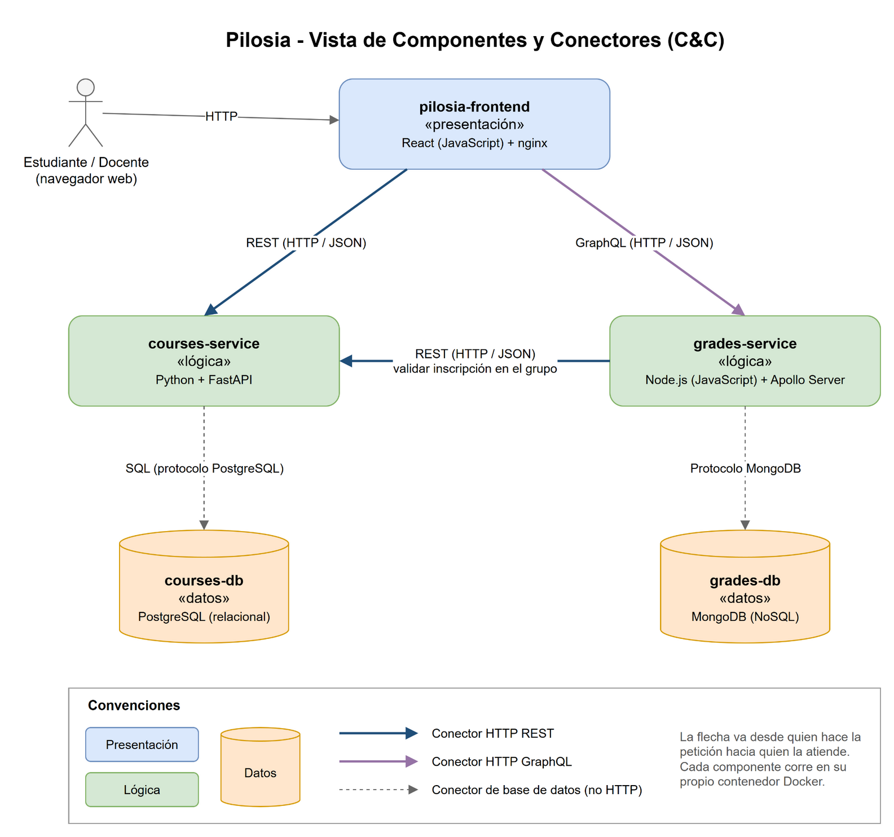

# Team 3-G

## Members

- Alirio Hernando Martínez Barreto
- Nicolas Pajaro Sanchez
- Álvaro Andrés Romero Castro

## Project

### Pilosia


Pilosia es un sistema de información académica. La idea es parecida a la de los sistemas
que usan los estudiantes para manejar su vida académica: ver qué materias se ofrecen, inscribirlas, ver el horario y
consultar las notas.

Para este primer prototipo escogimos un alcance pequeño que recorre todas las capas del sistema
(interfaz, lógica y datos). Hay dos tipos de usuario:

**Estudiante**

- **Catálogo de asignaturas:** ve las materias del periodo con sus grupos, docente, horario y cupos libres. Puede buscar por nombre o código.
- **Inscripción:** inscribe una materia escogiendo un grupo. El sistema revisa que:
  - el grupo tenga cupos,
  - no tenga ya inscrita esa materia,
  - no pase el límite de créditos (20),
  - no haya cruce de horario con otra materia inscrita.
- **Mis inscripciones:** lista de materias inscritas en el periodo, con el total de créditos. Desde aquí puede cancelar una inscripción.
- **Mi horario:** tabla semanal (lunes a sábado) con las materias inscritas.
- **Historia académica:** notas por periodo, promedio de cada periodo, promedio acumulado y créditos aprobados. El estudiante solo consulta, no puede modificar notas.

**Docente**

- **Mis grupos:** ve los grupos que dicta en el periodo actual.
- **Calificaciones:** ve los estudiantes inscritos en un grupo y registra o modifica la nota final de cada uno (de 0.0 a 5.0; se aprueba con 3.0).

Como es un prototipo, **no hay autenticación real**: en la pantalla de ingreso se escoge el rol y un usuario de prueba.
El periodo actual es `2025-2`.

### Limitaciones del prototipo

- No hay inicio de sesión con contraseña; el usuario se escoge de una lista.
- Solo se maneja un periodo actual (`2025-2`), configurado en `docker-compose.yml`.
- Los horarios del prototipo usan horas en punto (por ejemplo 07:00 - 09:00).

## Architecture

### Vista de Componentes y Conectores (C&C)



El diagrama se hizo en draw.io. El archivo editable está en [`docs/cc-view.drawio`](docs/cc-view.drawio).

### Estilos arquitectónicos usados

- **Cliente-servidor:** el navegador (cliente) pide la información a los servicios (servidores) por HTTP.
  El cliente no guarda datos del negocio, solo los muestra.
- **Arquitectura por capas (n-tier):** el sistema se divide en tres niveles: presentación (frontend),
  lógica (servicios) y datos (bases de datos). Cada nivel solo se comunica con el nivel que tiene al lado,
  por ejemplo el frontend nunca habla directamente con una base de datos.
- **Basado en servicios:** la lógica está separada en dos servicios independientes, cada uno con su propia
  base de datos y desplegado en su propio contenedor. Así el sistema es **distribuido**: cada parte corre
  como un proceso separado y se comunican por la red.

### Elementos arquitectónicos

| Componente | Tipo | Tecnología | Qué hace |
|---|---|---|---|
| `pilosia-frontend` | Presentación | React (JavaScript) + nginx | Es la interfaz web. nginx sirve la aplicación React y reenvía las peticiones `/api` a courses-service y `/graphql` a grades-service. |
| `courses-service` | Lógica | Python + FastAPI | Maneja estudiantes, docentes, asignaturas, grupos, horarios e inscripciones. Aplica las reglas de inscripción. Expone una API REST. |
| `grades-service` | Lógica | JavaScript (Node.js) + Apollo Server | Maneja las notas. Permite registrar/modificar notas y arma la historia académica con los promedios. Expone una API GraphQL. |
| `courses-db` | Datos | PostgreSQL | Base de datos relacional con las tablas `students`, `professors`, `courses`, `course_groups`, `group_schedules` y `enrollments`. |
| `grades-db` | Datos | MongoDB | Base de datos NoSQL con la colección `grades` (un documento por estudiante y grupo). |

¿Por qué dos bases de datos distintas?

- La información de inscripciones tiene muchas relaciones (estudiante, grupo, materia, horario) y reglas como cupos
  o no repetir una inscripción. Por eso usamos una base de datos **relacional**.
- Cada nota es un registro independiente que ya trae los datos de la materia (nombre, créditos, periodo),
  y casi siempre se consulta por estudiante o por grupo. Por eso usamos una base de datos de **documentos**.

### Conectores

| Conector | Desde → Hacia | Tipo | Uso |
|---|---|---|---|
| REST | frontend → courses-service | HTTP (GET, POST, DELETE con JSON) | Catálogo, inscripciones, horario, grupos del docente. |
| GraphQL | frontend → grades-service | HTTP (POST con consultas GraphQL) | Historia académica, notas de un grupo y registro de notas. |
| REST | grades-service → courses-service | HTTP (GET con JSON) | Antes de guardar una nota, grades-service pregunta a courses-service si el estudiante está inscrito en ese grupo. |
| SQL | courses-service → courses-db | Protocolo de PostgreSQL (librería psycopg) | Leer y guardar datos de inscripciones. |
| Protocolo MongoDB | grades-service → grades-db | Driver oficial de MongoDB | Leer y guardar notas. |

Los dos tipos de conectores HTTP son **REST** y **GraphQL**. En REST cada recurso tiene su propia URL
(por ejemplo `/api/students/{code}/enrollments`); en GraphQL hay una sola URL (`/graphql`) y el cliente
dice en la consulta exactamente qué datos necesita.

### Relaciones

- El usuario usa el **frontend** desde el navegador.
- El **frontend** usa **courses-service** (REST) para todo lo de inscripciones y usa **grades-service** (GraphQL) para todo lo de notas.
- **grades-service** depende de **courses-service**: al registrar una nota valida por REST que el estudiante esté inscrito
  **en ese grupo específico** y de ahí toma el nombre de la materia, los créditos y el periodo.
- **courses-service** es el único que accede a **courses-db** y **grades-service** es el único que accede a **grades-db**.

Ejemplo del flujo para registrar una nota:

1. El docente escribe la nota en el frontend y pulsa Guardar.
2. El frontend envía la mutación `registerGrade(groupId, studentCode, grade)` a grades-service.
3. grades-service consulta `GET /api/groups/{groupId}/students` en courses-service.
4. Si el estudiante está en la lista, guarda (o actualiza) la nota en MongoDB. Si no, responde con un error.
5. Cuando el estudiante abre su historia académica, ve la nota nueva.

### Cómo cumplimos los requisitos no funcionales

| Requisito | Cómo se cumple |
|---|---|
| Arquitectura distribuida | 5 componentes, cada uno en su propio contenedor, que se comunican por la red. |
| Al menos un componente de presentación (web) | `pilosia-frontend` (React). |
| Al menos dos componentes de lógica | `courses-service` y `grades-service`. |
| Al menos dos componentes de datos (relacional y NoSQL) | `courses-db` (PostgreSQL) y `grades-db` (MongoDB). |
| Al menos dos tipos de conectores HTTP | REST y GraphQL. |
| Al menos dos lenguajes de propósito general | Python (courses-service) y JavaScript (grades-service y frontend). |
| Despliegue orientado a contenedores | Docker + Docker Compose. |

## How to run

### Despliegue local

**Requisitos:** tener instalado [Docker Desktop](https://www.docker.com/products/docker-desktop/) (incluye Docker Compose).
No hace falta instalar Python, Node.js ni las bases de datos.

1. Abrir una terminal en la carpeta del proyecto (donde está `docker-compose.yml`).
2. Construir y levantar todos los contenedores:

   ```bash
   docker compose up --build
   ```

   La primera vez tarda unos minutos porque descarga las imágenes y crea las bases de datos con los datos de prueba.

3. Abrir en el navegador: **http://localhost:8080**

Para detener el sistema se usa `Ctrl + C` o `docker compose down`.
Si se quiere volver a los datos de prueba iniciales (borrando lo que se haya inscrito o calificado):

```bash
docker compose down -v
```

**Puertos que quedan disponibles:**

| URL | Qué es |
|---|---|
| http://localhost:8080 | Aplicación web (frontend) |
| http://localhost:8000/docs | Documentación automática de la API REST (Swagger) |
| http://localhost:4000 | Apollo Sandbox para probar la API GraphQL |

Las bases de datos no se exponen hacia afuera; solo los servicios pueden acceder a ellas dentro de la red de Docker.

### Usuarios de prueba

| Rol | Usuario | Para probar |
|---|---|---|
| Estudiante | 20231001 - Laura Gómez Ruiz | Tiene historia académica en dos periodos y 2 materias inscritas. |
| Estudiante | 20231002 - Andrés Martínez López | Tiene historia académica y materias inscritas. |
| Estudiante | 20222003 - Camila Torres Díaz | Tiene historia académica y materias inscritas. |
| Estudiante | 20241004 - Santiago Rojas Pérez | Estudiante nuevo, sin notas. |
| Docente | María Fernanda Castro | Dicta Arquitectura de Software (grupo 1) y Bases de Datos (grupo 2). |
| Docente | Jorge Enrique Ramírez | Dicta varios grupos de Ingeniería de Sistemas. |
| Docente | Ricardo Molina Suárez | Dicta las materias de matemáticas. |
| Docente | Paula Andrea Herrera | Dicta Física Mecánica. |

Casos útiles para la demostración (con Laura):

- Inscribir **Bases de Datos grupo 2** → falla porque el grupo no tiene cupos.
- Inscribir **Estructuras de Datos grupo 1** → falla por cruce de horario con Arquitectura de Software.
- Inscribir **Bases de Datos grupo 1** → funciona, y aparece en *Mis inscripciones* y *Mi horario*.
- Entrar como **María Fernanda Castro**, abrir Arquitectura de Software grupo 1 y ponerle nota a Laura →
  al volver a entrar como Laura, la nota aparece en la *Historia académica* en el periodo 2025-2.

### Ejemplos de uso de las APIs

REST (courses-service):

```bash
curl http://localhost:8080/api/courses
```

```bash
curl -X POST http://localhost:8080/api/students/20231001/enrollments -H "Content-Type: application/json" -d "{\"group_id\": 12}"
```

GraphQL (grades-service):

```bash
curl -X POST http://localhost:8080/graphql -H "Content-Type: application/json" -d "{\"query\": \"{ academicHistory(studentCode: \\\"20231001\\\") { average approvedCredits periods { period average } } }\"}"
```

Principales endpoints REST:

| Método | Ruta | Descripción |
|---|---|---|
| GET | `/api/students` | Lista de estudiantes |
| GET | `/api/professors` | Lista de docentes |
| GET | `/api/courses?search=` | Catálogo del periodo con grupos, cupos y horario |
| GET | `/api/students/{code}/enrollments` | Inscripciones del estudiante en el periodo |
| POST | `/api/students/{code}/enrollments` | Inscribir un grupo (`{"group_id": 12}`) |
| DELETE | `/api/students/{code}/enrollments/{id}` | Cancelar una inscripción |
| GET | `/api/students/{code}/schedule` | Bloques del horario del estudiante |
| GET | `/api/professors/{id}/groups` | Grupos del docente en el periodo |
| GET | `/api/groups/{id}/students` | Datos del grupo y estudiantes inscritos |

Operaciones GraphQL:

```graphql
type Query {
  academicHistory(studentCode: String!): AcademicHistory!
  groupGrades(groupId: Int!): [Grade!]!
}

type Mutation {
  registerGrade(groupId: Int!, studentCode: String!, grade: Float!): Grade!
}
```

### Estructura del proyecto

```
.
├── README.md
├── docker-compose.yml
├── docs/                    # logo y diagrama C&C (draw.io + PNG)
├── frontend/                # React + nginx
│   ├── nginx.conf
│   └── src/
│       ├── api.js           # llamadas REST y GraphQL
│       ├── App.jsx          # menú según el rol
│       └── pages/           # Login, Catalog, MyEnrollments, MySchedule,
│                            # AcademicHistory, MyGroups, GroupGrades
├── courses-service/         # Python + FastAPI (REST)
│   └── app/main.py
├── grades-service/          # Node.js + Apollo Server (GraphQL)
│   └── src/index.js
└── databases/
    ├── postgres/init.sql    # tablas y datos de prueba
    └── mongo/init.js        # colección de notas y datos de prueba
```
