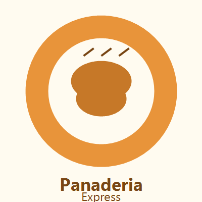
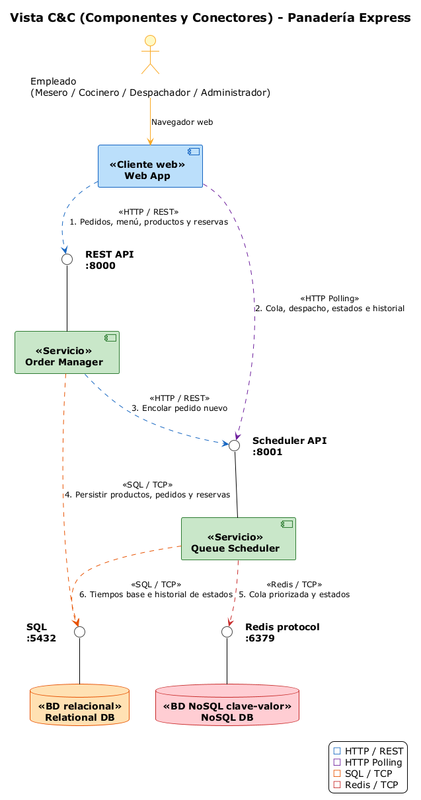
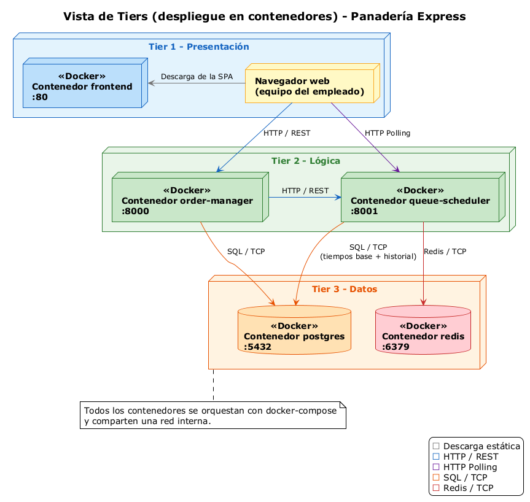

# Panadería Express

## 1. Equipo

**Nombre del equipo:** PanTech

| Integrante |
|---|
| Jaime Darley Angulo Tenorio |
| Diego Fernando Waitoto Quintero |
| Yeison Camilo Aparicio Aponte |

## 2. Sistema de software

### Nombre

**Panadería Express**

### Logo



### Descripción

Panadería Express resuelve el problema de la atención en una panadería con dos tipos de cliente: quien pide un café y un pan de vitrina y quiere salir rápido (**para llevar**), y quien se sienta a pedir un desayuno preparado que toma tiempo (**consumo en sitio**). Como los productos tienen tiempos de preparación muy distintos, atender en estricto orden de llegada (FIFO) deja esperando de más a los pedidos rápidos. El sistema organiza la cola de cocina según los tiempos estimados de preparación.

**Usuario final:** el empleado de la panadería. El cliente no interactúa con el sistema: pide verbalmente y el empleado registra el pedido. Hay cuatro roles dentro de la misma aplicación web:

- **Mesero:** crea pedidos (para llevar o en mesa), consulta el menú y gestiona las reservas.
- **Cocinero:** ve la cola de cocina en orden de prioridad y cambia el estado de las comandas.
- **Despachador:** confirma la entrega y retira la orden.
- **Productos (administración del catálogo):** mantiene el CRUD de productos y sus minutos de preparación base.

Además de las vistas por rol, la Web App incluye una vista **Historial** para consultar los tiempos de las comandas (Requerimiento 9).

#### Alcance del Prototipo 1

El Prototipo 1 es el flujo básico funcional: un empleado registra un pedido, selecciona los productos, la comanda aparece en cocina, el personal actualiza su estado y finalmente se confirma la entrega. Además, el sistema conserva el **historial de estados** de cada comanda (Requerimiento 9) para consultar los tiempos de preparación y entrega.

| N.º | Requerimiento | Prioridad | Alcance | Estado en el Prototipo 1 |
|---|---|---|---|---|
| 1 | Crear pedido para llevar o en mesa | P1 | Implementar | Implementado. Un pedido `en_mesa` exige número de mesa; se validan los productos y el pedido se persiste y se encola en cocina. |
| 2 | Crear cita de reserva | P1 | Implementar | Implementado (CRUD completo: crear, listar, editar y eliminar). |
| 3 | Elegir productos de vitrina o preparados | P1 | Implementar | Implementado. Cada producto tiene categoría `vitrina` o `preparado`. |
| 4 | Ver menú y tiempos estimados | P1 | Implementar | Implementado. El menú muestra los minutos base por producto y en cocina/despacho se ve el tiempo estimado por comanda. |
| 5 | Cobrar / confirmar pago y enviar comanda | P2 | Después | **No implementado (fuera del alcance).** Solo falta el cobro: el *envío de la comanda* a cocina ya ocurre automáticamente al crear el pedido. |
| 6 | Cambiar estado a *En preparación* o *Listo* | P1 | Implementar | Implementado, con validación de transiciones (`pendiente → en_preparación → listo`). |
| 7 | Confirmar entrega y retirar la orden | P1 | Implementar | Implementado. Solo las comandas `listo` pueden entregarse; al entregar salen de las pantallas. |
| 8 | CRUD de productos (minutos de preparación base) | P1 | Operaciones básicas | Implementado (CRUD completo). No se puede eliminar un producto con pedidos asociados: se sugiere desactivarlo. |
| 9 | Registrar y consultar el historial de estados de cada comanda | P1 | Implementar | Implementado. Cada transición (`pendiente → en_preparación → listo → entregado`) se guarda con marca de tiempo en PostgreSQL y se consulta desde la vista *Historial*. |

Para la cola de cocina se usa una regla sencilla basada en los tiempos estimados de preparación (los productos más rápidos se atienden primero). El algoritmo de priorización más completo, las alertas de espera, la pantalla de despacho avanzada, la actualización en tiempo real con WebSocket y las métricas quedan para los siguientes prototipos.

#### Trazabilidad requerimiento → implementación

| N.º | Vistas (frontend) | Servicio y ruta (backend) | Lógica / persistencia |
|---|---|---|---|
| 1 | `frontend/src/views/MeseroView.tsx` | Order Manager — `POST /orders` | Valida productos y `table_number`; guarda en `orders`/`order_items` (PostgreSQL) y encola en cocina. |
| 2 | `frontend/src/views/MeseroView.tsx` | Order Manager — `GET/POST/PUT/DELETE /reservations` | Tabla `reservations` (PostgreSQL). |
| 3 | `frontend/src/views/MeseroView.tsx` | Order Manager — `GET /menu`, `GET /products` | `Product.category ∈ {vitrina, preparado}`. |
| 4 | `MeseroView.tsx`, `CocineroView.tsx`, `DespachadorView.tsx` | Order Manager — `GET /menu`; Queue Scheduler — `GET /queue`, `GET /dispatch` | `prep_minutes` por producto y `estimated_minutes` por comanda. |
| 5 | — | — | Fuera de alcance (solo el cobro); la comanda ya se envía a cocina al crear el pedido. |
| 6 | `frontend/src/views/CocineroView.tsx` | Queue Scheduler — `PATCH /queue/orders/{id}/status` | `priority.is_valid_transition` (`pendiente → en_preparación → listo`). |
| 7 | `frontend/src/views/DespachadorView.tsx` | Queue Scheduler — `POST /queue/orders/{id}/deliver` | Exige estado `listo`; sale del `ZSET` de Redis y el hash queda con TTL. |
| 8 | `frontend/src/views/ProductosView.tsx` | Order Manager — `GET/POST/PUT/DELETE /products` | CRUD de `products`; bloquea el borrado con pedidos asociados (409). |
| 9 | `frontend/src/views/HistorialView.tsx`, `CocineroView.tsx`, `DespachadorView.tsx` | Queue Scheduler — `GET /history`, `GET /history/orders/{id}`; registro en `POST /queue/orders`, `PATCH /queue/orders/{id}/status`, `POST /queue/orders/{id}/deliver` | Tabla `order_status_events` (PostgreSQL): un evento por transición con `changed_at`. |

## 3. Estructuras arquitectónicas

### Estructura de Componentes y Conectores (C&C)

#### Vista C&C



#### Vista de tiers (despliegue en contenedores)



#### Estilos arquitectónicos utilizados

- **Arquitectura en capas (3 capas / 3 tiers):** presentación, lógica y datos, cada una en su propio nivel de despliegue. Cada capa solo se comunica con la inmediatamente inferior.
- **Cliente-servidor:** la aplicación web (cliente) solicita servicios a los servicios de la capa lógica mediante HTTP.
- **Orientado a servicios:** la lógica se divide en dos servicios independientes con responsabilidades distintas (gestión de pedidos y gestión de la cola), desplegados por separado y comunicados por HTTP.
- **Centrado en datos (repositorios):** dos almacenes de datos con roles distintos; uno relacional para datos persistentes y uno NoSQL para el estado temporal de la cola.
- **Consulta periódica (pull / polling):** el cliente consulta cada cierto tiempo el estado de la cola en lugar de recibir notificaciones del servidor. Se deja WebSocket para la siguiente entrega.

#### Elementos arquitectónicos

**Componentes**

| Componente | Tipo | Tecnología | Puerto | Responsabilidad |
|---|---|---|---|---|
| Web App | Cliente web (presentación) | React + Vite (JS/TS) | 80 | Interfaz del empleado: vistas por rol para mesero, cocina, despacho y administración del catálogo, más la vista de historial de comandas. |
| Order Manager | Servicio (lógica) | Python + FastAPI | 8000 | Gestión de pedidos, reservas y catálogo de productos (CRUD con tiempos de preparación base). |
| Queue Scheduler | Servicio (lógica) | Python + FastAPI | 8001 | Gestión de la cola de cocina: ordena los pedidos con la regla de priorización, administra los estados de las comandas y persiste su historial. |
| Relational DB | Base de datos relacional (datos) | PostgreSQL | 5432 | Datos persistentes: productos, tiempos base, pedidos, reservas e historial de estados de las comandas. |
| NoSQL DB | Base de datos NoSQL clave-valor (datos) | Redis | 6379 | Cola activa de cocina y estados temporales de las comandas. |

**Actor externo**

| Actor | Descripción |
|---|---|
| Empleado (Mesero / Cocinero / Despachador / Administrador del catálogo) | Usuario final. Interactúa con el sistema desde el navegador web. |

**Conectores**

| N.º | Origen | Destino | Tipo de conector | Descripción |
|---|---|---|---|---|
| 1 | Web App | Order Manager (REST API :8000) | HTTP / REST | Crear pedidos y reservas, consultar el menú y administrar productos. |
| 2 | Web App | Queue Scheduler (Scheduler API :8001) | HTTP Polling | Consulta periódica de la cola de cocina, de los pedidos listos y del historial; también el cambio de estado de las comandas. |
| 3 | Order Manager | Queue Scheduler (Scheduler API :8001) | HTTP / REST | Encolar un pedido nuevo para cocina. |
| 4 | Order Manager | Relational DB (SQL :5432) | SQL sobre TCP | Persistir productos, pedidos y reservas. |
| 5 | Queue Scheduler | NoSQL DB (Redis :6379) | Protocolo Redis sobre TCP | Mantener la cola priorizada y los estados temporales. |
| 6 | Queue Scheduler | Relational DB (SQL :5432) | SQL sobre TCP | Leer los tiempos base de preparación y registrar el historial de estados de las comandas en `order_status_events`. |

#### Cumplimiento de los requisitos no funcionales

| Requisito | Cómo se cumple |
|---|---|
| Arquitectura distribuida | Cinco componentes desplegados en contenedores independientes que se comunican por red. |
| Al menos un componente de presentación (web front-end) | Web App (React + Vite). |
| Al menos dos componentes de lógica | Order Manager y Queue Scheduler. |
| Al menos dos componentes de datos (relacional y NoSQL) | PostgreSQL y Redis. |
| Al menos dos tipos distintos de conectores basados en HTTP | HTTP / REST (petición-respuesta) y HTTP Polling (consulta periódica). |
| Al menos dos lenguajes de programación de propósito general | JavaScript/TypeScript (frontend) y Python (servicios). |
| Despliegue orientado a contenedores | Cada componente corre en su propio contenedor Docker, orquestados con Docker Compose. |

## 4. Prototipo

### Estructura del proyecto

```
swarch-2026ii/               # Repositorio del curso (sección 3)
└── g3-H-PanTech/            # Carpeta del equipo (Team 3-H · PanTech)
    ├── README.md
    ├── docker-compose.yml
    ├── .env.example
    ├── docs/                  # diagramas y logo
    ├── frontend/              # Web App (React + Vite)
    ├── order-manager/         # Servicio de pedidos y catálogo (FastAPI)
    └── queue-scheduler/       # Servicio de cola de cocina (FastAPI)
```

### Instrucciones para desplegar el sistema localmente

**Requisitos previos**

- Git
- Docker y Docker Compose (v2)

**Pasos**

1. Clonar el repositorio y ubicarse en la carpeta del equipo:

   ```bash
   git clone https://github.com/unal-sw-arch/swarch-2026ii.git
   cd swarch-2026ii
   cd g3-H-PanTech
   ```

2. Construir y levantar todos los contenedores:

   ```bash
   docker compose up --build
   ```

3. Abrir el sistema en el navegador:

   | Servicio | URL |
   |---|---|
   | Web App | http://localhost |
   | Order Manager (documentación de la API) | http://localhost:8000/docs |
   | Queue Scheduler (documentación de la API) | http://localhost:8001/docs |

4. Para detener el sistema:

   ```bash
   docker compose down
   ```

   Para borrar también los datos guardados (volúmenes):

   ```bash
   docker compose down -v
   ```

### Limitaciones conocidas

- **El detalle de la comanda no se persiste en PostgreSQL.** El Queue Scheduler mantiene el detalle y el estado actual de las comandas en Redis; las comandas entregadas salen de las pantallas y se conservan en Redis con un TTL (1 hora por defecto, configurable con `DELIVERED_TTL_SECONDS`). Sin embargo, **el historial de estados sí se persiste** de forma durable en la tabla `order_status_events` (Requerimiento 9), por lo que los tiempos de preparación y entrega se conservan aunque expire el TTL. El Order Manager persiste el pedido base en PostgreSQL (`orders` / `order_items`) al crearlo.
- La cola priorizada vive en un `ZSET` de Redis con `score` = tiempo estimado; el desempate por hora de llegada se resuelve al construir la vista de cocina.
- El Prototipo 1 no incluye cobro/pago, priorización avanzada, alertas de tiempo, métricas, WebSocket/SSE ni autenticación.
- **Validación de pedidos (Requerimiento 1).** Un pedido `en_mesa` exige número de mesa; un pedido `para_llevar` no lo requiere, pero tampoco se rechaza si se envía un número de mesa.
- **El envío de la comanda a cocina (parte del Requerimiento 5) ya está implementado:** al crear un pedido, el Order Manager lo encola en el Queue Scheduler. Lo único pendiente de ese requerimiento es el cobro / confirmación de pago.
