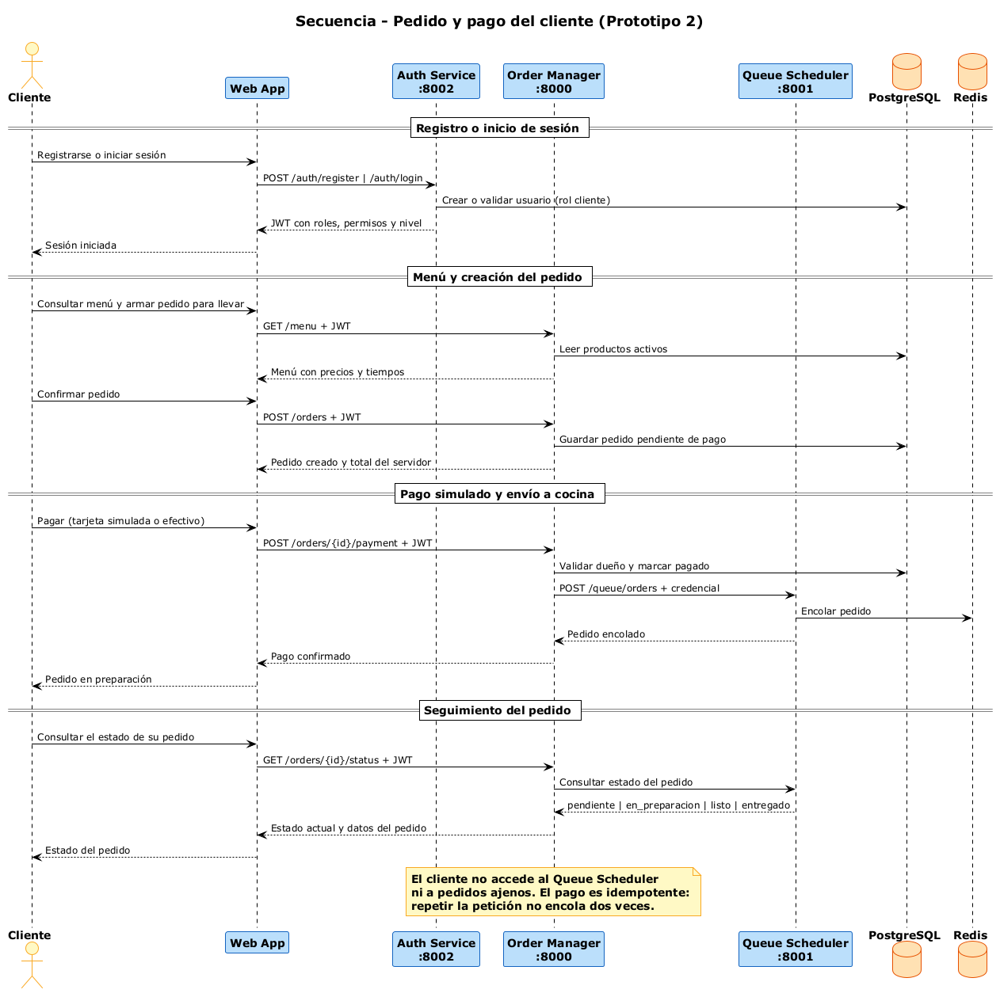
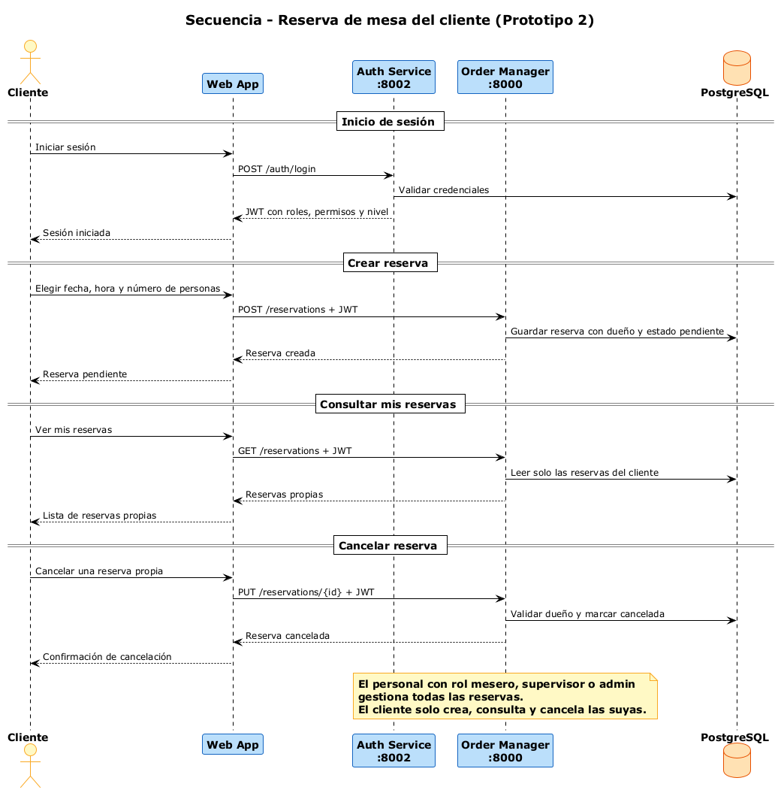

# Panadería Express

## 1. Equipo

**Nombre del equipo:** PanTech (Team 3-H)

| Integrante |
|---|
| Jaime Darley Angulo Tenorio |
| Diego Fernando Waitoto Quintero |
| Yeison Camilo Aparicio Aponte |
| Axel Gómez Moreno |

Los contratos técnicos del Prototipo 2 —puertos, autenticación, eventos, encabezados y errores— están en [`docs/equipo/contratos.md`](docs/equipo/contratos.md). El guion de demostración, las cuentas de prueba y la solución de problemas están en [`docs/equipo/demo.md`](docs/equipo/demo.md). El workflow `.github/workflows/ci-p2.yml` valida la configuración de Compose y ejecuta las pruebas de los componentes.

## 2. Sistema de software

### Nombre

**Panadería Express**

### Logo


### Descripción

Panadería Express resuelve el problema de la atención en una panadería con dos tipos de cliente: quien pide un café y un pan de vitrina y quiere salir rápido (**para llevar**), y quien se sienta a pedir un desayuno preparado que toma tiempo (**consumo en sitio**). Como los productos tienen tiempos de preparación muy distintos, atender en estricto orden de llegada (FIFO) deja esperando de más a los pedidos rápidos. El sistema organiza la cola de cocina según los tiempos estimados de preparación.

**Usuario final:** en el Prototipo 1 solo el empleado usa el sistema: el cliente pide verbalmente y el empleado registra el pedido. La aplicación ofrece cinco vistas seleccionables en la misma Web App; esos perfiles de navegación no son cuentas autenticadas ni permisos individuales:

- **Mesero:** crea pedidos (para llevar o en mesa), consulta el menú y gestiona las reservas.
- **Cocinero:** ve la cola de cocina en orden de prioridad y cambia el estado de las comandas.
- **Despachador:** confirma la entrega y retira la orden.
- **Productos (administración del catálogo):** mantiene el CRUD de productos y sus minutos de preparación base.
- **Historial:** consulta los tiempos y las transiciones de estado de las comandas (Requerimiento 9).

> **Prototipo 2 (implementado):** se rediseña la arquitectura para cumplir los diez requisitos no funcionales del documento del proyecto. El sistema pasa de una SPA con dos servicios a **dos componentes de presentación** (Web SSR y KDS/POS), **cuatro servicios de lógica** (Identity, Order, Kitchen y Reporting), un **API Gateway**, un **broker de eventos**, un **worker asíncrono** y **cuatro almacenes de datos** (PostgreSQL, MongoDB, Redis y RustFS). Se agrega el rol `cliente`, los empleados pasan a tener cuentas personales multi-rol y la jerarquía es `admin` > `supervisor` > operativos. El cliente se registra, consulta el menú, **reserva una mesa**, crea pedidos **para llevar**, paga de forma simulada y sigue el estado de sus pedidos. También consulta y cancela sus propias reservas. El personal conserva las vistas de cocina, despacho, catálogo e historial; el cliente no accede a ellas.

#### Alcance del Prototipo 1

El Prototipo 1 es el flujo básico funcional: un empleado registra un pedido, selecciona los productos, la comanda aparece en cocina, el personal actualiza su estado y finalmente se confirma la entrega. Además, el sistema conserva el **historial de estados** de cada comanda (Requerimiento 9) para consultar los tiempos de preparación y entrega.

| N.º | Requerimiento | Prioridad | Alcance | ¿Implementado en el Prototipo 1? |
|---|---|---|---|---|
| 1 | Crear pedido para llevar o en mesa | P1 | Implementar | Sí |
| 2 | Crear cita de reserva | P1 | Implementar | Sí |
| 3 | Elegir productos de vitrina o preparados | P1 | Implementar | Sí |
| 4 | Ver menú y tiempos estimados | P1 | Implementar | Sí |
| 6 | Cambiar estado a *En preparación* o *Listo* | P1 | Implementar | Sí |
| 7 | Confirmar entrega y retirar la orden | P1 | Implementar | Sí |
| 8 | CRUD de productos (minutos de preparación base) | P1 | Operaciones básicas | Sí |
| 9 | Registrar y consultar el historial de estados de cada comanda | P1 | Implementar | Sí |

> El detalle de la implementación de cada requerimiento está en la tabla de trazabilidad.

En el Prototipo 1, la cola de cocina se prioriza con una regla sencilla basada en los tiempos estimados (los productos más rápidos se atienden primero). La priorización avanzada descrita más adelante corresponde al Prototipo 2. Las alertas de espera, la actualización en tiempo real con WebSocket y otras métricas quedan fuera del alcance implementado.

#### Alcance del Prototipo 2 (implementado)

El Prototipo 2 se enfoca en tres frentes funcionales: **autenticación, autorización y jerarquía de usuarios**, **autoservicio del cliente (reservas, pedidos y pago simulado)** y **priorización avanzada de la cola de cocina**. Además, recibe el Requerimiento 5, que no se implementó en el Prototipo 1. Los requerimientos funcionales están implementados en los servicios y clientes de este repositorio; la verificación de punta a punta se hace con `scripts/smoke_test.py` y el flujo se describe en `docs/equipo/demo.md`.

El documento del proyecto no impone las funciones: deja la completitud funcional al equipo. Lo que sí impone son los **diez requisitos no funcionales** de la sección siguiente, que son los que gobiernan este rediseño.

**Requerimientos funcionales nuevos**

| N.º | Requerimiento | Prioridad | Alcance | Estado |
|---|---|---|---|---|
| 10 | Registro, inicio de sesión y sesión de usuario | P2 | Implementar | Implementado. Identity Service con usuarios, credenciales y JWT. El registro público crea usuarios con rol `cliente`; las cuentas de personal las crea un `admin`. |
| 11 | Autorización por roles y protección de endpoints | P2 | Implementar | Implementado. Roles `cliente`, `mesero`, `cocinero`, `despachador`, `supervisor` y `admin`; permisos por rol, cuentas multi-rol y validación de alcance. Historial como permiso de lectura. |
| 12 | Priorización avanzada de la cola | P2 | Implementar | Implementado. Kitchen Service con SJF, envejecimiento (aging), capacidad de cocina y ETA, manteniendo el desempate FIFO. |
| 13 | Registro público y autenticación de clientes | P2 | Implementar | Implementado. El formulario público solo crea el rol `cliente`; los roles de personal los asigna un `admin` (o un `supervisor` para cuentas operativas) o los datos semilla. |
| 14 | Autoservicio del cliente: menú, pedido para llevar y pago | P2 | Implementar | Implementado. El cliente arma su pedido y paga de forma simulada; el total se calcula en el servidor. |
| 15 | Seguimiento del estado del pedido por parte del cliente | P2 | Implementar | Implementado. El cliente consulta por polling el estado de sus propios pedidos a través del API Gateway y el Order Service. |
| 16 | Historial de pedidos del cliente, limitado a sus propios pedidos | P2 | Implementar | Implementado. El cliente solo ve sus pedidos; el personal autorizado ve el historial general a través de Reporting Service. |
| 17 | Reservar mesa desde la cuenta del cliente | P2 | Implementar | Implementado. El cliente crea, consulta y cancela sus propias reservas (fecha, hora, número de personas y notas); solo ve las suyas. La reserva guarda `customer_id` y un estado `pendiente`, `confirmada` o `cancelada`. |
| 18 | Gestión de cuentas de empleados y jerarquía | P2 | Implementar | Implementado. El `admin` crea, desactiva y asigna uno o varios roles a las cuentas del personal; el `supervisor` puede gestionar cuentas operativas si tiene el permiso. Las cuentas no se eliminan y toda asignación queda auditada. |

**Requerimientos del Prototipo 1 que pasan al Prototipo 2**

| N.º | Requerimiento | Prioridad | Estado |
|---|---|---|---|
| 5 | Cobrar / confirmar pago y enviar comanda | P2 | Implementado. El pago puede ser simulado por el cliente dueño del pedido o confirmado por `mesero`, `supervisor` o `admin`. El total se calcula en el servidor y el pedido se encola **solo después** de confirmar el pago. |

**Requerimientos funcionales modificados**

| N.º | Requerimiento | Cambio para el Prototipo 2 |
|---|---|---|
| 1 | Crear y cancelar pedidos | Admite pedidos creados por `cliente` (solo `para_llevar`) y por `mesero`, `supervisor` o `admin` (para llevar o en mesa). El cliente puede cancelar sus propios pedidos mientras sigan pendientes; supervisor y admin pueden cancelar cualquier pedido pendiente. Los pedidos pagados no se cancelan porque podrían estar en cocina. El pedido guarda `customer_id` tomado del JWT, nunca del cuerpo de la petición. |
| 2 | Crear cita de reserva | El `cliente` puede crear, consultar y cancelar sus propias reservas; `mesero`, `supervisor` o `admin` gestionan todas. La reserva guarda `customer_id` tomado del JWT y un estado `pendiente`, `confirmada` o `cancelada`. |
| 3 | Elegir productos de vitrina o preparados | Exige sesión autenticada; sigue siendo una operación de lectura. |
| 4 | Ver menú y tiempos estimados | El menú lo consultan el `cliente` y todo el personal autenticado. |
| 5 | Cobrar / confirmar pago y enviar comanda | El pago puede ser simulado por el cliente dueño del pedido o confirmado por `mesero`, `supervisor` o `admin`. El total se calcula en el servidor y el pedido se encola **solo después** de confirmar el pago. |
| 6 | Cambiar estado a *En preparación* o *Listo* | Exige rol `cocinero`, `supervisor` o `admin`; valida capacidad de cocina. |
| 7 | Confirmar entrega y retirar la orden | Exige rol `despachador`, `supervisor` o `admin`. |
| 8 | CRUD de productos (minutos de preparación base) | Exige rol `admin`. |
| 9 | Registrar y consultar el historial de estados | Historial deja de ser un rol y pasa a ser un permiso de lectura. El `cliente` solo consulta sus propios pedidos; el personal autorizado (`supervisor` o `admin`) consulta el historial general. |

**Requisitos no funcionales del Prototipo 2**

Estos son los diez requisitos del documento del proyecto y la forma en que Panadería Express los cumple.

| # | Requisito del documento | Cómo se cumple en Panadería Express |
|---:|---|---|
| 1 | Arquitectura distribuida | 12 contenedores independientes orquestados con Docker Compose y comunicados por la red `panaderia-net`; además, un cliente de escritorio KDS/POS. |
| 2 | Al menos dos componentes de presentación, uno web | **Web SSR** (Next.js) para clientes y personal, y **KDS/POS** (Flutter) para cocina y despacho. |
| 3 | El front-end web debe usar SSR | **Web SSR** se ejecuta con Node.js y renderiza en el servidor con Next.js; no es una SPA estática. |
| 4 | Al menos cuatro componentes de lógica | **Identity Service**, **Order Service**, **Kitchen Service** y **Reporting Service** (más el **Worker** asíncrono). |
| 5 | Al menos un componente de comunicación/orquestación | **API Gateway** (Go) para el tráfico HTTP y **RabbitMQ** para los eventos de dominio. |
| 6 | Al menos cuatro componentes de datos, con relacional y NoSQL | **PostgreSQL** (relacional), **MongoDB** (documental), **Redis** (clave-valor) y **RustFS** (objetos). |
| 7 | Al menos un componente de procesos asíncronos | **Worker** (Python + Celery) que consume eventos de RabbitMQ y ejecuta tareas diferidas. |
| 8 | Conectores basados en HTTP | HTTP/REST en el Compose local y HTTP/REST entre servicios; el cliente consulta por polling. HTTPS requiere terminación TLS externa. |
| 9 | Al menos cuatro lenguajes de propósito general | **TypeScript** (Web SSR), **Dart** (KDS/POS), **Go** (Gateway y Kitchen), **Kotlin** (Identity), **Python** (Order y Worker) y **C#** (Reporting). |
| 10 | Despliegue orientado a contenedores | Docker Compose, volúmenes persistentes, healthchecks y red interna. |

> **Criterio adoptado para el requisito 6:** Panadería Express considera **RustFS como su cuarto componente de datos**, especializado en almacenamiento de objetos compatibles con S3 para comprobantes, imágenes y exportaciones. Los cuatro componentes son PostgreSQL (relacional), MongoDB (NoSQL documental), Redis (NoSQL clave-valor) y RustFS (objetos). RustFS complementa las bases de datos; no se presenta como un motor de base de datos.

**Correspondencia entre el Prototipo 1 y el Prototipo 2**

| Prototipo 1 | Prototipo 2 | Motivo |
|---|---|---|
| Web App (React + Vite, SPA) | Web SSR (Next.js) + KDS/POS (Flutter) | Cumplir los dos componentes de presentación y el SSR. |
| Order Manager (FastAPI) | Order Service (FastAPI) | Mantener la lógica de pedidos, reservas y pagos; ahora detrás del Gateway. |
| Queue Scheduler (FastAPI) | Kitchen Service (Go) | Separar la cola y la priorización en un servicio propio y sumar un lenguaje más. |
| Auth Service (planeado) | Identity Service (Kotlin) | Convertirlo en el servicio de identidad, roles, permisos y auditoría. |
| Vista Historial | Reporting Service (C#) | Separar el historial y los reportes en un servicio de lectura. |
| PostgreSQL + Redis | PostgreSQL + MongoDB + Redis + RustFS | Cumplir los cuatro componentes de datos. |
| Encolado directo Order Manager → Queue Scheduler | Order Service → RabbitMQ → Worker → Kitchen Service | Introducir el procesamiento asíncrono y desacoplar el pago del encolado. |

##### Roles, jerarquía y permisos

Los roles del Prototipo 2 no son pestañas de la interfaz: son **cuentas personales** con permisos y alcance. Una misma cuenta puede tener varios roles; los permisos efectivos son la unión de sus roles y el nivel efectivo es el mayor. `productos` e `historial` dejan de ser roles y pasan a ser permisos (`products:manage` y `history:read_all`).

**Jerarquía**

| Nivel | Rol | Tipo | Alcance | Responsabilidad |
|---:|---|---|---|---|
| 100 | `admin` | Empleado | Todo el sistema | Usuarios, roles, catálogo, reportes y configuración |
| 80 | `supervisor` | Empleado | Toda la operación | Supervisa el turno, consulta historial, cancela pedidos y cubre a los operativos |
| 50 | `mesero` | Empleado | Pedidos propios de mostrador y reservas | Crea, consulta y cobra los pedidos que registró; gestiona reservas |
| 50 | `cocinero` | Empleado | Cola de cocina | Consulta la cola y cambia estados de preparación |
| 50 | `despachador` | Empleado | Pedidos listos | Confirma entregas |
| 10 | `cliente` | Externo | Solo lo propio | Menú, reservas, pedidos para llevar, pago y seguimiento |

Los tres roles operativos están en el mismo nivel jerárquico, pero tienen permisos distintos. La jerarquía no implica que un cocinero sea “superior” a un mesero: cada rol controla su función. `supervisor` no reemplaza a `admin`; supervisa la operación, pero no administra roles ni la configuración del sistema.

**Multi-rol**

Una cuenta personal puede tener varios roles. Por ejemplo, `mesero` + `despachador` permite crear y cobrar pedidos, además de confirmar entregas. No se crean cuentas compartidas: cada empleado tiene su propia cuenta y sus acciones quedan auditadas.

**Matriz de permisos**

| Permiso | cliente | mesero | cocinero | despachador | supervisor | admin |
|---|:--:|:--:|:--:|:--:|:--:|:--:|
| Ver menú | ✓ | ✓ | ✓ | ✓ | ✓ | ✓ |
| Crear y pagar pedido propio | ✓ | — | — | — | — | — |
| Ver sus propios pedidos | ✓ | — | — | — | — | — |
| Crear pedido de mostrador | — | ✓ | — | — | ✓ | ✓ |
| Cobrar pedido | — | ✓ | — | — | ✓ | ✓ |
| Ver y cambiar cola de cocina | — | — | ✓ | — | ✓ | ✓ |
| Ver pedidos listos y confirmar entrega | — | — | — | ✓ | ✓ | ✓ |
| Gestionar reservas propias | ✓ | — | — | — | — | — |
| Gestionar todas las reservas | — | ✓ | — | — | ✓ | ✓ |
| Ver historial propio | ✓ | — | — | — | — | — |
| Ver historial general y reportes | — | — | — | — | ✓ | ✓ |
| CRUD de productos | — | — | — | — | — | ✓ |
| Gestionar cuentas operativas | — | — | — | — | ✓ | ✓ |
| Gestionar usuarios, roles y configuración | — | — | — | — | — | ✓ |

**Modelo de datos de autorización**

```text
auth.users                 (id, email, password_hash, full_name, active, ...)
auth.roles                 (id, name, description, level, is_staff)
auth.permissions           (id, code, description)
auth.user_roles            (user_id, role_id, assigned_at, assigned_by)
auth.role_permissions      (role_id, permission_id)
auth.audit_log             (id, user_id, action, entity, entity_id, created_at)
```

**Cuentas y jerarquía**

- El registro público siempre crea `cliente`.
- El `admin` crea las cuentas del personal y asigna uno o varios roles.
- El `supervisor` puede gestionar cuentas operativas si tiene `users:manage_operational`, pero no puede crear `admin` ni modificar roles.
- Las cuentas no se eliminan: se desactivan para conservar historial y auditoría.
- Cada acción sensible registra quién la hizo y cuándo.

**Autorización en los servicios**

- El JWT lo emite **Identity Service** e incluye `sub`, `roles`, `permissions` y `level`.
- **API Gateway** valida la firma y los permisos generales; los servicios de lógica vuelven a validar el permiso y el alcance antes de ejecutar la operación.
- Cada endpoint usa una dependencia tipo `require_permission("orders:create")`.
- Además del permiso, se valida el alcance: `own`, `shift`, `all` o `kitchen`.
- El frontend oculta vistas y botones según los permisos, pero la decisión real se valida en el backend.
- El cliente nunca accede directamente a Kitchen Service, al despacho, al catálogo ni al historial general.
- El KDS/POS solo lo usan `cocinero` y `despachador` (o roles superiores); el cliente no tiene acceso.

##### Estado de implementación del Prototipo 2

1. **Infraestructura:** `docker-compose.p2.yml`, `.env.p2.example`, 12 contenedores, red, volúmenes, healthchecks y jobs de inicialización. Compose validado con `config --quiet`.
2. **Identidad:** `identity-service` implementado con esquema `auth`, Flyway, datos semilla, login, refresh, JWT con `kid`, roles, permisos y auditoría.
3. **Borde:** `api-gateway` implementado con ruteo, JWKS, validación de permisos, rate limit por usuario/IP y CORS.
4. **Pedidos:** `order-service` implementado con pedidos, reservas, pagos idempotentes, catálogo y outbox de eventos.
5. **Cocina:** `kitchen-service` implementado con SJF, aging, capacidad, ETA, estados y outbox.
6. **Asíncrono:** `worker` con Celery/RabbitMQ implementado para encolar pedidos pagados, actualizar read models, generar comprobantes y procesar `order.ready`.
7. **Reportes:** `reporting-service` implementado con historial, reportes de ventas/tiempos y exportaciones a RustFS.
8. **Presentación:** `web-ssr` implementado con tienda, carrito, checkout, pago, seguimiento, reservas y backoffice completo; `kds-pos` implementado como cliente Flutter de escritorio.
9. **Integración:** el contrato Worker→Kitchen→Worker está corregido y cubierto por pruebas; el smoke test E2E está en `scripts/smoke_test.py` y el guion de demo en `docs/equipo/demo.md`.
10. **Entrega:** README, contratos, notas de integración y las cuatro vistas arquitectónicas actualizados.

> La ejecución de todas las suites requiere los SDK correspondientes (Docker, Go, Flutter y .NET, entre otros). El workflow `.github/workflows/ci-p2.yml` automatiza las validaciones de los componentes.

#### Trazabilidad requerimiento → implementación

**Prototipo 1**

| N.º | Vistas (frontend) | Servicio y ruta (backend) | Lógica / persistencia |
|---|---|---|---|
| 1 | `frontend/src/views/MeseroView.tsx` | Order Manager — `POST /orders` | Valida productos y `table_number`; guarda el pedido y sus ítems en PostgreSQL y envía la comanda al Queue Scheduler, que mantiene en Redis la cola, el detalle operativo y el estado actual. |
| 2 | `frontend/src/views/MeseroView.tsx` | Order Manager — `GET/POST/PUT/DELETE /reservations` | Tabla `reservations` (PostgreSQL). |
| 3 | `frontend/src/views/MeseroView.tsx` | Order Manager — `GET /menu`, `GET /products` | `Product.category ∈ {vitrina, preparado}`. |
| 4 | `MeseroView.tsx`, `CocineroView.tsx`, `DespachadorView.tsx` | Order Manager — `GET /menu`; Queue Scheduler — `GET /queue`, `GET /dispatch` | `prep_minutes` por producto y `estimated_minutes` por comanda. |
| 6 | `frontend/src/views/CocineroView.tsx` | Queue Scheduler — `PATCH /queue/orders/{id}/status` | `priority.is_valid_transition` (`pendiente → en_preparación → listo`). |
| 7 | `frontend/src/views/DespachadorView.tsx` | Queue Scheduler — `POST /queue/orders/{id}/deliver` | Exige estado `listo`; sale del `ZSET` de Redis y el hash queda con TTL. |
| 8 | `frontend/src/views/ProductosView.tsx` | Order Manager — `GET/POST/PUT/DELETE /products` | CRUD de `products`; bloquea el borrado con pedidos asociados (409). |
| 9 | `frontend/src/views/HistorialView.tsx`, `CocineroView.tsx`, `DespachadorView.tsx` | Queue Scheduler — `GET /history`, `GET /history/orders/{id}`; registro en `POST /queue/orders`, `PATCH /queue/orders/{id}/status`, `POST /queue/orders/{id}/deliver` | Tabla `order_status_events` (PostgreSQL): un evento por transición con `changed_at`. |

> El Requerimiento 5 no aparece en esta trazabilidad porque se trasladó al Prototipo 2.

**Prototipo 2 (implementado)**

| N.º | Componente principal | Rutas o responsabilidad |
|---|---|---|
| 5 | Order Service + Worker | `POST /orders/{id}/payment` marca el pago y publica `order.paid`; el Worker encola en Kitchen Service. |
| 10 | Identity Service + Web SSR | `POST /auth/register`, `POST /auth/login`, `POST /auth/refresh`; sesión y JWT. |
| 11 | API Gateway + Identity Service | Validación de JWT, permisos y alcance en cada ruta; `require_permission(...)`. |
| 12 | Kitchen Service | `GET /queue`, `PATCH /queue/orders/{id}/status`, `POST /queue/orders/{id}/deliver`; SJF + aging + capacidad + ETA. |
| 13 | Identity Service + Web SSR | Registro público con rol `cliente`; administración de cuentas de personal. |
| 14 | Order Service + Web SSR | `GET /menu`, `POST /orders`, `POST /orders/{id}/payment`; total calculado en el servidor. |
| 15 | Order Service + Web SSR | `GET /orders/{id}/status` con polling; solo el dueño o personal autorizado. |
| 16 | Reporting Service | `GET /history`, `GET /history/orders/{id}`; el cliente solo ve lo propio. |
| 17 | Order Service | `GET/POST/PUT/DELETE /reservations`; propiedad validada con el JWT. |
| 18 | Identity Service | `GET/POST/PATCH /users`, `GET/POST/DELETE /roles`, asignación multi-rol y auditoría. |

## 3. Estructuras arquitectónicas

### Estructura de Componentes y Conectores (C&C)

#### Vista C&C — Prototipo 1


#### Vista C&C — Prototipo 2


La vista C&C del Prototipo 2 muestra dos actores externos, dos componentes de presentación, un API Gateway, cuatro servicios de lógica, un worker asíncrono, un broker de eventos y cuatro componentes de datos. Los actores usan la Web SSR o el KDS/POS; estas presentaciones se comunican con el **API Gateway**. Los clientes no acceden directamente a Kitchen Service ni a los almacenes.

**Elementos:** `Cliente`, `Empleado`, `Web SSR`, `KDS/POS`, `API Gateway`, `Identity Service`, `Order Service`, `Kitchen Service`, `Reporting Service`, `Worker`, `RabbitMQ`, `PostgreSQL`, `MongoDB`, `Redis` y `RustFS`.

**Relaciones:** los actores usan las presentaciones; las presentaciones llaman al Gateway por HTTP/REST en el Compose local; el Gateway enruta a los servicios por HTTP/REST; los servicios persisten en sus almacenes por SQL, MongoDB, Redis o S3; Order y Kitchen publican eventos en RabbitMQ; el Worker consume esos eventos y actualiza read models, encola pedidos y genera comprobantes. El detalle completo está en las secciones **Elementos arquitectónicos** y **Conectores**. Los estilos y patrones se describen en **Estilos arquitectónicos y patrones**.

#### Vista de despliegue — Prototipo 1


#### Vista de despliegue — Prototipo 2


El despliegue del Prototipo 2 usa **12 contenedores** sobre Docker Compose y un **cliente de escritorio KDS/POS** que no se containeriza. Los contenedores comparten la red interna `panaderia-net`. `web-ssr` (:3000) y `api-gateway` (:8080) son las entradas de usuario; también se publican RabbitMQ (:15672) y RustFS (:9000 para S3 y :9001 para la consola). Los servicios de lógica y las bases de datos no se publican. El Compose local usa HTTP sin TLS; HTTPS requiere terminación TLS externa.

**Elementos:** un host Docker, la red `panaderia-net`, 12 contenedores, siete volúmenes persistentes y dos clientes externos (navegador y KDS/POS de escritorio).

**Relaciones:** el navegador accede a `web-ssr`; el KDS/POS accede al Gateway; `web-ssr` accede al Gateway por la red interna; el Gateway enruta a los servicios de lógica; los servicios acceden a los almacenes y a RabbitMQ; RustFS publica el endpoint S3 para descargas firmadas; los volúmenes se montan en PostgreSQL, MongoDB, Redis, RustFS y RabbitMQ.

| Contenedor | Puerto | Función |
|---|---:|---|
| `web-ssr` | 3000 | Front-end web con SSR (Next.js). |
| `api-gateway` | 8080 | Entrada única, ruteo, JWT y rate limiting. |
| `identity-service` | 8002 | Usuarios, roles, permisos y auditoría. |
| `order-service` | 8000 | Pedidos, reservas, pagos y catálogo. |
| `kitchen-service` | 8001 | Cola priorizada, capacidad, ETA y estados. |
| `reporting-service` | 8003 | Historial, reportes y exportaciones. |
| `worker` | — | Consumidor de eventos y tareas asíncronas. |
| `rabbitmq` | 5672 / 15672 | Broker de eventos y consola de administración. |
| `postgres` | 5432 | Datos relacionales. |
| `mongodb` | 27017 | Datos documentales y read models. |
| `redis` | 6379 | Caché, sesión y cola priorizada. |
| `rustfs` | 9000 / 9001 | Objetos: comprobantes, imágenes y exportaciones. |

**Patrones de despliegue:** instancia de servicio por contenedor, configuración externalizada por variables de entorno, healthchecks, volúmenes persistentes (`postgres_data`, `mongo_data`, `redis_data`, `rustfs_data`, `rabbitmq_data`), red interna y APIs de lógica no expuestas. El KDS/POS se distribuye como aplicación de escritorio y se conecta al Gateway por HTTP en el Compose local.

#### Vista de capas — Prototipo 2


La vista de capas organiza el sistema en cuatro niveles:

1. **Presentación:** Web SSR y KDS/POS. Solo conocen el API Gateway.
2. **Borde:** API Gateway. Valida el JWT, aplica rate limiting y enruta.
3. **Lógica de negocio:** Identity, Order, Kitchen, Reporting y Worker.
4. **Infraestructura:** PostgreSQL, MongoDB, Redis, RustFS y RabbitMQ.

**Elementos:** las cuatro capas y los componentes de cada una: presentación (`Web SSR`, `KDS/POS`), borde (`API Gateway`), lógica (`Identity`, `Order`, `Kitchen`, `Reporting`, `Worker`) e infraestructura (`PostgreSQL`, `MongoDB`, `Redis`, `RustFS`, `RabbitMQ`).

**Relaciones:** presentación → borde → lógica → infraestructura. Las flechas solo apuntan hacia abajo; no se permiten dependencias ascendentes ni saltos de capa.

**Regla de dependencias:** una capa solo puede depender de la inmediatamente inferior. La presentación no accede a la lógica ni a los datos; el Gateway no accede directamente a los almacenes; la lógica no conoce la presentación. La comunicación asíncrona se hace por RabbitMQ.

**Patrones:** arquitectura en capas, separación de responsabilidades, dependencias unidireccionales, API Gateway y puertos/adaptadores dentro de cada servicio.

#### Vista de descomposición — Prototipo 2


La descomposición muestra los módulos funcionales de cada componente.

**Elementos:** el sistema se descompone en presentación, borde, lógica de negocio, datos y mensajería; cada rama se subdivide en los módulos funcionales de la tabla.

**Relaciones:** las ramas son relaciones de composición. Cada servicio es dueño de sus módulos y de sus datos; la presentación consume el borde; el borde consume la lógica; la lógica produce y consume eventos a través de la mensajería y persiste en los almacenes.

| Componente | Módulos |
|---|---|
| Web SSR | Storefront del cliente; backoffice del personal. |
| KDS/POS | Cola de cocina; despacho y entrega. |
| API Gateway | Ruteo y agregación; validación de JWT; rate limiting. |
| Identity Service | Usuarios y credenciales; roles, permisos y jerarquía; auditoría. |
| Order Service | Pedidos; reservas; pagos simulados; menú y catálogo. |
| Kitchen Service | Cola priorizada (SJF + aging); capacidad y ETA; estados de comanda. |
| Reporting Service | Historial de pedidos; reportes y métricas. |
| Worker | Consumidor de eventos; notificaciones simuladas; actualización de read models. |
| Datos | PostgreSQL, MongoDB, Redis y RustFS. |
| Mensajería | RabbitMQ. |

**Patrones:** descomposición modular por contextos delimitados (identidad, pedidos, cocina, reportes), responsabilidad única por servicio y propiedad lógica de los datos. PostgreSQL es la fuente de verdad transaccional; MongoDB contiene read models denormalizados; Redis guarda estado efímero; RustFS almacena objetos.

#### Diagramas de secuencia — Prototipo 2

**Pedido y pago del cliente**



El flujo muestra el registro o inicio de sesión, la consulta del menú, la creación de un pedido `para_llevar`, el pago simulado, la publicación de `order.paid`, el encolado asíncrono por parte del Worker y el seguimiento por polling. El pedido se encola **después** de confirmar el pago y el cliente nunca accede directamente a Kitchen Service ni a pedidos de otros clientes.

**Reserva de mesa del cliente**



El cliente crea, consulta y cancela sus propias reservas. La reserva queda asociada a su `customer_id` y a un estado (`pendiente`, `confirmada` o `cancelada`); el personal con rol `mesero`, `supervisor` o `admin` conserva la gestión general de todas las reservas. La creación y la cancelación publican eventos para actualizar los read models y las notificaciones simuladas.

### Estilos arquitectónicos y patrones

#### Prototipo 1

- **Arquitectura en capas (3 capas / 3 tiers):** presentación, lógica y datos, cada una en su propio nivel de despliegue. Cada capa solo se comunica con la inmediatamente inferior.
- **Cliente-servidor:** la aplicación web (cliente) solicita servicios a los servicios de la capa lógica mediante HTTP.
- **REST (servicios sin estado):** la capa lógica expone recursos (`/orders`, `/queue`, `/products`, …) con una interfaz uniforme sobre HTTP (GET/POST/PUT/PATCH/DELETE). Los servicios no guardan estado en el proceso: el estado vive en los almacenes, por lo que pueden replicarse. Evidencia: `frontend/src/api.ts`, `order-manager/app/routers/` y `queue-scheduler/app/main.py`.
- **Orientado a servicios:** la lógica se divide en dos servicios independientes con responsabilidades distintas (gestión de pedidos y gestión de la cola), desplegados por separado y comunicados por HTTP.
- **Centrado en datos (repositorios):** dos almacenes de datos con roles distintos; uno relacional para datos persistentes y uno NoSQL para el estado temporal de la cola. El acceso a los almacenes se encapsula en repositorios (`order-manager/app/database.py`, `queue-scheduler/app/store.py`).
- **Consulta periódica (pull / polling):** el cliente consulta cada cierto tiempo el estado de la cola en lugar de recibir notificaciones del servidor. Se deja WebSocket para la siguiente entrega. Evidencia: `frontend/src/hooks.ts` (`usePolling`).
- **Interfaz de usuario basada en componentes:** la Web App se compone de vistas por rol y hooks reutilizables. En el Prototipo 1 el cambio de rol se resuelve por estado local; en el Prototipo 2 se resuelve con la sesión autenticada y los permisos. Evidencia: `frontend/src/App.tsx`, `frontend/src/views/` y `frontend/src/hooks.ts`.

#### Prototipo 2

- **Arquitectura distribuida orientada a servicios:** 12 contenedores con responsabilidades separadas y comunicación por red. Cada servicio puede desplegarse y escalarse de forma independiente.
- **Server-Side Rendering (SSR):** Web SSR renderiza las vistas en el servidor con Next.js. El navegador recibe HTML; la hidratación se encarga de la interacción. Esto cumple el requisito de SSR y mejora el tiempo de primera carga.
- **API Gateway:** un único punto de entrada para clientes y personal. Centraliza el ruteo, la validación del JWT, el rate limiting y CORS. Evita que los clientes conozcan la topología interna.
- **Arquitectura en capas:** presentación → borde → lógica → infraestructura. Las dependencias son unidireccionales.
- **Event-driven / pub-sub:** Order Service publica `order.paid` y eventos de reserva; Kitchen Service publica `order.ready`; el Worker consume los eventos. RabbitMQ desacopla a productores y consumidores.
- **Procesamiento asíncrono:** el Worker ejecuta tareas que no deben bloquear la petición del usuario: encolar pedidos pagados, actualizar read models, generar comprobantes y enviar notificaciones simuladas.
- **CQRS ligero:** PostgreSQL es la fuente de verdad transaccional; MongoDB mantiene read models denormalizados para menú, historial y reportes. La consistencia es eventual.
- **REST sobre HTTP:** los servicios exponen recursos con JSON; el Compose local usa HTTP y requiere terminación TLS externa si se publica por HTTPS.
- **Polling:** el cliente consulta el estado de sus pedidos cada cierto tiempo. No se usa WebSocket/SSE en el Prototipo 2.
- **Poliglotía:** TypeScript, Dart, Go, Kotlin, Python y C# en componentes distintos, justificados por la responsabilidad de cada uno.
- **Despliegue en contenedores:** Docker Compose, volúmenes, healthchecks y configuración por variables de entorno.

### Elementos arquitectónicos

#### Prototipo 1

| Componente | Tipo | Tecnología | Puerto | Responsabilidad |
|---|---|---|---|---|
| Web App | Cliente web (presentación) | React + Vite (JS/TS) | 80 | Interfaz por roles: mesero, cocina, despacho, catálogo e historial. |
| Order Manager | Servicio (lógica) | Python + FastAPI | 8000 | Gestión de pedidos, reservas y catálogo de productos. |
| Queue Scheduler | Servicio (lógica) | Python + FastAPI | 8001 | Cola de cocina, priorización, estados e historial. |
| Relational DB | Base de datos relacional (datos) | PostgreSQL | 5432 | Productos, pedidos, reservas e historial de estados. |
| NoSQL DB | Base de datos NoSQL clave-valor (datos) | Redis | 6379 | Cola activa y estados temporales. |

#### Prototipo 2

| Componente | Tipo | Tecnología / lenguaje | Puerto | Responsabilidad | Datos que posee |
|---|---|---|---:|---|---|
| Web SSR | Presentación web | Next.js + TypeScript | 3000 | Storefront del cliente y backoffice del personal; renderizado en servidor. | — |
| KDS/POS | Presentación de escritorio | Flutter + Dart | — | Cola de cocina, despacho y confirmación de entregas. | — |
| API Gateway | Borde / orquestación | Go | 8080 | Ruteo, validación de JWT, rate limiting, CORS y agregación. | Redis (rate limiting) |
| Identity Service | Lógica | Kotlin + Spring Boot | 8002 | Registro, login, usuarios, roles, permisos, jerarquía y auditoría. | PostgreSQL (`auth`), Redis (refresh tokens) |
| Order Service | Lógica | Python + FastAPI | 8000 | Pedidos, reservas, pagos simulados, menú y catálogo; publica eventos. | PostgreSQL, MongoDB (read models), Redis (idempotencia) |
| Kitchen Service | Lógica | Go | 8001 | Cola priorizada, SJF, aging, capacidad, ETA y estados de comanda. | PostgreSQL, Redis, RabbitMQ |
| Reporting Service | Lógica | C# + .NET | 8003 | Historial, reportes, métricas y exportaciones. | PostgreSQL, MongoDB, RustFS |
| Worker | Asíncrono | Python + Celery | — | Consume eventos, encola pedidos pagados, actualiza read models, genera comprobantes y notificaciones. | MongoDB, RustFS, RabbitMQ |
| RabbitMQ | Mensajería | RabbitMQ | 5672 / 15672 | Broker de eventos de dominio. | — |
| PostgreSQL | Datos relacionales | PostgreSQL | 5432 | Fuente de verdad: auth, productos, pedidos, pagos, reservas e historial de estados. | — |
| MongoDB | Datos documentales | MongoDB | 27017 | Menú denormalizado, historial de pedidos del cliente y read models de reportes. | — |
| Redis | Datos clave-valor | Redis | 6379 | Caché, sesión/refresh tokens, cola priorizada e idempotencia. | — |
| RustFS | Almacenamiento de objetos | RustFS 1.0.4 (S3) | 9000 / 9001 | Imágenes de productos, comprobantes PDF y exportaciones de reportes. | — |

**Actor externo**

| Actor | Descripción |
|---|---|
| Empleado (Mesero / Cocinero / Despachador / Supervisor / Administrador) | Usuario final del Prototipo 1. En el Prototipo 2 cada empleado tiene su propia cuenta y puede tener uno o varios roles. Usa Web SSR o KDS/POS según su función. |
| Cliente (Prototipo 2) | Usuario final que se registra en Web SSR, consulta el menú, reserva mesa, crea pedidos para llevar, paga de forma simulada y sigue el estado de sus pedidos. También consulta y cancela sus propias reservas. No accede a la cola de cocina, al despacho, al catálogo ni al historial general. |

**Conectores**

| N.º | Origen | Destino | Tipo de conector | Descripción |
|---:|---|---|---|---|
| 1 | Cliente | Web SSR | HTTP (local) | Navegación y acciones del cliente. |
| 2 | Empleado | Web SSR | HTTP (local) | Backoffice del personal. |
| 3 | Empleado | KDS/POS | Interfaz local | Aplicación de escritorio para cocina y despacho. |
| 4 | Web SSR | API Gateway | HTTP / REST | Llamadas del servidor Next.js y acciones del navegador. |
| 5 | KDS/POS | API Gateway | HTTP / REST (local) | Cola, estados y confirmación de entregas. |
| 6 | API Gateway | Identity Service | HTTP / REST | Registro, login, refresh y administración de cuentas. |
| 7 | API Gateway | Order Service | HTTP / REST + JWT | Pedidos, reservas, pagos y menú. |
| 8 | API Gateway | Kitchen Service | HTTP / REST + JWT | Cola, estados y ETA. |
| 9 | API Gateway | Reporting Service | HTTP / REST + JWT | Historial y reportes. |
| 10 | Identity Service | PostgreSQL | SQL / TCP | Usuarios, roles, permisos y auditoría. |
| 11 | Identity Service | Redis | Redis / TCP | Refresh tokens y sesiones. |
| 12 | Order Service | PostgreSQL | SQL / TCP | Productos, pedidos, pagos y reservas. |
| 13 | Order Service | MongoDB | MongoDB / TCP | Menú denormalizado y read models. |
| 14 | Order Service | Redis | Redis / TCP | Idempotencia de pagos y caché. |
| 15 | Order Service | RabbitMQ | AMQP | Publica `order.paid`, `reservation.created` y `reservation.cancelled`. |
| 16 | Kitchen Service | PostgreSQL | SQL / TCP | Tiempos base y historial de estados. |
| 17 | Kitchen Service | Redis | Redis / TCP | Cola priorizada y ETA. |
| 18 | Kitchen Service | RabbitMQ | AMQP | Publica `order.ready`. |
| 19 | RabbitMQ | Worker | AMQP | Entrega de eventos al consumidor. |
| 20 | Worker | Kitchen Service | HTTP / REST | Encola el pedido pagado. |
| 21 | Worker | MongoDB | MongoDB / TCP | Actualiza read models. |
| 22 | Worker | RustFS | S3 / HTTP | Genera comprobantes y reportes. |
| 23 | Reporting Service | PostgreSQL | SQL / TCP | Consultas de historial. |
| 24 | Reporting Service | MongoDB | MongoDB / TCP | Reportes precalculados. |
| 25 | Reporting Service | RustFS | S3 / HTTP | Exportaciones. |
| 26 | API Gateway | Redis | Redis / TCP | Rate limiting y caché de sesión. |

### Cumplimiento de los requisitos no funcionales

#### Prototipo 1

| Requisito | Cómo se cumple |
|---|---|
| Arquitectura distribuida | Cinco componentes desplegados en contenedores independientes que se comunican por red. |
| Al menos un componente de presentación (web front-end) | Web App (React + Vite). |
| Al menos dos componentes de lógica | Order Manager y Queue Scheduler. |
| Al menos dos componentes de datos (relacional y NoSQL) | PostgreSQL y Redis. |
| Al menos dos tipos distintos de conectores basados en HTTP | HTTP / REST (petición-respuesta) y HTTP Polling (consulta periódica). |
| Al menos dos lenguajes de programación de propósito general | JavaScript/TypeScript (frontend) y Python (servicios). |
| Despliegue orientado a contenedores | Cada componente corre en su propio contenedor Docker, orquestados con Docker Compose. |

#### Prototipo 2

| # | Requisito | Evidencia en el diseño |
|---:|---|---|
| 1 | Arquitectura distribuida | 12 contenedores independientes en Docker Compose, red `panaderia-net` y un cliente de escritorio. |
| 2 | Al menos dos componentes de presentación, uno web | `web-ssr` (Next.js) y `kds-pos` (Flutter). |
| 3 | Front-end web con SSR | `web-ssr` ejecuta Next.js en Node.js y renderiza en el servidor. |
| 4 | Al menos cuatro componentes de lógica | `identity-service`, `order-service`, `kitchen-service` y `reporting-service`; además, `worker`. |
| 5 | Al menos un componente de comunicación/orquestación | `api-gateway` (HTTP) y `rabbitmq` (eventos). |
| 6 | Al menos cuatro componentes de datos, con relacional y NoSQL | PostgreSQL (relacional), MongoDB (documental), Redis (clave-valor) y RustFS (objetos). |
| 7 | Al menos un componente de procesos asíncronos | `worker` con Celery consumiendo RabbitMQ. |
| 8 | Conectores basados en HTTP | HTTP/REST en el Compose local y entre servicios; HTTPS requiere terminación TLS externa. |
| 9 | Al menos cuatro lenguajes de propósito general | TypeScript, Dart, Go, Kotlin, Python y C#. |
| 10 | Despliegue orientado a contenedores | Docker Compose, healthchecks, volúmenes y red interna. |

## 4. Prototipo

### Estructura del proyecto

**Prototipo 1 (implementado)**

```text
swarch-2026ii/               # Repositorio del curso (sección 3)
└── g3-H-PanTech/            # Carpeta del equipo (Team 3-H · PanTech)
    ├── README.md
    ├── docker-compose.yml
    ├── .env.example
    ├── docs/                  # diagramas y logo
    ├── frontend/              # Web App (React + Vite)
    ├── order-manager/         # Servicio de pedidos y catálogo (FastAPI)
    └── queue-scheduler/       # Servicio de cola de cocina (FastAPI)
```

**Prototipo 2 (implementado)**

```text
g3-H-PanTech/
├── README.md
├── docker-compose.p2.yml      # 12 contenedores + red + volúmenes
├── .env.p2.example
├── .gitattributes
├── docs/
│   ├── Vista CyC P2.puml
│   ├── tiers_despliegue P2.puml
│   ├── capas P2.puml
│   ├── descomposicion P2.puml
│   ├── secuencia_cliente_pedido.puml
│   ├── secuencia_cliente_reserva.puml
│   └── equipo/
│       ├── contratos.md       # puertos, JWT, eventos y encabezados
│       └── demo.md            # guion de demostración y troubleshooting
├── scripts/                   # smoke_test.py, seed_demo.py, wait_for_services.ps1
├── .github/workflows/         # CI P2 (compose, Python, Node, Go, Kotlin, .NET, Flutter)
├── web-ssr/                   # Next.js + TypeScript
├── kds-pos/                   # Flutter + Dart (escritorio)
├── api-gateway/               # Go
├── identity-service/          # Kotlin + Spring Boot
├── order-service/             # Python + FastAPI
├── kitchen-service/           # Go
├── reporting-service/         # C# + .NET
├── worker/                    # Python + Celery
└── infrastructure/            # postgres/, mongodb/, redis/, rustfs/, rabbitmq/
```

> El código del Prototipo 1 se conserva como referencia histórica. El Prototipo 2 vive en los servicios `*-service`, `api-gateway`, `worker`, `web-ssr` y `kds-pos`; `docker-compose.p2.yml` es el stack principal y `docker-compose.yml` queda como legado reproducible.

> **Estado de integración:** el compose P2 valida con `docker compose config --quiet`; Identity, Order, Kitchen, Reporting, Worker, Gateway, Web SSR y KDS/POS tienen código y pruebas. Las pruebas que requieren Docker, Go, Flutter o .NET se ejecutan en el workflow de CI o en una máquina con esos SDK.

### Instrucciones para desplegar el sistema localmente

#### Prototipo 1 (versión anterior implementada)

**Requisitos previos**

- Git
- Docker y Docker Compose (v2)

**Pasos**

1. Clonar el repositorio y ubicarse en la carpeta del equipo:

   ```bash
   git clone https://github.com/unal-sw-arch/swarch-2026ii.git
   cd swarch-2026ii
   cd g3-H-PanTech
   ```

2. Construir y levantar todos los contenedores:

   ```bash
   docker compose up --build
   ```

3. Abrir el sistema en el navegador:

   | Servicio | URL |
   |---|---|
   | Web App | http://localhost |
   | Order Manager (documentación de la API) | http://localhost:8000/docs |
   | Queue Scheduler (documentación de la API) | http://localhost:8001/docs |

4. Para detener el sistema:

   ```bash
   docker compose down
   ```

   Para borrar también los datos guardados (volúmenes):

   ```bash
   docker compose down -v
   ```

#### Prototipo 2 (implementado)

> El stack P2 es el entorno principal de demostración. El guion completo, las cuentas demo y el troubleshooting están en `docs/equipo/demo.md`.

**Requisitos previos**

- Git
- Docker y Docker Compose (v2)
- Flutter SDK (solo para compilar el KDS/POS de escritorio)

**Pasos**

1. Ubicarse en la carpeta del equipo:

   ```bash
   cd swarch-2026ii/g3-H-PanTech
   ```

2. Copiar el archivo de variables de entorno:

   ```bash
   cp .env.p2.example .env.p2
   ```

3. Levantar los 12 contenedores:

   ```bash
   docker compose -f docker-compose.p2.yml --env-file .env.p2 up --build
   ```

   El compose ejecuta además dos jobs efímeros: `rabbitmq-init` importa las colas y bindings después de crear el vhost, y `rustfs-perms` prepara el volumen de objetos. Ambos terminan solos.

4. Crear los buckets de RustFS (una sola vez, o cuando se borre el volumen):

   ```bash
   docker compose -f docker-compose.p2.yml --env-file .env.p2 \
     --profile init run --rm rustfs-init
   ```

   El job es idempotente: si los buckets ya existen, solo verifica y termina.

5. Esperar a que el borde y la web respondan:

   ```powershell
   powershell -ExecutionPolicy Bypass -File scripts/wait_for_services.ps1
   ```

6. Sembrar los datos demo (idempotente):

   ```bash
   python scripts/seed_demo.py
   ```

7. Abrir las interfaces:

   | Servicio | URL |
   |---|---|
   | Web SSR | http://localhost:3000 |
   | API Gateway | http://localhost:8080 |
   | RabbitMQ (consola) | http://localhost:15672 |
   | RustFS (consola) | http://localhost:9001 |

   PostgreSQL, MongoDB, Redis y las APIs internas de Identity, Order, Kitchen y Reporting no se publican; se acceden solo desde la red interna. Para inspeccionar una API interna:

   ```bash
   docker compose -f docker-compose.p2.yml exec api-gateway \
     wget -qO- http://order-service:8000/openapi.json
   ```

8. Compilar y ejecutar el KDS/POS de escritorio:

   ```bash
   cd kds-pos
   flutter pub get
   flutter run -d windows
   ```

   Si no hay Flutter/Windows disponible, usar `http://localhost:3000/staff/kitchen`
   como vista de respaldo de la cola (solo lectura).

9. Ejecutar el smoke test E2E (con el Worker activo):

   ```bash
   python scripts/smoke_test.py
   ```

10. Para detener el sistema:

   ```bash
   docker compose -f docker-compose.p2.yml down
   ```

   Para borrar también los datos:

   ```bash
   docker compose -f docker-compose.p2.yml down -v
   ```

### Limitaciones conocidas

- **El Prototipo 2 está implementado como prototipo académico.** No es un sistema listo para producción: el pago es simulado, no hay pasarela real, la consistencia entre PostgreSQL y MongoDB es eventual y el KDS/POS es un cliente de escritorio que se distribuye aparte.
- **Las pruebas requieren sus herramientas de desarrollo.** Para ejecutar todas las suites se necesitan Docker y los SDK de los lenguajes utilizados; el workflow `.github/workflows/ci-p2.yml` define las validaciones automatizadas.
- **El diseño de 6 contenedores quedó superado.** El documento del Prototipo 2 exige dos presentaciones, SSR, cuatro servicios de lógica, cuatro almacenes de datos, un componente de orquestación, uno asíncrono y al menos cuatro lenguajes. Por eso el objetivo es de 13 componentes (12 contenedores permanentes + KDS/POS de escritorio). El compose agrega dos jobs efímeros que no cuentan como componentes: `rabbitmq-init` importa las definiciones después de crear el vhost y `rustfs-perms` prepara el volumen de objetos. Los buckets se crean aparte con `rustfs-init`.
- **El KDS/POS no es un contenedor.** Es una aplicación de escritorio Flutter que se conecta al API Gateway. El despliegue containerizado cubre los servicios y los almacenes del sistema; el cliente se distribuye como artefacto de escritorio.
- **MinIO se reemplazó por RustFS.** MinIO dejó de publicar imágenes oficiales en Docker Hub y Quay en 2026, por lo que el compose no puede arrancar con `minio/minio`. RustFS es compatible con la API de S3 y mantiene las mismas operaciones; solo cambian el nombre del servicio y las variables (`S3_*`). El compose además usa un job efímero `rustfs-perms` para ajustar los permisos del volumen antes de arrancar RustFS.
- **Persistencia de comandas en el Prototipo 1.** El Queue Scheduler mantiene en Redis el detalle y el estado actual de las comandas; las entregadas se conservan allí con un TTL (una hora por defecto, configurable con `DELIVERED_TTL_SECONDS`). El historial de transiciones sí se persiste en `order_status_events`. En el Prototipo 2, PostgreSQL es la fuente de verdad y MongoDB contiene read models.
- **La cola priorizada del Prototipo 1 vive en un `ZSET` de Redis** con `score` = tiempo estimado; el desempate por hora de llegada se resuelve al construir la vista de cocina. El Prototipo 2 agrega aging, capacidad y ETA en Kitchen Service.
- **El pago es simulado.** No se integra una pasarela real; el total se calcula en el servidor y el pedido se encola solo después de confirmar el pago.
- **Se mantiene polling.** No se usa WebSocket/SSE en el Prototipo 2.
- **La consistencia entre PostgreSQL y MongoDB es eventual.** Los read models se actualizan por eventos; PostgreSQL sigue siendo la fuente de verdad para pedidos, pagos y reservas.
- **La entrega formal del PDF usa la rama `prototype_2` y la carpeta `project/prototype_2/X`.** El repositorio del curso está organizado por carpetas de equipo (`g3-H-PanTech`) y la rama de trabajo es `g3-H/Pantech-P2`. Antes de la entrega hay que confirmar con el profesor si se mantiene el esquema del repositorio o se replica literalmente el del documento.
- **El PDF está fechado 2025-10-08 y fija entrega para el 22/10/2025.** Si la fecha ya no aplica, hay que confirmar la vigente; el contenido y el formato de las cuatro vistas siguen siendo la referencia.
