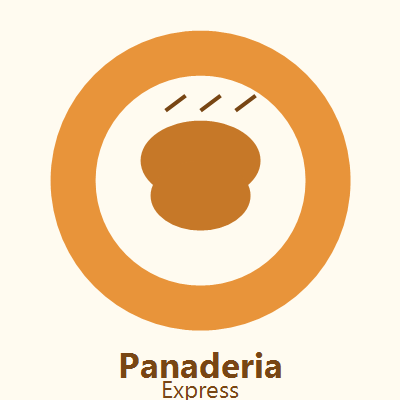
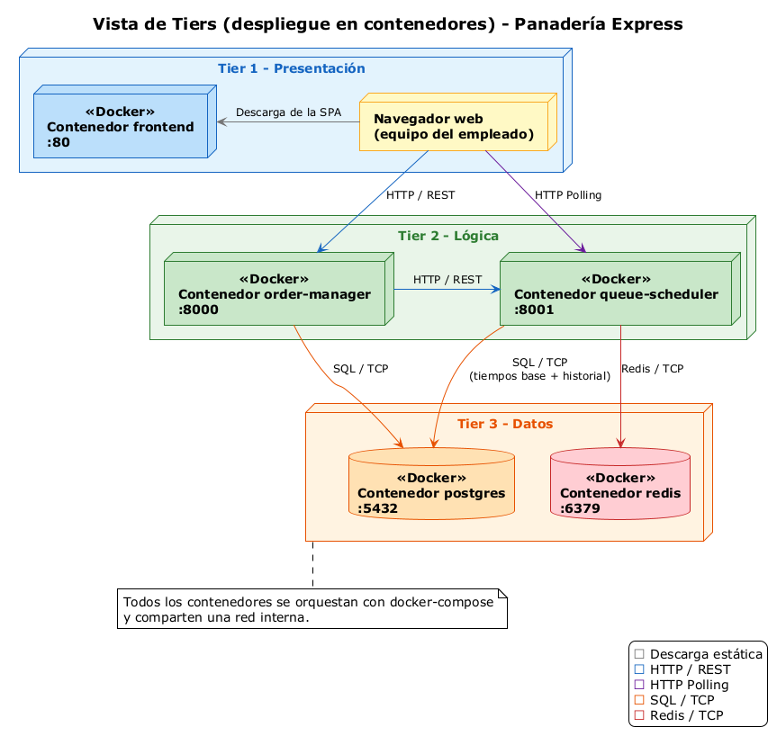

# Panadería Express

## 1. Equipo

**Nombre del equipo:** PanTech

| Integrante |
|---|
| Jaime Darley Angulo Tenorio |
| Diego Fernando Waitoto Quintero |
| Yeison Camilo Aparicio Aponte |
| Axel Gómez Moreno |

## 2. Sistema de software

### Nombre

**Panadería Express**

### Logo



### Descripción

Panadería Express resuelve el problema de la atención en una panadería con dos tipos de cliente: quien pide un café y un pan de vitrina y quiere salir rápido (**para llevar**), y quien se sienta a pedir un desayuno preparado que toma tiempo (**consumo en sitio**). Como los productos tienen tiempos de preparación muy distintos, atender en estricto orden de llegada (FIFO) deja esperando de más a los pedidos rápidos. El sistema organiza la cola de cocina según los tiempos estimados de preparación.

**Usuario final:** el empleado de la panadería. El cliente no interactúa con el sistema: pide verbalmente y el empleado registra el pedido. Hay cuatro roles dentro de la misma aplicación web:

- **Mesero:** crea pedidos (para llevar o en mesa), consulta el menú y gestiona las reservas.
- **Cocinero:** ve la cola de cocina en orden de prioridad y cambia el estado de las comandas.
- **Despachador:** confirma la entrega y retira la orden.
- **Productos (administración del catálogo):** mantiene el CRUD de productos y sus minutos de preparación base.

Además de las vistas por rol, la Web App incluye una vista **Historial** para consultar los tiempos de las comandas (Requerimiento 9).

> **Prototipo 2 (propuesto):** los roles pasan a ser `mesero`, `cocinero`, `despachador` y `admin`; la vista *Historial* deja de ser un rol y se convierte en un permiso de lectura para el personal autenticado.

#### Alcance del Prototipo 1

El Prototipo 1 es el flujo básico funcional: un empleado registra un pedido, selecciona los productos, la comanda aparece en cocina, el personal actualiza su estado y finalmente se confirma la entrega. Además, el sistema conserva el **historial de estados** de cada comanda (Requerimiento 9) para consultar los tiempos de preparación y entrega.

| N.º | Requerimiento | Prioridad | Alcance | ¿Implementado en el Prototipo 1? |
|---|---|---|---|---|
| 1 | Crear pedido para llevar o en mesa | P1 | Implementar | Sí |
| 2 | Crear cita de reserva | P1 | Implementar | Sí |
| 3 | Elegir productos de vitrina o preparados | P1 | Implementar | Sí |
| 4 | Ver menú y tiempos estimados | P1 | Implementar | Sí |
| 6 | Cambiar estado a *En preparación* o *Listo* | P1 | Implementar | Sí |
| 7 | Confirmar entrega y retirar la orden | P1 | Implementar | Sí |
| 8 | CRUD de productos (minutos de preparación base) | P1 | Operaciones básicas | Sí |
| 9 | Registrar y consultar el historial de estados de cada comanda | P1 | Implementar | Sí |

> El detalle de la implementación de cada requerimiento está en la tabla de trazabilidad.

Para la cola de cocina se usa una regla sencilla basada en los tiempos estimados de preparación (los productos más rápidos se atienden primero). El algoritmo de priorización más completo, las alertas de espera, la pantalla de despacho avanzada, la actualización en tiempo real con WebSocket y las métricas quedan para los siguientes prototipos.

#### Alcance del Prototipo 2 (propuesto)

El Prototipo 2 se enfoca en dos frentes: **autenticación y autorización de usuarios** y **priorización avanzada de la cola de cocina**. Además, recibe el Requerimiento 5, que no se implementó en el Prototipo 1. Los requerimientos se documentan como diseño objetivo; **aún no están implementados**.

**Requerimientos funcionales nuevos**

| N.º | Requerimiento | Prioridad | Alcance | Estado |
|---|---|---|---|---|
| 10 | Registro, inicio de sesión y sesión de usuario | P2 | Implementar | Pendiente. Auth Service con usuarios, credenciales y JWT. |
| 11 | Autorización por roles y protección de endpoints | P2 | Implementar | Pendiente. Roles `mesero`, `cocinero`, `despachador` y `admin`; Historial como permiso de lectura. |
| 12 | Priorización avanzada de la cola | P2 | Implementar | Pendiente. Ya existe SJF con desempate FIFO; faltan envejecimiento (aging), capacidad de cocina y ETA. |

**Requerimientos del Prototipo 1 que pasan al Prototipo 2**

| N.º | Requerimiento | Prioridad | Estado |
|---|---|---|---|
| 5 | Cobrar / confirmar pago y enviar comanda | P2 | Pendiente. El envío de la comanda a cocina ya está implementado; falta el cobro/confirmación de pago. |

**Requerimientos funcionales modificados**

| N.º | Requerimiento | Cambio para el Prototipo 2 |
|---|---|---|
| 1 | Crear pedido para llevar o en mesa | Exige sesión con rol `mesero` o `admin`; el Order Manager valida JWT y encola con credencial de servicio. |
| 2 | Crear cita de reserva | Exige rol `mesero` o `admin`. |
| 3 | Elegir productos de vitrina o preparados | Exige sesión autenticada; sigue siendo una operación de lectura. |
| 4 | Ver menú y tiempos estimados | Exige sesión autenticada. |
| 6 | Cambiar estado a *En preparación* o *Listo* | Exige rol `cocinero` o `admin`; valida capacidad de cocina si se implementa el scheduler avanzado. |
| 7 | Confirmar entrega y retirar la orden | Exige rol `despachador` o `admin`. |
| 8 | CRUD de productos (minutos de preparación base) | Exige rol `admin`. |
| 9 | Registrar y consultar el historial de estados | Historial deja de ser un rol y pasa a ser un permiso de lectura para personal autenticado. |

**Requerimientos no funcionales que cambian**

| Requerimiento | Cambio para el Prototipo 2 |
|---|---|
| Arquitectura distribuida | Se agrega `auth-service` y el sistema pasa de 5 a 6 componentes. |
| Seguridad | Autenticación JWT, autorización por roles, HTTPS para Auth Service y credencial de servicio para la comunicación interna. |
| Persistencia | Se agregan los volúmenes `postgres_data` y `redis_data`; Redis con AOF para conservar la cola activa. |
| Despliegue | Red interna `panaderia-net`; en producción no se publican `5432` ni `6379`. |
| Tipos de conector | Se agregan `HTTPS / REST`, `HTTP / REST + JWT`, `HTTP Polling + JWT` y credencial de servicio. |
| Actualización de la interfaz | Se mantiene **polling**; WebSocket/SSE queda como extensión futura. |

> La trazabilidad de los requerimientos del Prototipo 2 se completará cuando se implementen. Por ahora solo se documenta el alcance y los cambios respecto al Prototipo 1.

#### Trazabilidad requerimiento → implementación

| N.º | Vistas (frontend) | Servicio y ruta (backend) | Lógica / persistencia |
|---|---|---|---|
| 1 | `frontend/src/views/MeseroView.tsx` | Order Manager — `POST /orders` | Valida productos y `table_number`; guarda en `orders`/`order_items` (PostgreSQL) y encola en cocina. |
| 2 | `frontend/src/views/MeseroView.tsx` | Order Manager — `GET/POST/PUT/DELETE /reservations` | Tabla `reservations` (PostgreSQL). |
| 3 | `frontend/src/views/MeseroView.tsx` | Order Manager — `GET /menu`, `GET /products` | `Product.category ∈ {vitrina, preparado}`. |
| 4 | `MeseroView.tsx`, `CocineroView.tsx`, `DespachadorView.tsx` | Order Manager — `GET /menu`; Queue Scheduler — `GET /queue`, `GET /dispatch` | `prep_minutes` por producto y `estimated_minutes` por comanda. |
| 6 | `frontend/src/views/CocineroView.tsx` | Queue Scheduler — `PATCH /queue/orders/{id}/status` | `priority.is_valid_transition` (`pendiente → en_preparación → listo`). |
| 7 | `frontend/src/views/DespachadorView.tsx` | Queue Scheduler — `POST /queue/orders/{id}/deliver` | Exige estado `listo`; sale del `ZSET` de Redis y el hash queda con TTL. |
| 8 | `frontend/src/views/ProductosView.tsx` | Order Manager — `GET/POST/PUT/DELETE /products` | CRUD de `products`; bloquea el borrado con pedidos asociados (409). |
| 9 | `frontend/src/views/HistorialView.tsx`, `CocineroView.tsx`, `DespachadorView.tsx` | Queue Scheduler — `GET /history`, `GET /history/orders/{id}`; registro en `POST /queue/orders`, `PATCH /queue/orders/{id}/status`, `POST /queue/orders/{id}/deliver` | Tabla `order_status_events` (PostgreSQL): un evento por transición con `changed_at`. |

> El Requerimiento 5 no aparece en esta trazabilidad porque se trasladó al Prototipo 2.

## 3. Estructuras arquitectónicas

### Estructura de Componentes y Conectores (C&C)

#### Vista C&C — Prototipo 1


#### Vista C&C — Prototipo 2 (diseño objetivo)


El diseño del Prototipo 2 conserva la estructura del Prototipo 1 y agrega:

- **Auth Service** (`:8002`) como sexto componente, encargado del registro, inicio de sesión y emisión de JWT.
- **Autenticación y autorización (JWT + RBAC):** Order Manager y Queue Scheduler validan el token localmente; los roles son `mesero`, `cocinero`, `despachador` y `admin`, e Historial queda como permiso de lectura.
- **Queue Scheduler con priorización avanzada:** SJF + envejecimiento (aging) + capacidad de cocina + ETA, manteniendo el desempate FIFO.
- **Mismo PostgreSQL con esquema `auth`** para usuarios y roles, sin agregar un contenedor de base de datos adicional.
- **Polling** como mecanismo de actualización; WebSocket/SSE queda como extensión futura.

> Los diagramas del Prototipo 2 representan el diseño objetivo. La implementación de estos cambios se realizará en la siguiente fase.

#### Vista de tiers — Prototipo 1



#### Vista de tiers — Prototipo 2 (diseño objetivo)


#### Estilos arquitectónicos utilizados

- **Arquitectura en capas (3 capas / 3 tiers):** presentación, lógica y datos, cada una en su propio nivel de despliegue. Cada capa solo se comunica con la inmediatamente inferior.
- **Cliente-servidor:** la aplicación web (cliente) solicita servicios a los servicios de la capa lógica mediante HTTP.
- **REST (servicios sin estado):** la capa lógica expone recursos (`/orders`, `/queue`, `/products`, …) con una interfaz uniforme sobre HTTP (GET/POST/PUT/PATCH/DELETE). Los servicios no guardan estado en el proceso: el estado vive en los almacenes, por lo que pueden replicarse. Evidencia: `frontend/src/api.ts`, `order-manager/app/routers/` y `queue-scheduler/app/main.py`.
- **Orientado a servicios:** la lógica se divide en dos servicios independientes con responsabilidades distintas (gestión de pedidos y gestión de la cola), desplegados por separado y comunicados por HTTP.
- **Centrado en datos (repositorios):** dos almacenes de datos con roles distintos; uno relacional para datos persistentes y uno NoSQL para el estado temporal de la cola. El acceso a los almacenes se encapsula en repositorios (`order-manager/app/database.py`, `queue-scheduler/app/store.py`).
- **Consulta periódica (pull / polling):** el cliente consulta cada cierto tiempo el estado de la cola en lugar de recibir notificaciones del servidor. Se deja WebSocket para la siguiente entrega. Evidencia: `frontend/src/hooks.ts` (`usePolling`).
- **Interfaz de usuario basada en componentes:** la Web App se compone de vistas por rol y hooks reutilizables, con el cambio de rol resuelto por estado local. Evidencia: `frontend/src/App.tsx`, `frontend/src/views/` y `frontend/src/hooks.ts`.

#### Elementos arquitectónicos

**Componentes**

| Componente | Tipo | Tecnología | Puerto | Responsabilidad |
|---|---|---|---|---|
| Web App | Cliente web (presentación) | React + Vite (JS/TS) | 80 | Interfaz del empleado: vistas por rol para mesero, cocina, despacho y administración del catálogo, más la vista de historial de comandas. |
| Order Manager | Servicio (lógica) | Python + FastAPI | 8000 | Gestión de pedidos, reservas y catálogo de productos (CRUD con tiempos de preparación base). |
| Queue Scheduler | Servicio (lógica) | Python + FastAPI | 8001 | Gestión de la cola de cocina: ordena los pedidos con la regla de priorización, administra los estados de las comandas y persiste su historial. |
| Relational DB | Base de datos relacional (datos) | PostgreSQL | 5432 | Datos persistentes: productos, tiempos base, pedidos, reservas e historial de estados de las comandas. |
| NoSQL DB | Base de datos NoSQL clave-valor (datos) | Redis | 6379 | Cola activa de cocina y estados temporales de las comandas. |

> En el diseño del Prototipo 2 se agrega el **Auth Service** (FastAPI, `:8002`), que centraliza usuarios, roles y emisión de JWT. Order Manager y Queue Scheduler validan el token localmente.

**Actor externo**

| Actor | Descripción |
|---|---|
| Empleado (Mesero / Cocinero / Despachador / Administrador del catálogo) | Usuario final. Interactúa con el sistema desde el navegador web. |

**Conectores**

| N.º | Origen | Destino | Tipo de conector | Descripción |
|---|---|---|---|---|
| 1 | Web App | Order Manager (REST API :8000) | HTTP / REST | Crear pedidos y reservas, consultar el menú y administrar productos. |
| 2 | Web App | Queue Scheduler (Scheduler API :8001) | HTTP Polling | Consulta periódica de la cola de cocina, de los pedidos listos y del historial; también el cambio de estado de las comandas. |
| 3 | Order Manager | Queue Scheduler (Scheduler API :8001) | HTTP / REST | Encolar un pedido nuevo para cocina. |
| 4 | Order Manager | Relational DB (SQL :5432) | SQL sobre TCP | Persistir productos, pedidos y reservas. |
| 5 | Queue Scheduler | NoSQL DB (Redis :6379) | Protocolo Redis sobre TCP | Mantener la cola priorizada y los estados temporales. |
| 6 | Queue Scheduler | Relational DB (SQL :5432) | SQL sobre TCP | Leer los tiempos base de preparación y registrar el historial de estados de las comandas en `order_status_events`. |

> El Prototipo 2 agrega el conector Web App → Auth Service (HTTPS / REST) y Auth Service → PostgreSQL (SQL / TCP, esquema `auth`). También cambia el conector Order Manager → Queue Scheduler para usar una credencial de servicio. El detalle está en la Vista C&C del Prototipo 2.

#### Cumplimiento de los requisitos no funcionales

| Requisito | Cómo se cumple |
|---|---|
| Arquitectura distribuida | Cinco componentes desplegados en contenedores independientes que se comunican por red. En el diseño del Prototipo 2 se agrega un sexto componente (Auth Service). |
| Al menos un componente de presentación (web front-end) | Web App (React + Vite). |
| Al menos dos componentes de lógica | Order Manager y Queue Scheduler. |
| Al menos dos componentes de datos (relacional y NoSQL) | PostgreSQL y Redis. |
| Al menos dos tipos distintos de conectores basados en HTTP | HTTP / REST (petición-respuesta) y HTTP Polling (consulta periódica). |
| Al menos dos lenguajes de programación de propósito general | JavaScript/TypeScript (frontend) y Python (servicios). |
| Despliegue orientado a contenedores | Cada componente corre en su propio contenedor Docker, orquestados con Docker Compose. |

## 4. Prototipo

### Estructura del proyecto

```
swarch-2026ii/               # Repositorio del curso (sección 3)
└── g3-H-PanTech/            # Carpeta del equipo (Team 3-H · PanTech)
    ├── README.md
    ├── docker-compose.yml
    ├── .env.example
    ├── docs/                  # diagramas y logo
    ├── frontend/              # Web App (React + Vite)
    ├── order-manager/         # Servicio de pedidos y catálogo (FastAPI)
    └── queue-scheduler/       # Servicio de cola de cocina (FastAPI)
```

### Instrucciones para desplegar el sistema localmente

**Requisitos previos**

- Git
- Docker y Docker Compose (v2)

**Pasos**

1. Clonar el repositorio y ubicarse en la carpeta del equipo:

   ```bash
   git clone https://github.com/unal-sw-arch/swarch-2026ii.git
   cd swarch-2026ii
   cd g3-H-PanTech
   ```

2. Construir y levantar todos los contenedores:

   ```bash
   docker compose up --build
   ```

3. Abrir el sistema en el navegador:

   | Servicio | URL |
   |---|---|
   | Web App | http://localhost |
   | Order Manager (documentación de la API) | http://localhost:8000/docs |
   | Queue Scheduler (documentación de la API) | http://localhost:8001/docs |

4. Para detener el sistema:

   ```bash
   docker compose down
   ```

   Para borrar también los datos guardados (volúmenes):

   ```bash
   docker compose down -v
   ```

### Limitaciones conocidas

- **El detalle de la comanda no se persiste en PostgreSQL.** El Queue Scheduler mantiene el detalle y el estado actual de las comandas en Redis; las comandas entregadas salen de las pantallas y se conservan en Redis con un TTL (1 hora por defecto, configurable con `DELIVERED_TTL_SECONDS`). Sin embargo, **el historial de estados sí se persiste** de forma durable en la tabla `order_status_events` (Requerimiento 9), por lo que los tiempos de preparación y entrega se conservan aunque expire el TTL. El Order Manager persiste el pedido base en PostgreSQL (`orders` / `order_items`) al crearlo.
- La cola priorizada vive en un `ZSET` de Redis con `score` = tiempo estimado; el desempate por hora de llegada se resuelve al construir la vista de cocina.
- El Prototipo 1 no incluye cobro/pago (Requerimiento 5, trasladado al Prototipo 2), priorización avanzada, alertas de tiempo, métricas, WebSocket/SSE ni autenticación.
- El **Prototipo 2** incorpora en su diseño autenticación JWT/RBAC, el Auth Service, priorización con aging/capacidad/ETA, persistencia de Redis y el cobro/confirmación de pago (Requerimiento 5); su implementación está pendiente.
- **Validación de pedidos (Requerimiento 1).** Un pedido `en_mesa` exige número de mesa; un pedido `para_llevar` no lo requiere, pero tampoco se rechaza si se envía un número de mesa.
- **El envío de la comanda a cocina (parte del Requerimiento 5) ya está implementado:** al crear un pedido, el Order Manager lo encola en el Queue Scheduler. Lo único pendiente de ese requerimiento es el cobro / confirmación de pago.
