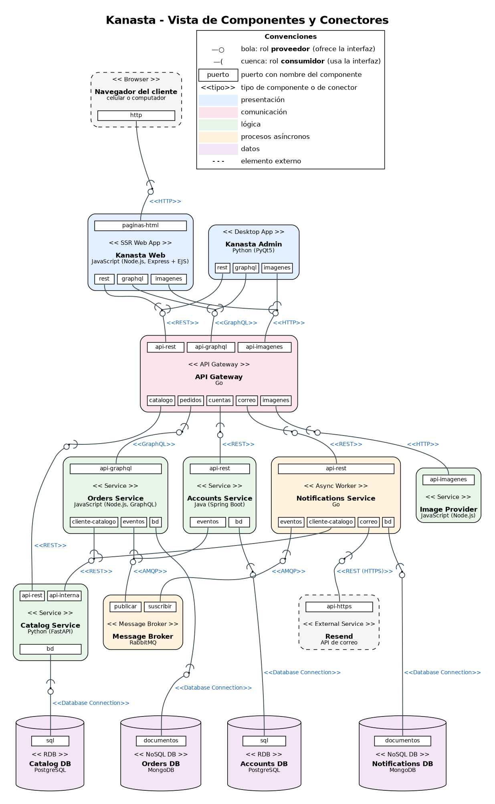
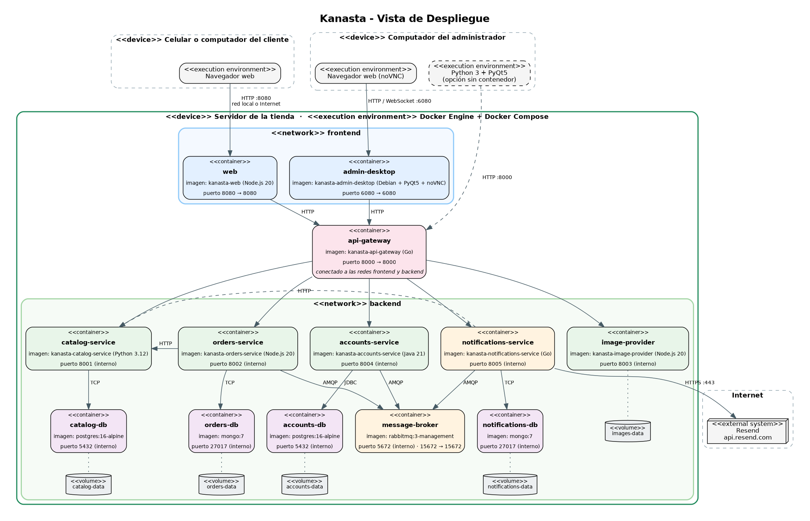
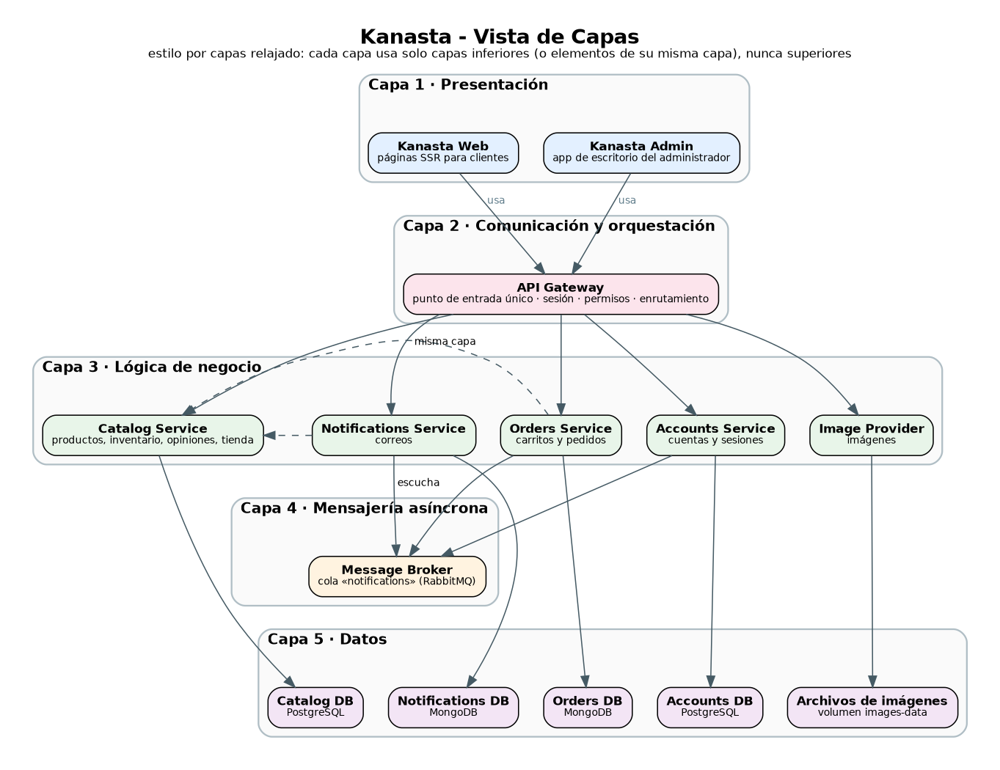
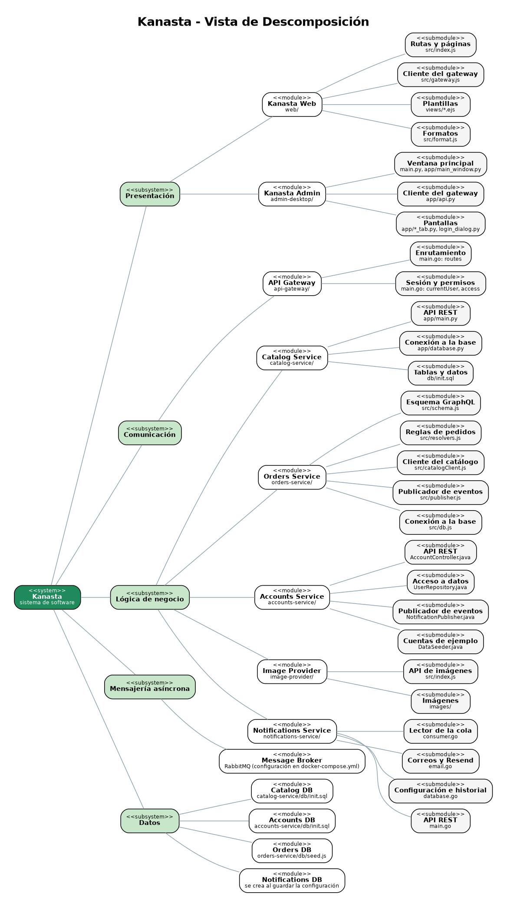

<p align="center">
  
</p>

# Equipo 3-C: Kanasta

## Equipo

**Nombre del equipo:** 3-C

| Integrantes |
|---|
| Rene Alejandro Barrero Gonzalez |
| Cristian Alejandro Sanabria Pinzon |
| Juan Mateo Rozo Torres |
| Daniel Esteban López Guaca |

## Sistema de software

| | |
|---|---|
| **Nombre** | Kanasta |
| **Logo** |  |
| **Lema** | *Todo lo que buscas, en una canasta* |

### Descripción

**Kanasta** es un software de ventas a domicilio para **tiendas de barrio**: fruterías, carnicerías y tiendas de mercado. Cada tienda instala su propia copia de Kanasta en un computador del local. El administrador configura la tienda (nombre, dirección, zona de entregas, cuenta de correo y catálogo) desde la aplicación de escritorio **Kanasta Admin**, y desde ese momento los vecinos pueden comprar en la página web **Kanasta Web**.

Los clientes crean su cuenta, buscan productos, arman su carrito y confirman su pedido con la dirección de entrega. La tienda lleva el pedido a domicilio y el cliente paga al recibirlo. Las frutas, verduras, carnes y líquidos se venden **por peso o por volumen** (kg o litros), con un aviso de que el valor final puede variar un poco, porque no siempre es posible pesar o medir la cantidad exacta. Kanasta envía correos automáticos con **Resend** cuando el cliente crea su cuenta, cuando cambia su contraseña y cuando hace una compra (con el recibo).

---

## Estructuras arquitectónicas

La descripción completa de cada estructura está en [documentacion/arquitectura/descripcion-arquitectura.md](documentacion/arquitectura/descripcion-arquitectura.md).

### 1. Estructura de componentes y conectores (C&C)

#### Vista C&C



Notación: `<<tipo>>`, nombre y puertos con nombre en cada componente; en cada conector, su `<<tipo>>` y sus roles con notación de piruleta (bola = **proveedor**, cuenca = **consumidor**).

#### Elementos y relaciones

| Componente | Tipo | Lenguaje / tecnología | Responsabilidad |
|---|---|---|---|
| Kanasta Web | Presentación (web SSR) | JavaScript: Node.js, Express, EJS | Tienda para los clientes; arma el HTML en el servidor. |
| Kanasta Admin | Presentación (escritorio) | Python: PyQt5 | Aplicación del administrador. |
| API Gateway | Comunicación y orquestación | Go | Entrada única; sesión, permisos y enrutamiento. |
| Catalog Service | Lógica | Python: FastAPI | Productos, inventario, categorías, opiniones y datos de la tienda. |
| Orders Service | Lógica | JavaScript: Node.js, GraphQL | Carritos y pedidos. |
| Accounts Service | Lógica | Java: Spring Boot | Cuentas, contraseñas y sesiones. |
| Notifications Service | Lógica asíncrona | Go | Lee eventos de la cola y envía los correos con Resend. |
| Image Provider | Lógica | JavaScript: Node.js | Imágenes de los productos. |
| Message Broker | Comunicación asíncrona | RabbitMQ | Cola de eventos `notifications`. |
| Catalog DB | Datos (relacional) | PostgreSQL | Tienda, categorías, productos y opiniones. |
| Accounts DB | Datos (relacional) | PostgreSQL | Usuarios y sesiones. |
| Orders DB | Datos (NoSQL) | MongoDB | Carritos y pedidos. |
| Notifications DB | Datos (NoSQL) | MongoDB | Configuración de correo e historial de envíos. |

| Conector | Tipo | Consumidor → Proveedor |
|---|---|---|
| C1 | HTTP | Navegador → Kanasta Web |
| C2 | REST | Kanasta Web, Kanasta Admin → API Gateway |
| C3 | GraphQL | Kanasta Web, Kanasta Admin → API Gateway |
| C4 | HTTP | Kanasta Web, Kanasta Admin → API Gateway (imágenes) |
| C5 | REST | API Gateway → Catalog Service |
| C6 | GraphQL | API Gateway → Orders Service |
| C7 | REST | API Gateway → Accounts Service |
| C8 | REST | API Gateway → Notifications Service |
| C9 | HTTP | API Gateway → Image Provider |
| C10 | REST | Orders Service, Notifications Service → Catalog Service |
| C11 | AMQP | Orders Service, Accounts Service → Message Broker (publicar) |
| C12 | AMQP | Notifications Service → Message Broker (suscribir) |
| C13 | REST (HTTPS) | Notifications Service → Resend |
| C14–C17 | Database Connection | Cada servicio → su propia base de datos |

#### Estilos y patrones arquitectónicos

- **Cliente-servidor** en todas las comunicaciones síncronas (petición y respuesta).
- **Por niveles (n-tier):** presentación → comunicación → lógica → datos.
- **API Gateway:** punto de entrada único con autenticación y autorización centralizadas.
- **Server-Side Rendering (SSR)** en el front-end web.
- **Publicar-suscribir** con un broker de mensajes para los procesos asíncronos (correos).
- **Base de datos por servicio** y **persistencia políglota** (PostgreSQL y MongoDB).

### 2. Estructura de despliegue

#### Vista de despliegue



#### Elementos y relaciones

- **Servidor de la tienda:** un computador con Docker que ejecuta los 13 contenedores (uno por componente) y 5 volúmenes con los datos.
- **Redes de Docker:** `frontend` (Kanasta Web, Kanasta Admin y API Gateway) y `backend` (API Gateway, servicios, broker y bases de datos). El API Gateway es el único contenedor conectado a las dos.
- **Puertos publicados:** 8080 (tienda web), 6080 (Kanasta Admin en el navegador), 8000 (API Gateway) y 15672 (consola de RabbitMQ). Los servicios y las bases no publican puertos.
- **Dispositivos externos:** el celular o computador del cliente (navegador), el computador del administrador (navegador o Python con PyQt5) y el servicio de correo Resend en Internet (HTTPS).

#### Patrones de despliegue

- **Un contenedor por componente**, orquestados con **Docker Compose**.
- **Segmentación de red** con el API Gateway como único puente.
- **Estado en volúmenes con nombre**; los contenedores no guardan datos propios.
- **Instalación local (on-premise)**: cada tienda tiene su propia copia del sistema.

### 3. Estructura de capas

#### Vista de capas



#### Elementos y relaciones

| Capa | Elementos |
|---|---|
| 1. Presentación | Kanasta Web, Kanasta Admin |
| 2. Comunicación y orquestación | API Gateway |
| 3. Lógica de negocio | Catalog Service, Orders Service, Accounts Service, Notifications Service, Image Provider |
| 4. Mensajería asíncrona | Message Broker |
| 5. Datos | Catalog DB, Accounts DB, Orders DB, Notifications DB, archivos de imágenes |

La relación entre capas es **"usa"**: cada capa solo pide servicios a capas inferiores, nunca a superiores. Dentro de la capa de lógica, un servicio usa a otro solo por su API.

#### Patrones

- **Capas relajadas:** una capa puede usar cualquier capa inferior (la lógica usa la mensajería y los datos).
- **Fachada:** el API Gateway oculta a los front-ends la cantidad y la ubicación de los servicios.
- **Separación de responsabilidades:** las reglas de negocio están en la capa de lógica, así las dos interfaces se comportan igual.

### 4. Estructura de descomposición

#### Vista de descomposición



#### Elementos y relaciones

El sistema **Kanasta** se divide en cinco **subsistemas** (uno por capa); cada subsistema en **módulos** (uno por componente, cada uno con su carpeta en `codigo/`) y cada módulo en **submódulos** (archivos con una responsabilidad). La relación es **"es parte de"**. El detalle de cada módulo está en la [descripción de la arquitectura](documentacion/arquitectura/descripcion-arquitectura.md#4-estructura-de-descomposición).

---

## Prototipo: cómo ejecutarlo en local

### Requisitos

- [Docker Desktop](https://www.docker.com/products/docker-desktop/) (Windows o macOS) o Docker Engine con Docker Compose (Linux).
- Unos 4 GB de RAM libres. La primera construcción descarga las imágenes base y tarda varios minutos.

### Pasos

1. Abrir una terminal en la carpeta `codigo`:

   ```bash
   cd codigo
   ```

2. Construir y encender todos los componentes:

   ```bash
   docker compose up --build
   ```

   Esperar hasta ver en la terminal `Kanasta Web listening on port 8080` y `Started AccountsApplication`. Las bases de datos se llenan solas con la tienda de ejemplo, 61 productos, 3 cuentas y 3 pedidos.

3. Abrir la **tienda de los clientes**: **http://localhost:8080**

4. Abrir **Kanasta Admin** (la aplicación de escritorio, dentro del navegador): **http://localhost:6080/vnc.html?autoconnect=true&resize=scale**

5. Para apagar todo, pulsar `Ctrl + C` o ejecutar `docker compose down`. Para borrar también los datos y volver a la tienda de ejemplo: `docker compose down -v`.

### Cuentas de ejemplo

| Rol | Correo | Contraseña | Dónde se usa |
|---|---|---|---|
| Administrador | `admin@tienda.com` | `admin123` | Kanasta Admin |
| Cliente | `ana@correo.com` | `cliente123` | Kanasta Web |
| Cliente | `carlos@correo.com` | `cliente123` | Kanasta Web |

### Activar el envío de correos (opcional)

Sin configurar nada, Kanasta funciona completo y registra cada correo en el historial como "No enviado". Para enviarlos de verdad:

1. Crear una cuenta gratuita en [resend.com](https://resend.com) y copiar una **API key** (empieza por `re_`).
2. En Kanasta Admin, pestaña **Correo**: pegar la API key, dejar el remitente `onboarding@resend.dev`, marcar "Enviar correos a los clientes" y guardar.
3. Escribir un correo y pulsar **Enviar correo de prueba**.

> Mientras no se verifique un dominio propio en Resend, Resend solo entrega correos a la dirección con la que se creó la cuenta. Para probar, registre en la tienda un cliente con esa misma dirección.

### Kanasta Admin sin contenedor (opcional)

La aplicación de escritorio también se puede instalar en el computador del administrador (requiere Python 3.10 o superior):

```bash
cd codigo/admin-desktop
pip install -r requirements.txt
python main.py
```

En la ventana de ingreso, el campo **Servidor** debe apuntar al API Gateway: `http://localhost:8000` si es el mismo computador, o `http://<IP-del-servidor>:8000` desde otro computador de la tienda.

### Direcciones útiles

| Dirección | Qué muestra |
|---|---|
| http://localhost:8080 | Kanasta Web (tienda de los clientes) |
| http://localhost:6080/vnc.html?autoconnect=true&resize=scale | Kanasta Admin (aplicación de escritorio) |
| http://localhost:8000/api/catalog/products | API Gateway: productos en JSON |
| http://localhost:15672 | Consola de RabbitMQ (usuario `guest`, contraseña `guest`) |

---

## Estructura del proyecto

```
.
├── README.md                       ← este archivo
├── recursos/                       ← logo e ícono
├── codigo/                         ← todo lo necesario para ejecutar el sistema
│   ├── docker-compose.yml          ← despliegue de los 13 contenedores
│   ├── web/                        ← Kanasta Web (Node.js, SSR)
│   ├── admin-desktop/              ← Kanasta Admin (Python, PyQt5)
│   ├── api-gateway/                ← API Gateway (Go)
│   ├── catalog-service/            ← Catalog Service (Python) + datos de Catalog DB
│   ├── orders-service/             ← Orders Service (Node.js) + datos de Orders DB
│   ├── accounts-service/           ← Accounts Service (Java) + tablas de Accounts DB
│   ├── notifications-service/      ← Notifications Service (Go)
│   └── image-provider/             ← Image Provider (Node.js) + imágenes
├── documentacion/                  ← documentación del proyecto
│   ├── requisitos-funcionales.md
│   ├── requisitos-no-funcionales.md
│   ├── mapa-historias-usuario.puml / .png
│   ├── arquitectura/               ← las cuatro vistas (.dot / .png) y su descripción
│   ├── manual-de-usuario.md
│   └── capturas/
└── recorrido/                      ← recorrido interactivo por los requisitos no funcionales
```

## Documentación

- [Requisitos funcionales e historias de usuario](documentacion/requisitos-funcionales.md)
- [Requisitos no funcionales](documentacion/requisitos-no-funcionales.md)
- [Descripción de la arquitectura](documentacion/arquitectura/descripcion-arquitectura.md)
- [Manual de usuario](documentacion/manual-de-usuario.md)
- [Recorrido interactivo](recorrido/index.html): abrir `recorrido/index.html` directamente en el navegador (no necesita servidor).

Las imágenes de los productos provienen de Wikimedia Commons con licencias libres; los créditos están en [CREDITOS.md](codigo/image-provider/images/CREDITOS.md).
