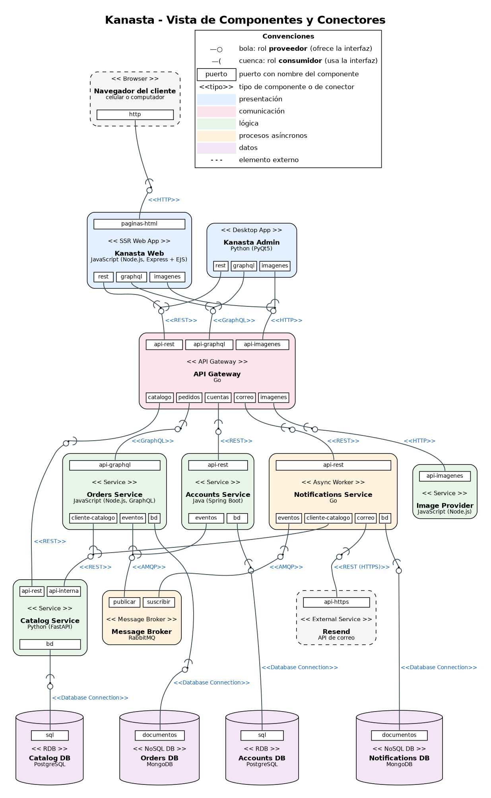
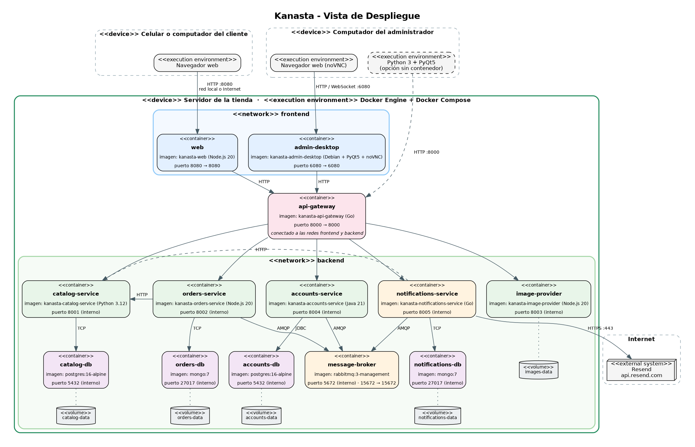
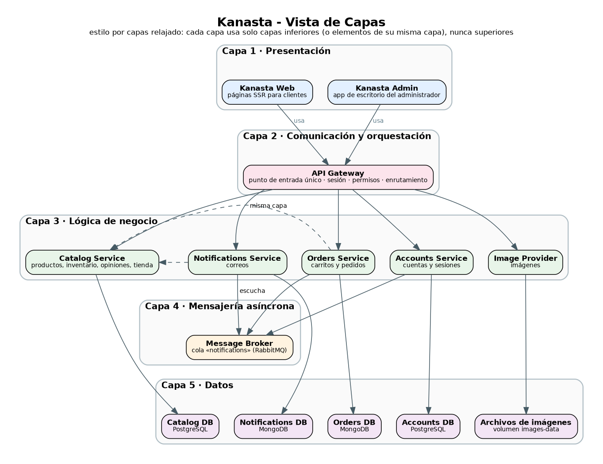
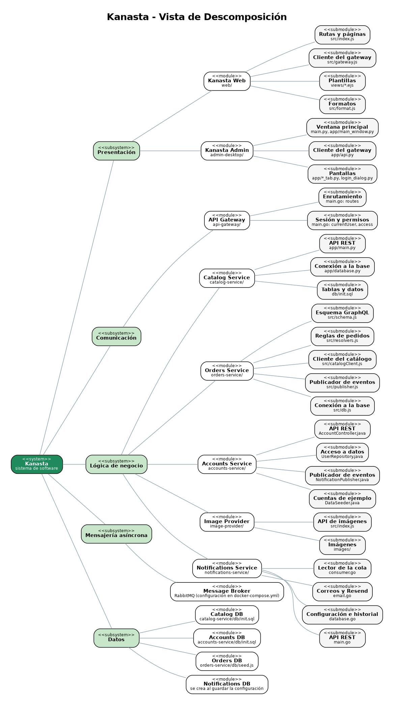

# Arquitectura de Kanasta (prototipo 2)

Este documento describe las cuatro estructuras arquitectónicas de Kanasta: **componentes y conectores**, **despliegue**, **capas** y **descomposición**. Los diagramas están en esta misma carpeta, en formato Graphviz (`.dot`) y en imagen (`.png`).

| Estructura | Diagrama | Fuente |
|---|---|---|
| Componentes y conectores (C&C) | [vista-cc.png](vista-cc.png) | [vista-cc.dot](vista-cc.dot) |
| Despliegue | [vista-despliegue.png](vista-despliegue.png) | [vista-despliegue.dot](vista-despliegue.dot) |
| Capas | [vista-capas.png](vista-capas.png) | [vista-capas.dot](vista-capas.dot) |
| Descomposición | [vista-descomposicion.png](vista-descomposicion.png) | [vista-descomposicion.dot](vista-descomposicion.dot) |

---

## 1. Estructura de componentes y conectores (C&C)

### Vista C&C

**Notación.** Cada componente muestra su tipo entre `<< >>`, su nombre, su tecnología y sus **puertos con nombre** (los recuadros blancos). Cada conector muestra su tipo entre `<< >>` y sus **roles** con la notación de piruleta: la **bola** (○) es el rol **proveedor**, que ofrece la interfaz, y la **cuenca** (( ) es el rol **consumidor**, que la usa. Cuando varios consumidores usan la misma interfaz, sus cuencas llegan al mismo punto de unión. Los elementos con borde punteado son externos a Kanasta.

### Descripción de los componentes

| Componente | Tipo | Tecnología | Responsabilidad | Puertos |
|---|---|---|---|---|
| Navegador del cliente | Browser (externo) | Cualquier navegador | Muestra las páginas que recibe de Kanasta Web. | `http` (consumidor) |
| **Kanasta Web** | SSR Web App (presentación) | JavaScript: Node.js, Express, EJS | Tienda para los clientes. Arma cada página en el servidor con datos del API Gateway. | `paginas-html` (proveedor); `rest`, `graphql`, `imagenes` (consumidores) |
| **Kanasta Admin** | Desktop App (presentación) | Python: PyQt5 | Aplicación de escritorio del administrador: pedidos, productos, categorías, clientes, datos de la tienda, correo y cuenta propia. | `rest`, `graphql`, `imagenes` (consumidores) |
| **API Gateway** | API Gateway (comunicación) | Go (solo librería estándar) | Punto de entrada único. Valida la sesión con el Accounts Service, revisa permisos, agrega los encabezados `X-User-*` y envía cada petición a su servicio. | `api-rest`, `api-graphql`, `api-imagenes` (proveedores); `catalogo`, `pedidos`, `cuentas`, `correo`, `imagenes` (consumidores) |
| **Catalog Service** | Service (lógica) | Python: FastAPI | Productos (por unidad, kg o litro), categorías, inventario, opiniones y datos de la tienda. | `api-rest`, `api-interna` (proveedores); `bd` (consumidor) |
| **Orders Service** | Service (lógica) | JavaScript: Node.js, GraphQL | Carritos y pedidos. Reserva y devuelve inventario y publica el evento del recibo. | `api-graphql` (proveedor); `cliente-catalogo`, `eventos`, `bd` (consumidores) |
| **Accounts Service** | Service (lógica) | Java: Spring Boot | Cuentas, contraseñas (BCrypt), sesiones y roles. Publica eventos de cuenta creada y contraseña cambiada. | `api-rest` (proveedor); `eventos`, `bd` (consumidores) |
| **Notifications Service** | Async Worker (lógica asíncrona) | Go | Lee los eventos de la cola, arma los correos y los envía con Resend. Guarda la configuración del correo y el historial de envíos. | `api-rest` (proveedor); `eventos`, `cliente-catalogo`, `correo`, `bd` (consumidores) |
| **Image Provider** | Service (lógica) | JavaScript: Node.js | Entrega las imágenes de los productos y recibe las nuevas que sube el administrador. Si una imagen no existe, responde con una de reemplazo. | `api-imagenes` (proveedor) |
| **Message Broker** | Message Broker (asíncrono) | RabbitMQ | Guarda los eventos en la cola `notifications` hasta que el Notifications Service los procesa. | `publicar`, `suscribir` (proveedores) |
| **Catalog DB** | RDB (datos) | PostgreSQL | Tablas `store`, `categories`, `products`, `reviews`. | `sql` (proveedor) |
| **Accounts DB** | RDB (datos) | PostgreSQL | Tablas `users`, `sessions`. | `sql` (proveedor) |
| **Orders DB** | NoSQL DB (datos) | MongoDB | Colecciones `carts`, `orders`. | `documentos` (proveedor) |
| **Notifications DB** | NoSQL DB (datos) | MongoDB | Colecciones `settings`, `emails`. | `documentos` (proveedor) |
| Resend | External Service (externo) | API web de correo | Entrega los correos a los clientes. | `api-https` (proveedor) |

### Descripción de los conectores

| # | Tipo | Consumidor → Proveedor | Para qué |
|---|---|---|---|
| C1 | HTTP | Navegador → Kanasta Web | Pedir páginas HTML y enviar formularios. |
| C2 | REST | Kanasta Web, Kanasta Admin → API Gateway | Catálogo, cuentas, tienda y correo. |
| C3 | GraphQL | Kanasta Web, Kanasta Admin → API Gateway | Carrito y pedidos. |
| C4 | HTTP | Kanasta Web, Kanasta Admin → API Gateway | Descargar y subir imágenes. |
| C5 | REST | API Gateway → Catalog Service | `/api/catalog/...` |
| C6 | GraphQL | API Gateway → Orders Service | `/graphql` |
| C7 | REST | API Gateway → Accounts Service | `/api/accounts/...` (incluye validar la sesión). |
| C8 | REST | API Gateway → Notifications Service | `/api/notifications/...` |
| C9 | HTTP | API Gateway → Image Provider | `/images/...` |
| C10 | REST | Orders Service, Notifications Service → Catalog Service | Consultar productos, reservar y devolver inventario; leer los datos de la tienda para los correos. |
| C11 | AMQP | Orders Service, Accounts Service → Message Broker | Publicar eventos (`ORDER_PLACED`, `ACCOUNT_CREATED`, `PASSWORD_CHANGED`). |
| C12 | AMQP | Notifications Service → Message Broker | Suscribirse a la cola y recibir los eventos. |
| C13 | REST (HTTPS) | Notifications Service → Resend | Enviar cada correo. |
| C14–C17 | Database Connection | Cada servicio → su base de datos | Leer y guardar datos (psycopg, JDBC, driver de MongoDB). |

### Estilos y patrones arquitectónicos

- **Cliente-servidor.** Toda la comunicación síncrona es de petición y respuesta: el navegador es cliente de Kanasta Web, los dos front-ends son clientes del API Gateway, el gateway es cliente de los servicios y cada servicio es cliente de su base de datos.
- **Por niveles (n-tier).** Presentación → comunicación → lógica → datos. Ningún front-end toca una base de datos ni un servicio directamente.
- **API Gateway.** Un solo punto de entrada que enruta, autentica y autoriza. Los servicios no tienen que repetir la validación de la sesión: confían en los encabezados que pone el gateway.
- **Server-Side Rendering (SSR).** Kanasta Web arma el HTML en el servidor; el navegador solo lo muestra.
- **Publicar-suscribir / mensajería asíncrona.** Los servicios que producen eventos no conocen al que los consume; el broker los desacopla en el tiempo (si el Notifications Service está apagado, los mensajes esperan en la cola).
- **Base de datos por servicio.** Cada base de datos tiene un único dueño. Si otro servicio necesita esos datos, los pide por la API (por ejemplo, Orders → Catalog para reservar inventario).
- **Persistencia políglota.** Relacional donde los datos son tablas con reglas (catálogo y cuentas) y documentos donde cada registro es un todo (pedidos, configuración y correos).

---

## 2. Estructura de despliegue

### Vista de despliegue

### Descripción de los elementos

| Elemento | Tipo | Descripción |
|---|---|---|
| Servidor de la tienda | Dispositivo | Un computador de la tienda (Windows, macOS o Linux) con Docker Engine y Docker Compose. Ahí corren todos los contenedores. |
| Celular o computador del cliente | Dispositivo | Solo necesita un navegador. Se conecta al puerto **8080** por la red local o por Internet (por ejemplo, con el puerto abierto en el router). |
| Computador del administrador | Dispositivo | Usa Kanasta Admin desde el navegador (noVNC, puerto **6080**) o instalada con Python, conectada al API Gateway en el puerto **8000**. Puede ser el mismo servidor. |
| Red `frontend` | Red de Docker | Une a los dos front-ends con el API Gateway. |
| Red `backend` | Red de Docker | Une al API Gateway con los servicios, el broker y las bases de datos. |
| 13 contenedores | Contenedor | Uno por componente: `web`, `admin-desktop`, `api-gateway`, `catalog-service`, `orders-service`, `accounts-service`, `notifications-service`, `image-provider`, `message-broker`, `catalog-db`, `accounts-db`, `orders-db`, `notifications-db`. |
| 5 volúmenes | Volumen de Docker | `catalog-data`, `accounts-data`, `orders-data`, `notifications-data` e `images-data`. Guardan los datos aunque los contenedores se apaguen o se actualicen. |
| Resend | Sistema externo | Servicio en Internet que entrega los correos (HTTPS, puerto 443). |

### Relaciones y puertos publicados

| Puerto del servidor | Contenedor | Uso |
|---|---|---|
| 8080 | `web` | Tienda para los clientes. |
| 6080 | `admin-desktop` | Kanasta Admin en el navegador (noVNC). |
| 8000 | `api-gateway` | Entrada de los front-ends (también para Kanasta Admin instalada con Python). |
| 15672 | `message-broker` | Consola de RabbitMQ para revisar la cola (opcional). |

Los servicios y las bases de datos **no publican puertos**: solo se alcanzan dentro de la red `backend`.

### Patrones de despliegue

- **Un contenedor por componente** (*single service per container*): cada componente se construye, se actualiza y se reinicia por separado.
- **Orquestación con Docker Compose**: un solo archivo declara contenedores, redes, volúmenes, variables y el orden de arranque (con revisiones de salud para las bases de datos y el broker).
- **Segmentación de red**: dos redes; el API Gateway es el único puente entre ellas.
- **Datos en volúmenes** (*externalized state*): los contenedores no guardan estado propio; todo el estado está en volúmenes con nombre.
- **Despliegue local (on-premise)**: cada tienda tiene su propia copia completa, sin depender de una nube; solo el envío de correos sale a Internet.

---

## 3. Estructura de capas

### Vista de capas

### Descripción de las capas

| Capa | Elementos | Responsabilidad | Puede usar |
|---|---|---|---|
| 1. Presentación | Kanasta Web, Kanasta Admin | Mostrar información y recibir las acciones de los usuarios. | Capa 2 |
| 2. Comunicación y orquestación | API Gateway | Recibir todas las peticiones de afuera, identificar al usuario, aplicar permisos y enrutar. | Capa 3 |
| 3. Lógica de negocio | Catalog, Orders, Accounts, Notifications, Image Provider | Reglas del negocio: inventario, pedidos, cuentas, correos e imágenes. | Capas 4 y 5 (y servicios de su misma capa por su API) |
| 4. Mensajería asíncrona | Message Broker | Transportar eventos entre servicios sin que tengan que esperarse. | — |
| 5. Datos | Catalog DB, Accounts DB, Orders DB, Notifications DB, archivos de imágenes | Guardar la información de forma permanente. | — |

### Relaciones

- La relación entre capas es **"usa"**: una capa solo pide cosas a las capas de abajo y nunca a las de arriba. Por ejemplo, ningún servicio llama a Kanasta Web ni al API Gateway.
- Dentro de la capa de lógica, un servicio puede usar a otro **solo por su API** (Orders → Catalog y Notifications → Catalog).
- La capa de lógica usa la capa 4 para los eventos y la capa 5 para los datos; cada servicio solo toca **su propia** base.

### Patrones

- **Capas relajadas** (*relaxed layered*): una capa puede usar cualquier capa inferior (la lógica usa tanto la mensajería como los datos), pero nunca una superior.
- **Capa de fachada**: el API Gateway oculta a los front-ends cuántos servicios hay y dónde están.
- **Separación de responsabilidades**: las reglas de negocio no están en los front-ends; por eso las dos interfaces (web y escritorio) se comportan igual.

---

## 4. Estructura de descomposición

### Vista de descomposición

### Descripción de los elementos

El sistema se divide en **subsistemas** (uno por capa), cada subsistema en **módulos** (uno por componente, que coincide con una carpeta de `codigo/`) y cada módulo en **submódulos** (archivos con una responsabilidad clara).

| Subsistema | Módulo | Carpeta | Submódulos principales |
|---|---|---|---|
| Presentación | Kanasta Web | `codigo/web/` | `src/index.js` (rutas y páginas), `src/gateway.js` (cliente del gateway), `src/format.js` (formatos), `views/*.ejs` (plantillas) |
| Presentación | Kanasta Admin | `codigo/admin-desktop/` | `main.py`, `app/main_window.py` (ventana), `app/api.py` (cliente del gateway), `app/*_tab.py` y `app/login_dialog.py` (pantallas) |
| Comunicación | API Gateway | `codigo/api-gateway/` | `main.go`: tabla de rutas (`routes`), sesión (`currentUser`) y permisos (`access`) |
| Lógica | Catalog Service | `codigo/catalog-service/` | `app/main.py` (API REST), `app/database.py` (conexión), `db/init.sql` (tablas y datos) |
| Lógica | Orders Service | `codigo/orders-service/` | `src/schema.js` (esquema GraphQL), `src/resolvers.js` (reglas), `src/catalogClient.js`, `src/publisher.js`, `src/db.js` |
| Lógica | Accounts Service | `codigo/accounts-service/` | `AccountController.java` (API REST), `UserRepository.java` (datos), `NotificationPublisher.java` (eventos), `DataSeeder.java` (cuentas de ejemplo) |
| Lógica | Notifications Service | `codigo/notifications-service/` | `main.go` (API REST), `consumer.go` (lector de la cola), `email.go` (correos y Resend), `database.go` (configuración e historial) |
| Lógica | Image Provider | `codigo/image-provider/` | `src/index.js` (API de imágenes), `images/` (fotos iniciales) |
| Mensajería | Message Broker | `codigo/docker-compose.yml` | Imagen oficial de RabbitMQ; la cola `notifications` la declaran los propios servicios. |
| Datos | Catalog DB, Accounts DB, Orders DB, Notifications DB | — | Imágenes oficiales de PostgreSQL y MongoDB, con sus scripts de datos iniciales en la carpeta del servicio dueño. |

### Relaciones

La única relación de esta vista es **"es parte de"**: cada submódulo pertenece a un solo módulo y cada módulo a un solo subsistema. Así cada equipo o persona sabe exactamente qué carpeta y qué archivos le corresponden, y la estructura del código coincide uno a uno con los componentes de la vista C&C.
