# Manual de usuario

Kanasta tiene dos partes:

- **Kanasta Web** (http://localhost:8080): la tienda donde compran los clientes.
- **Kanasta Admin** (http://localhost:6080/vnc.html?autoconnect=true&resize=scale): la aplicación de escritorio del administrador de la tienda.

Para encender el sistema, siga los pasos del [README](../README.md#prototipo-cómo-ejecutarlo-en-local).

---

## Parte 1. Kanasta Web (clientes)

### 1. Ver el catálogo

Al abrir la tienda se ven todos los productos con su foto, categoría, calificación y precio. Las frutas, verduras, carnes y líquidos muestran el precio **por kg** o **por litro**.

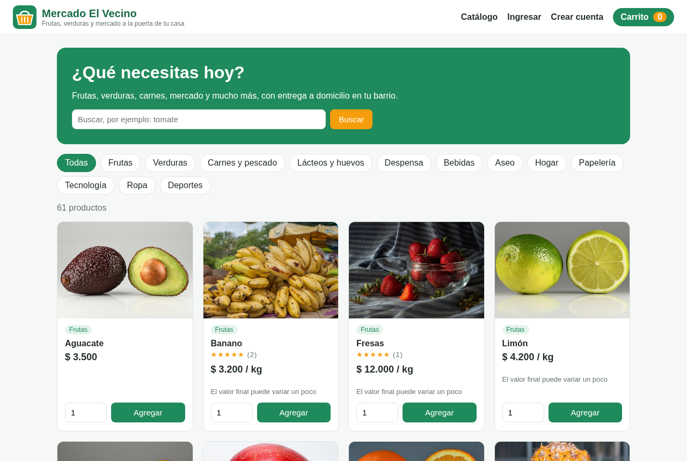

### 2. Filtrar por categoría y buscar

- Pulse una categoría (Frutas, Verduras, Carnes y pescado…) para ver solo sus productos. "Todas" quita el filtro.
- Escriba una palabra en el buscador (por ejemplo, *leche*) y pulse **Buscar**.

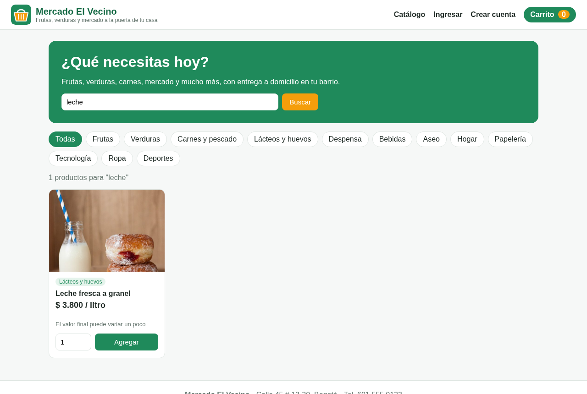

### 3. Ver el detalle de un producto

Pulse el nombre o la foto de un producto. Verá la descripción, el precio, la cantidad disponible y las opiniones de otros clientes. En los productos por peso o volumen aparece el aviso: *el valor final puede variar un poco, porque no siempre es posible pesar o medir exactamente la cantidad que pide*.

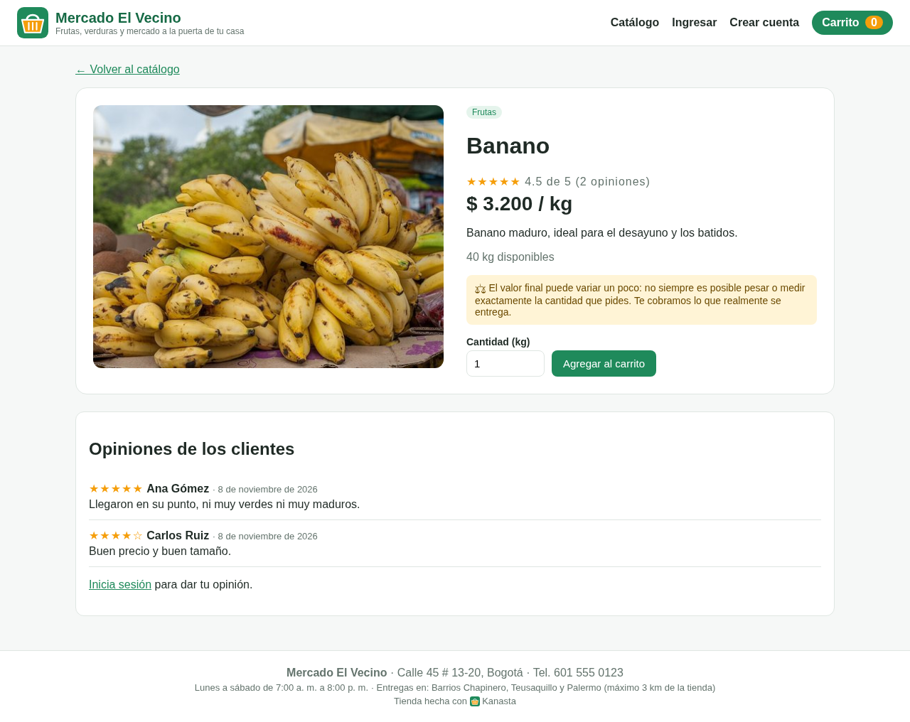

### 4. Agregar al carrito

Escriba la cantidad y pulse **Agregar al carrito** (o **Agregar** en el catálogo).

- Productos por unidad: cantidades enteras (1, 2, 3…).
- Productos por kg o litro: pasos de 0,25 (por ejemplo, 1,5 kg de banano o 0,75 kg de tomate).

No se puede pedir más de lo disponible. El número del botón **Carrito** muestra cuántos productos tiene.

### 5. Crear una cuenta e ingresar

Para confirmar pedidos necesita una cuenta. Pulse **Crear cuenta**, llene sus datos y pulse **Crear cuenta**. Recibirá un **correo de bienvenida**.

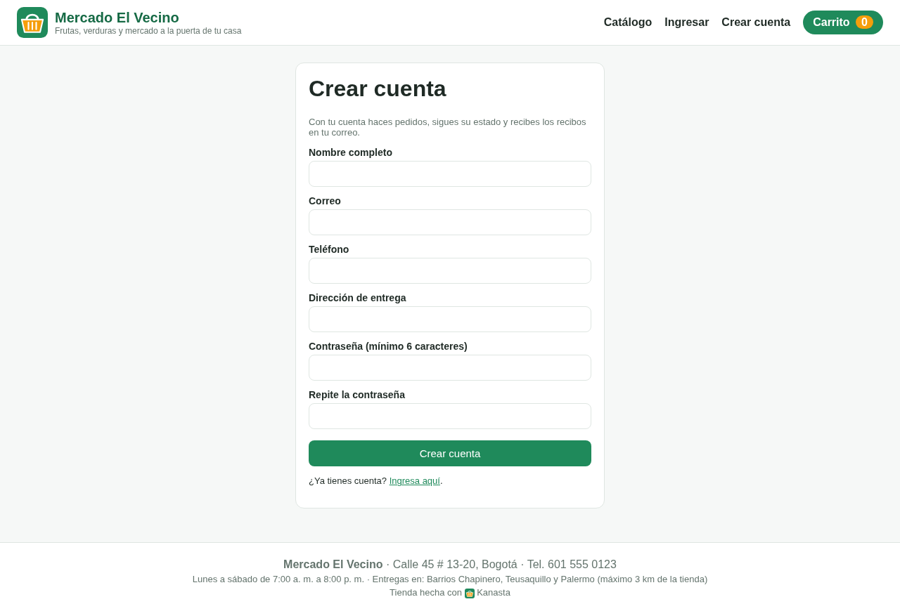

Si ya tiene cuenta, pulse **Ingresar** y escriba su correo y contraseña. Para cerrar la sesión pulse **Salir**.

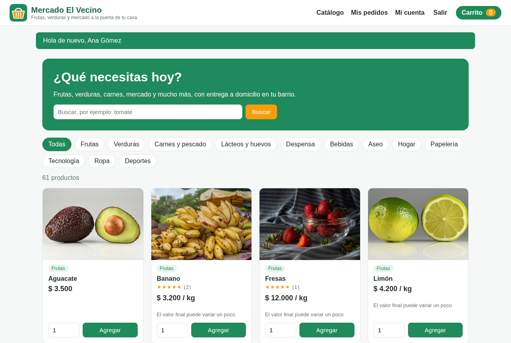

> Cuentas de ejemplo: `ana@correo.com` / `cliente123` y `carlos@correo.com` / `cliente123`.

### 6. Revisar el carrito

En **Carrito** puede cambiar cantidades (**Actualizar**) o quitar productos (**Quitar**). Si hay productos por peso o volumen, el total aparece como **aproximado**.

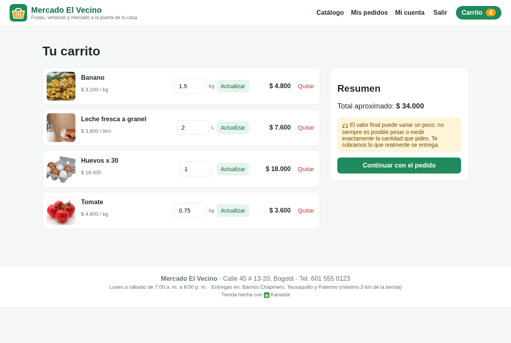

### 7. Confirmar el pedido

Pulse **Continuar con el pedido**. Revise el teléfono y la dirección (vienen de su cuenta), agregue notas si quiere y pulse **Confirmar pedido**. El pago se hace al recibir.

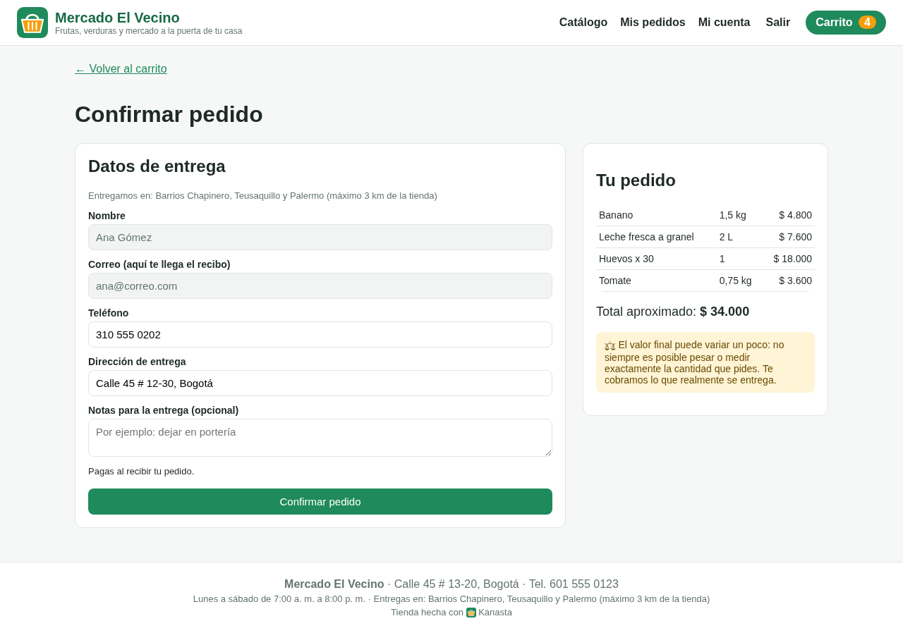

Verá el número del pedido y recibirá el **recibo por correo**.

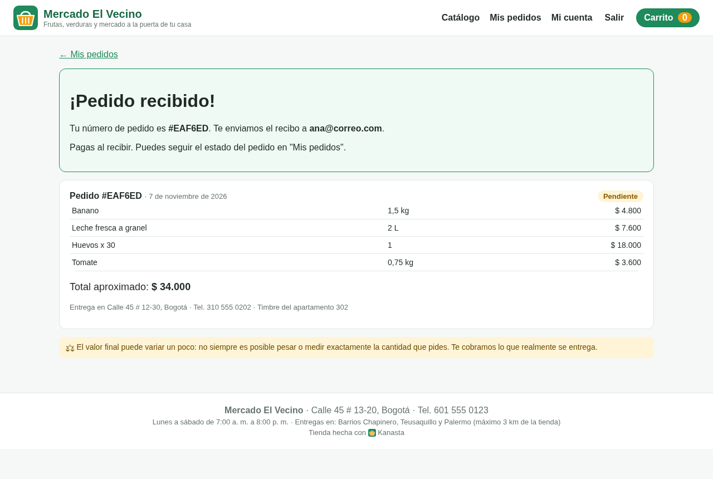

### 8. Ver mis pedidos

En **Mis pedidos** aparecen todos sus pedidos con fecha, productos, total y estado: **Pendiente**, **En camino**, **Entregado** o **Cancelado**.

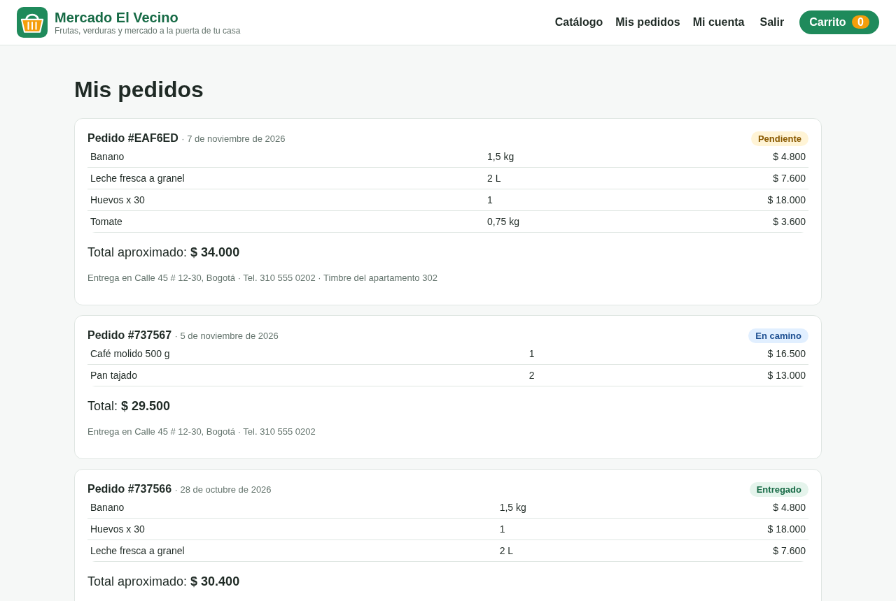

### 9. Gestionar mi cuenta

En **Mi cuenta** puede cambiar su nombre, teléfono y dirección, y cambiar su contraseña (debe escribir la actual). Al cambiar la contraseña recibirá un **correo de aviso**.

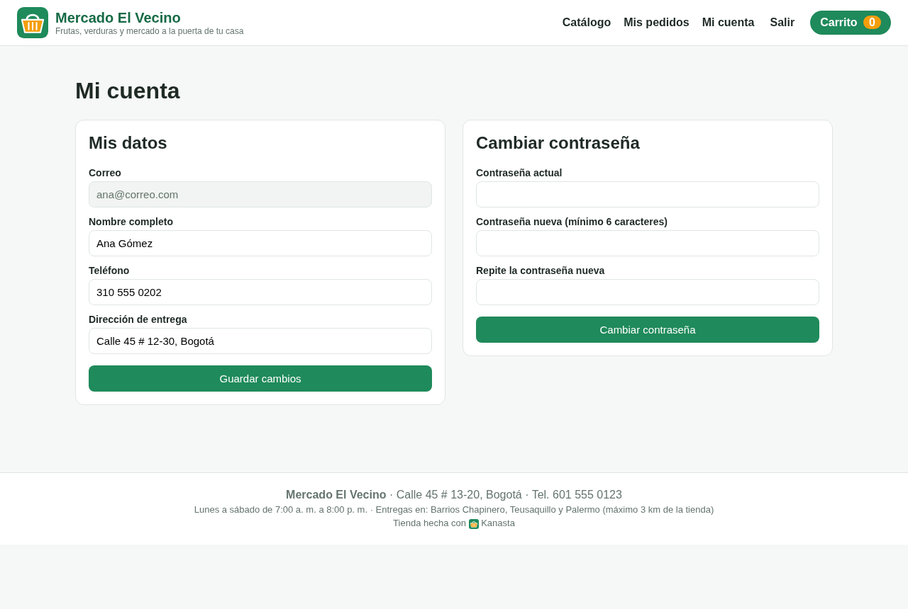

### 10. Opinar sobre un producto

Con la sesión iniciada, al final del detalle de un producto elija de 1 a 5 estrellas, escriba un comentario y pulse **Publicar opinión**. Si ya opinó, puede cambiar su opinión.

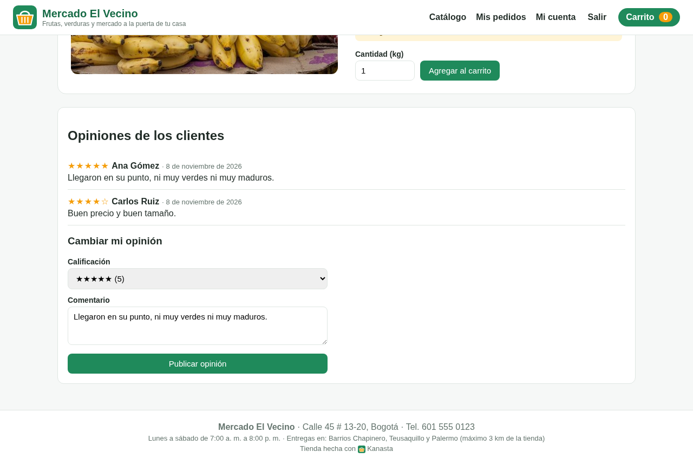

### Otros casos

- Si un producto no tiene foto, se muestra un recuadro "Imagen no disponible".
- La tienda también se ve bien en el celular.

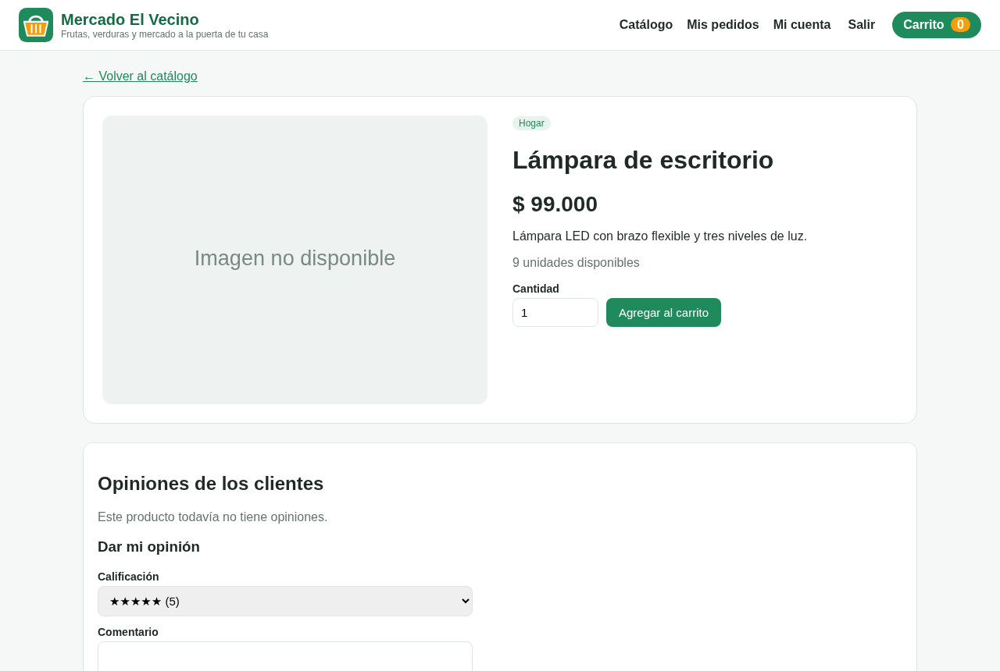

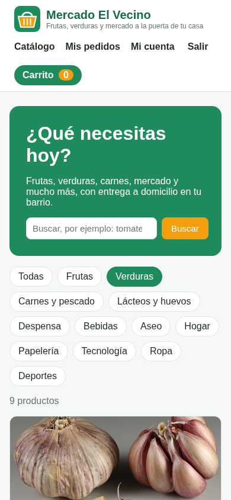

---

## Parte 2. Kanasta Admin (administrador)

### 1. Abrir e ingresar

Abra http://localhost:6080/vnc.html?autoconnect=true&resize=scale (o ejecute `python main.py` si la instaló en su computador). Escriba el correo y la contraseña del administrador y pulse **Ingresar**. Las cuentas de cliente no pueden entrar.

> Cuenta de ejemplo: `admin@tienda.com` / `admin123`.

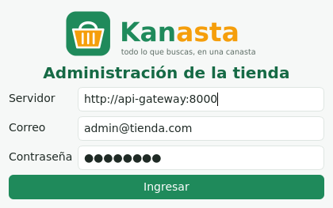

### 2. Pedidos

- Elija en **Mostrar** qué pedidos ver (todos, pendientes, en camino…).
- Al seleccionar un pedido, abajo aparecen sus productos, cantidades y notas.
- Elija el nuevo estado y pulse **Guardar estado**. El cliente lo verá en "Mis pedidos".
- Si cancela un pedido, sus productos vuelven al inventario. Un pedido entregado o cancelado ya no se puede cambiar.
- En los pedidos con productos por peso o volumen, cobre el valor real de lo que entrega.

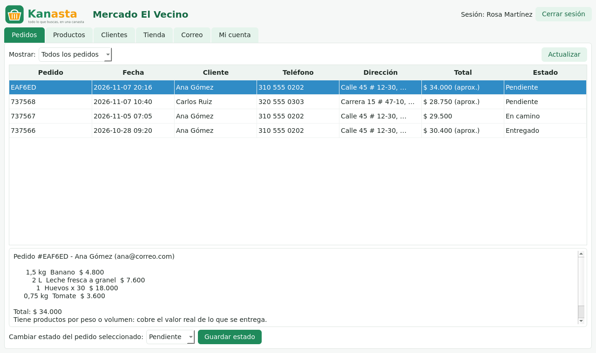

### 3. Productos y categorías

- **Nuevo producto** abre el formulario vacío; **Editar** (o doble clic) abre el producto seleccionado; **Eliminar** lo borra del catálogo.
- En el formulario elija si se vende por **unidad**, **kg** o **litro**; el precio es por esa unidad.
- **Subir imagen...** envía una foto de su computador al Image Provider.
- **Categorías...** permite crear categorías nuevas o eliminar las que no tengan productos.

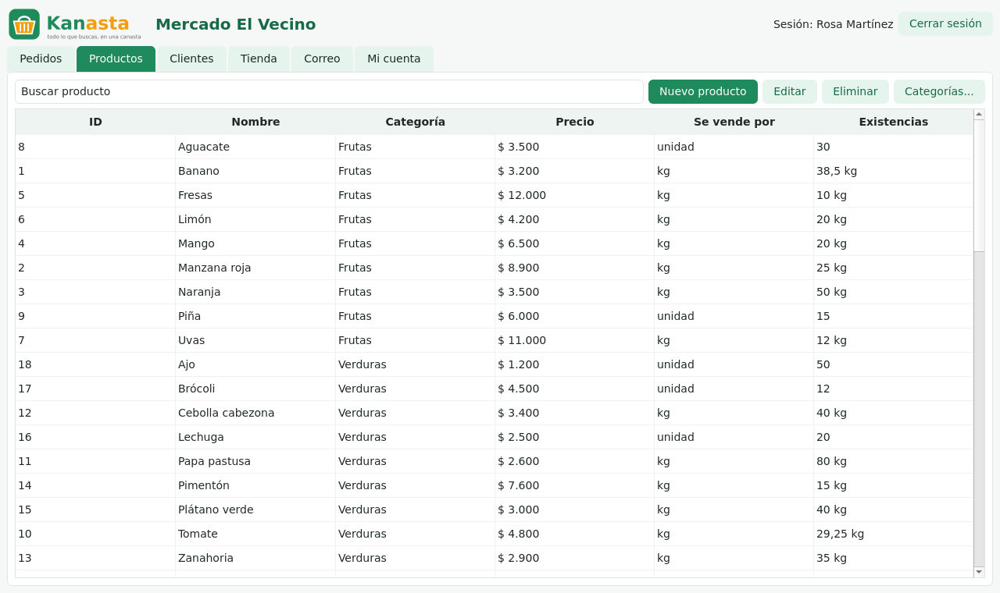

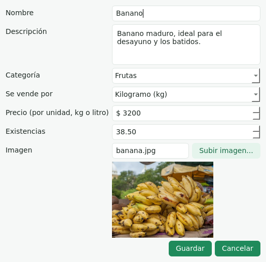

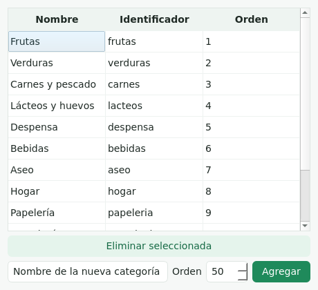

### 4. Clientes

Lista de todas las cuentas. Seleccione una y pulse **Activar / desactivar cuenta**. Una cuenta desactivada no puede ingresar ni hacer pedidos.

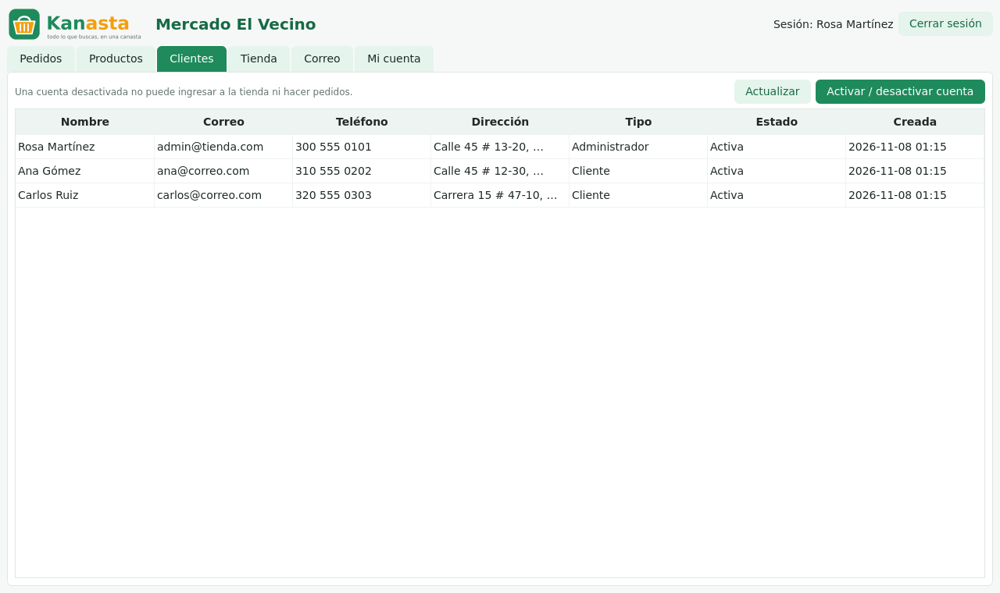

### 5. Datos de la tienda

Nombre, frase, dirección, teléfono, correo de contacto, horario y zona de entregas. Se muestran en la página web y en los correos.

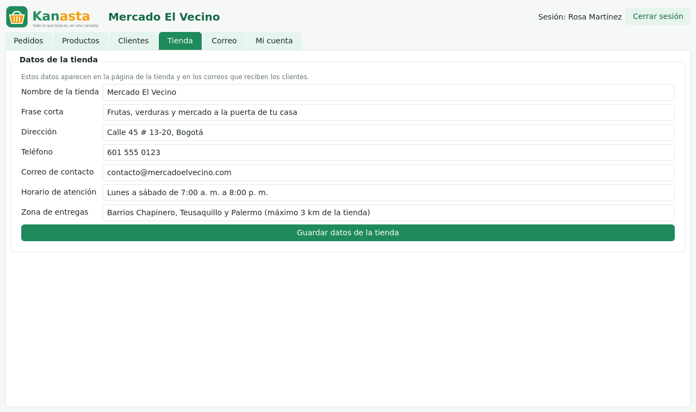

### 6. Correo (Resend)

1. Cree una cuenta gratis en [resend.com](https://resend.com) y copie su **API key**.
2. Péguela en **API key de Resend**, marque **Enviar correos a los clientes** y pulse **Guardar configuración**.
3. Escriba un correo y pulse **Enviar correo de prueba**.

La tabla **Últimos correos** muestra cada correo enviado por el sistema y su resultado: **Enviado**, **Falló** (con el motivo) o **No enviado** (cuando el envío no está configurado). La API key guardada nunca se vuelve a mostrar completa.

> Mientras no verifique un dominio propio en Resend, use el remitente `onboarding@resend.dev`. En ese modo Resend solo entrega correos a la dirección con la que creó su cuenta.

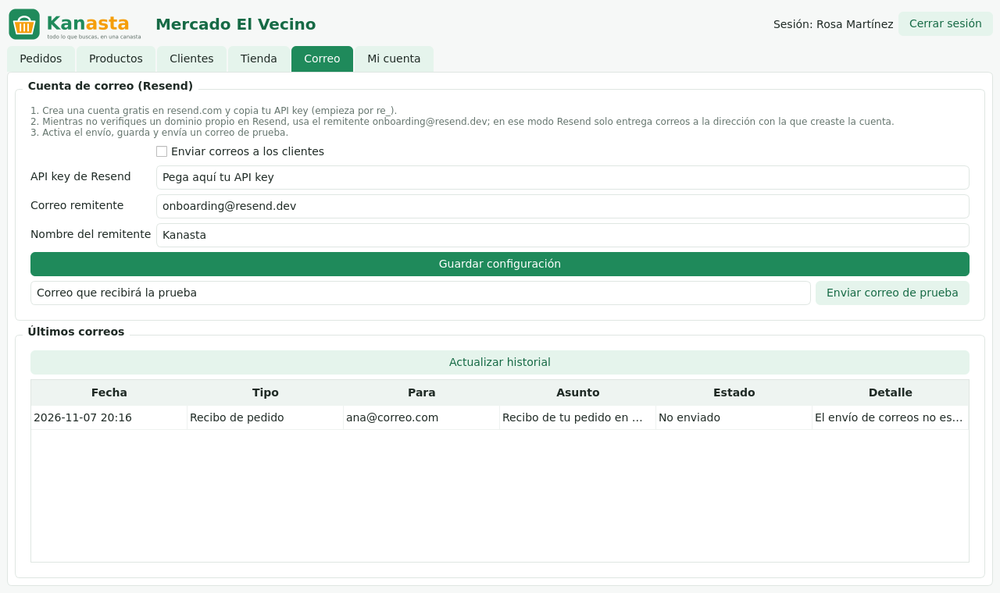

### 7. Mi cuenta

Cambie sus datos o su contraseña. Al cambiar la contraseña recibirá un correo de aviso.

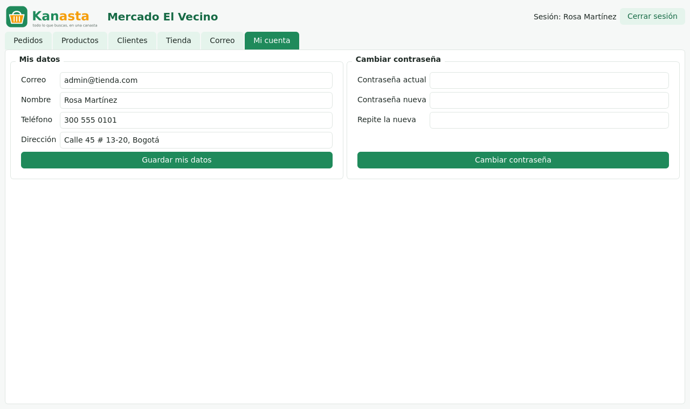

Para salir pulse **Cerrar sesión** (vuelve a la ventana de ingreso).
