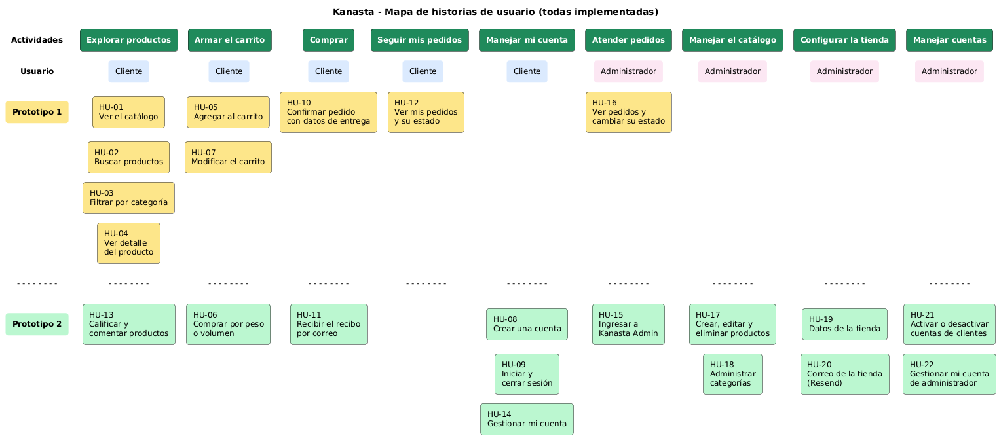

# Requisitos funcionales

Los requisitos funcionales de Kanasta están escritos como **historias de usuario**. Cada historia dice quién la necesita, qué quiere hacer y para qué.

## La idea del negocio

Kanasta es un software que una **tienda de barrio** (frutas, verduras, carnes y mercado en general) instala en su propio computador. El administrador configura la tienda (nombre, dirección, zona de entregas, correo y catálogo) y desde ese momento los clientes del sector pueden hacer pedidos por la página web. La tienda lleva los pedidos a domicilio y el cliente paga al recibir.

## Tipos de usuario

| Usuario | Descripción | Usa |
|---|---|---|
| Cliente | Persona del barrio que compra en la tienda. Puede ver el catálogo sin cuenta; para hacer pedidos necesita una cuenta. | Kanasta Web (página web) |
| Administrador | Persona de la tienda que configura el sistema, maneja el catálogo y atiende los pedidos. | Kanasta Admin (aplicación de escritorio) |

## Historias de usuario

**Estado:** ✅ Implementada · **Entrega:** P1 = prototipo 1, P2 = prototipo 2

### Cliente (Kanasta Web)

| ID | Historia de usuario | Criterios de aceptación | Prioridad | Entrega | Estado |
|---|---|---|---|---|---|
| HU-01 | Como **cliente** quiero **ver el catálogo de productos** para **conocer lo que vende la tienda**. | Se muestran los productos con foto, nombre, categoría, precio y calificación. Los productos sin existencias aparecen como "Agotado". | Alta | P1 | ✅ |
| HU-02 | Como **cliente** quiero **buscar productos por nombre o descripción** para **encontrar rápido lo que necesito**. | Al buscar un texto solo aparecen los productos que lo contienen. Si no hay resultados se muestra un mensaje. | Alta | P1 | ✅ |
| HU-03 | Como **cliente** quiero **filtrar los productos por categoría** para **ver solo lo que me interesa**. | Hay un botón por categoría (Frutas, Verduras, Carnes…) y uno de "Todas". | Media | P1 | ✅ |
| HU-04 | Como **cliente** quiero **ver el detalle de un producto** para **decidir si lo compro**. | Se muestra foto grande, descripción, precio, forma de venta, cantidad disponible y opiniones. | Alta | P1 | ✅ |
| HU-05 | Como **cliente** quiero **agregar productos al carrito** para **comprarlos juntos**. | El producto se suma al carrito y el contador del menú aumenta. No se puede pedir más de lo disponible. | Alta | P1 | ✅ |
| HU-06 | Como **cliente** quiero **pedir frutas, verduras, carnes y líquidos por peso o por volumen** para **comprar la cantidad exacta que necesito**. | Estos productos muestran el precio por kg o por litro y se piden en pasos de 0,25 (por ejemplo 1,5 kg). Se muestra el aviso: *"El valor final puede variar un poco: no siempre es posible pesar o medir exactamente la cantidad que pides"*. El total aparece como "aproximado". | Alta | P2 | ✅ |
| HU-07 | Como **cliente** quiero **cambiar cantidades y quitar productos del carrito** para **ajustar mi compra**. | Al cambiar la cantidad el total se recalcula. El botón "Quitar" elimina el producto. El carrito se conserva si cierro la página. | Alta | P1 | ✅ |
| HU-08 | Como **cliente** quiero **crear una cuenta** para **hacer pedidos y seguirlos**. | Registro con nombre, correo, teléfono, dirección y contraseña (mínimo 6 caracteres). El correo no se puede repetir. Al crearla recibo un **correo de bienvenida**. | Alta | P2 | ✅ |
| HU-09 | Como **cliente** quiero **iniciar y cerrar sesión** para **usar mi cuenta de forma segura**. | Ingreso con correo y contraseña. Si los datos no coinciden se muestra un mensaje. Hay una opción "Salir". | Alta | P2 | ✅ |
| HU-10 | Como **cliente** quiero **confirmar mi pedido con mis datos de entrega** para **recibir los productos en mi casa**. | Se piden teléfono, dirección (con los datos de la cuenta ya escritos) y notas. Al confirmar se descuenta el inventario, se vacía el carrito y se muestra el número del pedido. Se informa que se paga al recibir. | Alta | P1 | ✅ |
| HU-11 | Como **cliente** quiero **recibir el recibo de mi pedido por correo** para **tener el comprobante de la compra**. | Al confirmar el pedido llega un correo con el número, los productos, las cantidades, el total, la dirección y, si aplica, el aviso de peso o volumen. | Alta | P2 | ✅ |
| HU-12 | Como **cliente** quiero **ver mis pedidos y su estado** para **saber cuándo llegan**. | Con la sesión iniciada se listan mis pedidos con fecha, productos, total y estado (Pendiente, En camino, Entregado o Cancelado). | Media | P1 | ✅ |
| HU-13 | Como **cliente** quiero **calificar y comentar los productos** para **ayudar a otros compradores**. | Calificación de 1 a 5 estrellas y comentario. Una opinión por cliente y producto (se puede cambiar). El promedio aparece en el catálogo y en el detalle. | Media | P2 | ✅ |
| HU-14 | Como **cliente** quiero **gestionar mi cuenta** para **mantener mis datos al día**. | Puedo cambiar nombre, teléfono y dirección. Puedo cambiar mi contraseña escribiendo la actual; al cambiarla recibo un **correo de aviso**. | Media | P2 | ✅ |

### Administrador (Kanasta Admin)

| ID | Historia de usuario | Criterios de aceptación | Prioridad | Entrega | Estado |
|---|---|---|---|---|---|
| HU-15 | Como **administrador** quiero **ingresar a la aplicación de escritorio con mi cuenta** para **que nadie más maneje la tienda**. | Solo las cuentas de administrador pueden entrar. Una cuenta de cliente recibe el mensaje "Esta aplicación es solo para el administrador". Hay opción de cerrar sesión. | Alta | P2 | ✅ |
| HU-16 | Como **administrador** quiero **ver los pedidos y cambiar su estado** para **llevar el control de las entregas**. | Tabla con todos los pedidos y filtro por estado. Al seleccionar uno se ven sus productos. Al cancelar un pedido su inventario vuelve al catálogo. Un pedido entregado o cancelado ya no se puede cambiar. | Alta | P1 | ✅ |
| HU-17 | Como **administrador** quiero **crear, editar y eliminar productos** para **mantener el catálogo al día**. | Formulario con nombre, descripción, categoría, forma de venta (unidad, kg o litro), precio, existencias e imagen. La imagen se puede subir desde el computador. | Alta | P2 | ✅ |
| HU-18 | Como **administrador** quiero **crear y eliminar categorías** para **organizar el catálogo**. | Se puede agregar una categoría con su orden de aparición. No se puede eliminar una categoría que tenga productos. | Media | P2 | ✅ |
| HU-19 | Como **administrador** quiero **configurar los datos de la tienda** para **que los clientes sepan quiénes somos y dónde entregamos**. | Se guardan nombre, frase, dirección, teléfono, correo, horario y zona de entregas. Los cambios aparecen en la página y en los correos. | Alta | P2 | ✅ |
| HU-20 | Como **administrador** quiero **configurar la cuenta de correo de la tienda (Resend)** para **que los clientes reciban los avisos**. | Se guardan la API key de Resend, el remitente y si el envío está activo. La API key nunca se vuelve a mostrar completa. Hay un botón para enviar un correo de prueba y una tabla con los últimos correos y su resultado. | Alta | P2 | ✅ |
| HU-21 | Como **administrador** quiero **ver las cuentas de los clientes y desactivarlas** para **bloquear cuentas que hagan mal uso de la tienda**. | Tabla con todas las cuentas. Una cuenta desactivada no puede ingresar y se cierran sus sesiones abiertas. La cuenta del administrador no se puede desactivar. | Media | P2 | ✅ |
| HU-22 | Como **administrador** quiero **gestionar mi propia cuenta** para **mantener mis datos y mi contraseña seguros**. | Puedo cambiar nombre, teléfono, dirección y contraseña. Al cambiar la contraseña recibo un correo de aviso. | Media | P2 | ✅ |

## Resumen

| Total de historias | Del prototipo 1 | Nuevas en el prototipo 2 | Implementadas | Avance |
|---|---|---|---|---|
| 22 | 9 | 13 | 22 | 100 % |

### Correos que envía el sistema

| Evento | Historia | Quién lo recibe |
|---|---|---|
| Cuenta creada | HU-08 | El cliente nuevo |
| Cambio de contraseña | HU-14, HU-22 | El dueño de la cuenta |
| Pedido confirmado (recibo) | HU-11 | El cliente que hizo el pedido |
| Correo de prueba | HU-20 | La dirección que escriba el administrador |

## Mapa de historias de usuario

El mapa organiza las historias según las actividades de cada usuario (columnas) y la entrega en que se construyeron (filas).

El código fuente del mapa está en [`mapa-historias-usuario.puml`](mapa-historias-usuario.puml) (PlantUML).
